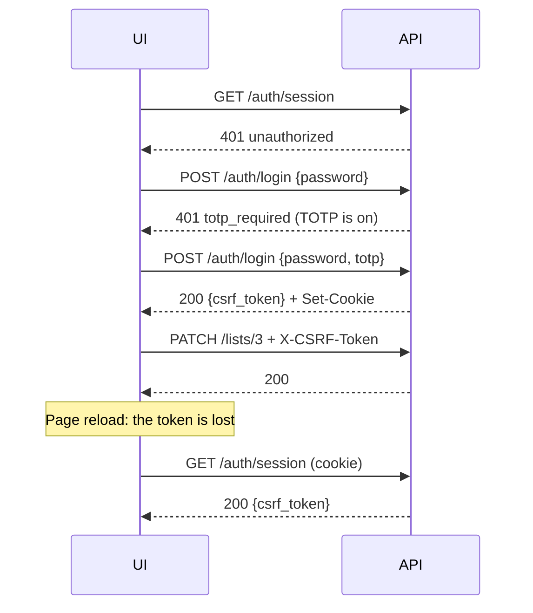
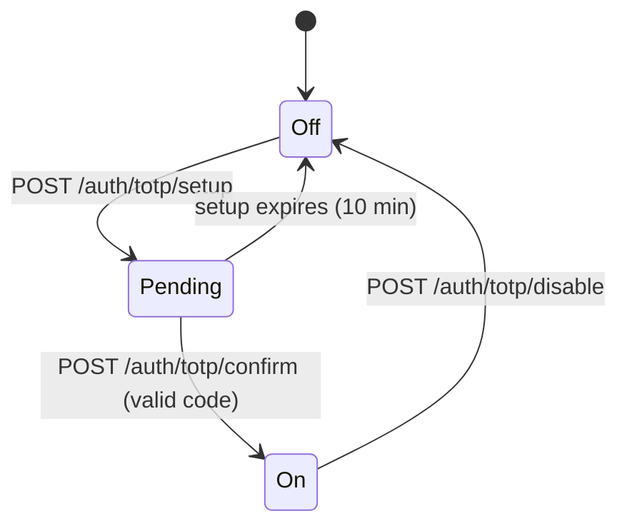

# rusthole admin REST API (v1)

This document is the contract between the admin API (part P5, Rust) and the web UI
(part P6, `web/`). The UI is built on this contract. P5 implements it.
[PLAN.md](PLAN.md) has the decisions (D9, D10, A7, A9, A11). Where this document and PLAN.md
differ, PLAN.md wins, and this document must be updated.

## 1. General rules

| Item | Rule |
|---|---|
| Base path | `/api/v1`. All paths below are relative to it. |
| Transport | HTTPS on the admin listener. The UI and the API have the same origin. |
| Body | JSON (`Content-Type: application/json; charset=utf-8`), UTF-8. Maximum request body: 64 KiB. |
| Field names | `snake_case`. |
| Time stamps | RFC 3339 strings in UTC, for example `"2026-11-17T08:30:00Z"`. Field names end in `_at`. A time that is not known is `null`. |
| Durations | Integer seconds. Field names end in `_seconds`, or `_ms` for milliseconds. |
| Ids | CRUD resources have an integer `id`. The server makes the id. The id does not change and is not used again. |
| Unknown fields | The server rejects a request body with an unknown field (422). The server can add new fields to a response. The UI ignores fields that it does not know. |
| Read-only fields | A field that is marked "read-only" is in responses only. The server rejects it in a request body (422). |
| Versioning | A change that breaks a client goes to `/api/v2`. Additive changes stay in v1. |
| IP version (A11) | rusthole v1 uses IPv4 transport only. All client addresses, client ids, CIDRs, upstream addresses, conditional-forwarding servers and audit-log addresses are IPv4. The server rejects an IPv6 value in these fields with 422 and the message "IPv6 comes in a later version." DNS content does not change: AAAA queries and local AAAA records are supported. A later version adds IPv6 as an additive change. |

### 1.1 Methods

| Method | Use | Success status |
|---|---|---|
| `GET` | Read. Has no side effects. | 200 |
| `POST` on a collection | Create. The response body is the new resource. | 201 |
| `POST` on an action path (for example `/lists/3/update`) | Start an action. | 200 or 202 |
| `PATCH` | Partial update. The body holds a subset of the writable top-level fields. Each field in the body replaces its old value. A nested object or an array is replaced as a whole. The response body is the full resource. | 200 |
| `PUT` | Replace a singleton (for example `/blocking`). | 200 |
| `DELETE` | Delete. No body. | 204 |

### 1.2 Collections and pagination

A collection response has this shape:

```json
{ "items": [ ... ], "next_cursor": null }
```

- Short collections (lists, rules, groups, clients, local DNS, tokens) return all items.
  `next_cursor` is always `null` for them.
- Long collections (audit log, per-client domains, domain search, clients in statistics)
  accept `limit` and `cursor`.
  - `limit`: integer, 1 to 500. The default is 50.
  - `cursor`: an opaque string. Copy it from `next_cursor` of the previous page. Do not
    parse it.
  - `next_cursor` is `null` on the last page.
- A bad `limit` or a bad `cursor` gives 400 `bad_request`.

### 1.3 Time range for statistics

Statistics endpoints accept `range`:

| `range` | Period | `bucket_seconds` in timelines | Buckets |
|---|---|---|---|
| `24h` (default) | Last 24 hours | 600 (10 min) | 144 |
| `7d` | Last 7 days | 3600 (1 h) | 168 |
| `30d` | Last 30 days | 14400 (4 h) | 180 |

The server aligns the range to bucket boundaries. `from` is the start of the first
bucket. `to` is the end of the last bucket (the current, partial bucket). The retention
setting (`stats.retention_days`) can make the real data shorter than the range. Then the
older buckets are zero.

### 1.4 Hour-of-day histograms and time zone

An hour-of-day histogram has 24 buckets. Bucket 0 is 00:00–00:59, bucket 23 is
23:00–23:59. The server adds them up over the whole `range`.

- The client sends `utc_offset_minutes` (integer, -840 to 840, default 0). The UI sends
  the browser offset (`-new Date().getTimezoneOffset()`).
- The server keeps hourly aggregates in UTC. It moves each aggregate by the offset before
  it takes the hour. If the offset is not a whole number of hours, the server rounds it
  down to a whole hour.
- The response gives `utc_offset_minutes`: the offset that the server really used.
- The server uses one fixed offset for the whole range. A daylight-saving change inside
  the range moves some hours by one bucket. This error is accepted.

### 1.5 Registrable domain

`base` is the registrable domain of a name (one label below the public suffix), for
example `cdn.example.co.uk` → `example.co.uk`. The server calculates it with the Public
Suffix List. The UI does not calculate it. A name that has no registrable domain (for
example a single label or a reverse zone) is its own `base`.

## 2. Errors

Every error response has a JSON body with this shape:

```json
{
  "code": "validation_failed",
  "message": "The request has invalid fields.",
  "details": [ { "field": "url", "message": "Use an http or https URL." } ],
  "retry_after_seconds": null
}
```

- `code`: a stable, machine-readable string (table below).
- `message`: an English sentence for people. The UI can show it.
- `details`: optional. A list of field errors for 422.
- `retry_after_seconds`: optional. Set for 429.

| Status | `code` | When |
|---|---|---|
| 400 | `bad_request` | The JSON is bad, or a query parameter is bad. |
| 401 | `unauthorized` | No valid session and no valid token. |
| 401 | `invalid_credentials` | Login: the password or the TOTP code is wrong. |
| 401 | `totp_required` | Login: TOTP is on and the body has no `totp` code. |
| 401 | `password_not_set` | Login: the config has no password hash. Set it with `rusthole passwd`. |
| 403 | `csrf_failed` | A write with a session cookie has no valid `X-CSRF-Token`. |
| 403 | `forbidden` | An API token uses a path for sessions only (`POST /tokens`, `/auth/totp*`, `/auth/logout`). Or a write (not `GET` or `HEAD`) comes from another site: `Sec-Fetch-Site: cross-site`, or an `Origin` that is not this server (section 3.4). |
| 421 | `misdirected_request` | The `Host` header does not name this server (DNS rebinding defence). A client outside the ACL gets no answer: the server closes the connection at once. |
| 404 | `not_found` | The path or the resource does not exist. |
| 405 | `method_not_allowed` | The path exists, but not with this method. |
| 409 | `config_conflict` | The config file changed on disk after rusthole read it (A7). The server does not write. The UI must reload the data and try again. |
| 409 | `conflict` | The write breaks a rule, for example a duplicate name, or delete of the default group. |
| 413 | `payload_too_large` | The body is larger than 64 KiB. |
| 415 | `bad_request` | A request with a JSON body has no `Content-Type: application/json` (parameters such as `charset` are allowed). |
| 422 | `validation_failed` | A field is not valid. `details` tells which. |
| 429 | `rate_limited` | Login ban (D10) or too many requests. The `Retry-After` header and `retry_after_seconds` give the wait time in seconds. |
| 500 | `internal` | Server fault. The message does not show internal data. |
| 503 | `unavailable` | The server cannot do this now, for example a list update already runs. |

## 3. Authentication

Only these paths work without authentication (D9):

- `POST /auth/login`
- static assets of the UI (paths outside `/api/`)

All other paths return 401 `unauthorized` without a valid session or token.

### 3.1 Session (browser)



#### `POST /auth/login`

Request:

```json
{ "password": "…", "totp": "123456" }
```

- `totp` is optional. Send it when TOTP is on.
- If TOTP is on and the body has no `totp`, the server returns 401 `totp_required`. It
  does not check the password in this case, so this response does not tell if the
  password is correct.
- A wrong password or a wrong TOTP code gives 401 `invalid_credentials`. The response does
  not tell which one is wrong.
- A TOTP code cannot be used two times (A7).
- With no password set in the config, every login fails with 401 `password_not_set` (A7).
  You set the password with `rusthole passwd`. The API has no endpoint to set or change the
  password. A running server reads the changed file at the next login or API request (at
  most once in 2 s), and then ends all open sessions.
- Each failure counts in the ban state machine (per IPv4 address). During a
  ban the server returns 429 `rate_limited` with `Retry-After`, and it does not check the
  password.

Response 200:

```json
{
  "csrf_token": "b64url-random-32-bytes",
  "expires_at": "2026-11-18T08:30:00Z",
  "totp_enabled": true
}
```

The response sets the session cookie:

```
Set-Cookie: __Host-rusthole_session=<random>; Path=/; Secure; HttpOnly; SameSite=Strict
```

The cookie has no `Max-Age`. The server keeps the session expiry. The session expires 1 h
after the last request (idle) and `admin.session_ttl_seconds` after login (absolute,
default 8 h). When the absolute limit is shorter than 1 h, it is also the idle limit.
Sessions are in memory: a restart ends them. [SECURITY.md](SECURITY.md) has the details.

#### `POST /auth/logout`

Needs the session and `X-CSRF-Token`. The server deletes the session and clears the
cookie. Response: 204.

#### `GET /auth/session`

Response 200 with a valid session (same shape as login):

```json
{
  "csrf_token": "b64url-random-32-bytes",
  "expires_at": "2026-11-18T08:30:00Z",
  "totp_enabled": true
}
```

Response 401 `unauthorized` without a valid session.

The UI keeps the CSRF token in memory only. After a page reload, the UI calls this
endpoint to get the token again.

### 3.2 CSRF

- Every request that is not `GET` and uses the session cookie must have the header
  `X-CSRF-Token: <csrf_token>`. The value must be equal to the token of the session.
  Else the server returns 403 `csrf_failed`.
- The token is fixed for the life of the session.
- `POST /auth/login` does not need the header.
- A change of the password or the TOTP secret ends all sessions (m13). A TOTP change
  through the API keeps the session that made it. A change with `rusthole passwd` keeps
  no session: the next API request (at most 2 s later) gets 401. API tokens stay.

### 3.3 API tokens (scripts)

- A script sends `Authorization: Bearer <token>`. The token format is `rh_` followed by
  43 base64url characters.
- A request with a bearer token does not use a cookie. CSRF does not apply to it.
- The server keeps only a hash of the token. It shows the token one time, in the
  response of `POST /tokens`.
- A failed token check counts in the ban state machine (A7).
- A token has the same rights as the admin session, with one exception: a token cannot
  create tokens and cannot change TOTP.

### 3.4 Other security rules (P5)

These rules are not visible in the JSON, but the UI depends on them:

- `Host` check against the configured names and addresses, with the admin port (DNS
  rebinding). Else 421 `misdirected_request`.
- Security headers on every response:
  `Content-Security-Policy: default-src 'none'; script-src 'self'; style-src 'self'; img-src 'self' data:; font-src 'self'; connect-src 'self'; base-uri 'none'; form-action 'self'; frame-ancestors 'none'`,
  `X-Content-Type-Options: nosniff`, `Referrer-Policy: no-referrer`,
  `Strict-Transport-Security: max-age=31536000`, `Permissions-Policy` (all features off),
  `Cross-Origin-Opener-Policy: same-origin`.
- API responses have `Cache-Control: no-store`.
- Cross-site writes (m12): a request that is not `GET` or `HEAD` gets 403 `forbidden` when
  `Sec-Fetch-Site` is `cross-site`, or when an `Origin` header is not `https://` and a host
  that the `Host` check accepts (`null` too). This check runs before the auth, so such a
  request never counts in the login ban. A request with no `Origin` and no
  `Sec-Fetch-Site` (curl, scripts) passes.
- A JSON body needs `Content-Type: application/json`, else 415. A page of another site
  can send `text/plain` or a form with no CORS preflight, but not JSON.
- The UI uses no inline scripts, no inline styles, no `eval` and no external resources.

## 4. Blocking

### `GET /blocking`

```json
{
  "enabled": false,
  "remaining_seconds": 287,
  "until_at": "2026-11-17T08:35:00Z"
}
```

- `enabled`: `true` if blocking is on.
- `remaining_seconds`: when blocking is off with a timer, the seconds until blocking goes
  on again. Else `null`.
- `until_at`: the same time as a time stamp, for people. The UI counts down from
  `remaining_seconds` with a monotonic clock. It does not compare `until_at` with the
  browser clock.

### `PUT /blocking`

Request, one of:

```json
{ "enabled": true }
{ "enabled": false }
{ "enabled": false, "duration_seconds": 300 }
```

- `duration_seconds`: 1 to 86400. Blocking goes on again after this time. Without it,
  blocking stays off until the next `PUT`.
- `duration_seconds` with `"enabled": true` gives 422.
- The toggle is a runtime state. It does not change `blocking.enabled` in the config (the
  state at start).

Response 200: the new state (same shape as `GET`).

## 5. Statistics

All statistics endpoints accept `range` (section 1.3). Endpoints with an hour-of-day
histogram also accept `utc_offset_minutes` (section 1.4).

Each query has one status:

| Status | Meaning |
|---|---|
| `forwarded` | Sent to an upstream server. |
| `cached` | Answered from the cache. |
| `blocked` | Blocked by a list, a rule, a special domain or a CNAME check. |
| `local` | Answered from a local record. |
| `refused` | Refused (rate limit). Off-net clients are not counted. |
| `error` | No answer from upstreams (SERVFAIL). |

### 5.1 `GET /stats/summary`

```json
{
  "range": "24h",
  "from": "2026-11-16T08:40:00Z",
  "to": "2026-11-17T08:40:00Z",
  "queries": 48210,
  "blocked": 6120,
  "blocked_percent": 12.69,
  "cached": 20114,
  "forwarded": 21430,
  "local": 512,
  "unique_domains": 1830,
  "unique_clients": 9
}
```

`blocked_percent` is `0` when `queries` is `0`. The server rounds it to 2 decimals.

### 5.2 `GET /stats/timeline`

Queries over time. Optional filters: `client` (a client key, section 5.6) and `domain`
(an exact name).

```json
{
  "range": "24h",
  "from": "2026-11-16T08:40:00Z",
  "to": "2026-11-17T08:40:00Z",
  "bucket_seconds": 600,
  "queries":   [310, 295, 288],
  "blocked":   [41, 39, 30],
  "cached":    [120, 110, 100],
  "forwarded": [149, 146, 158]
}
```

- The arrays have the same length. Bucket `i` starts at `from + i * bucket_seconds`.
- Every bucket is present. A bucket without queries has `0`.
- The `24h` range has 144 buckets of 600 s also with `client` or `domain` (the store keeps
  10-minute counts of each client and name for the last 160 buckets).

### 5.3 `GET /stats/hours`

Hour-of-day histogram. Optional filters (they can be used together):

- `client`: a client key (section 5.6).
- `domain`: an exact name, for example `cdn.example.com`.
- `base`: a registrable domain, for example `example.com` (all names below it).

`domain` and `base` together give 400.

```json
{
  "range": "7d",
  "utc_offset_minutes": 120,
  "queries": [12, 8, 5, 3, 2, 2, 9, 40, 88, 95, 90, 87, 92, 85, 80, 84, 90, 110, 140, 150, 130, 100, 60, 30],
  "blocked": [1, 1, 0, 0, 0, 0, 1, 5, 11, 12, 10, 9, 12, 10, 9, 10, 11, 15, 20, 22, 18, 12, 7, 3]
}
```

Both arrays have exactly 24 items.

### 5.4 Top lists

| Path | Item |
|---|---|
| `GET /stats/top/domains` | Most queried names that were not blocked. |
| `GET /stats/top/blocked` | Most blocked names. |
| `GET /stats/top/clients` | Clients with the most queries. |

Parameters: `range`, `limit` (1 to 100, default 10). `top/domains` and `top/blocked`
also accept `client`.

Domain item:

```json
{ "items": [ { "name": "cdn.example.com", "base": "example.com", "count": 4210 } ], "next_cursor": null }
```

Client item:

```json
{ "items": [ { "key": "02:00:00:00:00:01", "name": "laptop", "ip": "192.0.2.10", "count": 9120, "blocked": 1180 } ], "next_cursor": null }
```

### 5.5 Query types and upstream share

#### `GET /stats/query-types`

```json
{ "items": [ { "type": "A", "count": 30110 }, { "type": "AAAA", "count": 12002 }, { "type": "HTTPS", "count": 4100 } ], "next_cursor": null }
```

`type` is the record type name. An unknown type has the form `TYPE65280`.

#### `GET /stats/upstreams`

Where the answers came from.

```json
{
  "items": [
    { "name": "192.0.2.53:53", "kind": "upstream", "count": 12100, "avg_ms": 18.4 },
    { "name": "cache", "kind": "cache", "count": 20114, "avg_ms": null },
    { "name": "blocked", "kind": "blocked", "count": 6120, "avg_ms": null },
    { "name": "local", "kind": "local", "count": 512, "avg_ms": null }
  ],
  "next_cursor": null
}
```

`kind` is one of `upstream`, `cache`, `blocked`, `local`. `avg_ms` is the mean answer time
of an upstream, or `null`.

### 5.6 Clients in statistics

A seen client has a `key`. The key is the MAC address (lower case, colon form) when the
server knows it, else the IP address. The key can have `:` characters. The UI
encodes it with `encodeURIComponent` in a path.

#### `GET /stats/clients`

Parameters: `range`, `limit`, `cursor`, `q` (filter: a part of the name, IP or MAC),
`sort` (`queries` (default), `blocked`, `last_seen`, `name`).

```json
{
  "items": [
    {
      "key": "02:00:00:00:00:01",
      "name": "laptop",
      "ip": "192.0.2.10",
      "mac": "02:00:00:00:00:01",
      "client_id": 4,
      "queries": 9120,
      "blocked": 1180,
      "blocked_percent": 12.94,
      "unique_domains": 412,
      "first_seen_at": "2026-11-10T07:00:00Z",
      "last_seen_at": "2026-11-17T08:39:00Z"
    }
  ],
  "next_cursor": "opaque"
}
```

- `name`: the configured client comment, else the name from conditional forwarding or
  local records, else `null`.
- `client_id`: the id of the configured client (section 9) that matches, or `null`.

#### `GET /stats/clients/{key}`

```json
{
  "key": "02:00:00:00:00:01",
  "name": "laptop",
  "ip": "192.0.2.10",
  "ips": ["192.0.2.10", "192.0.2.110"],
  "mac": "02:00:00:00:00:01",
  "client_id": 4,
  "groups": [0],
  "range": "24h",
  "queries": 9120,
  "blocked": 1180,
  "blocked_percent": 12.94,
  "unique_domains": 412,
  "unique_bases": 96,
  "first_seen_at": "2026-11-10T07:00:00Z",
  "last_seen_at": "2026-11-17T08:39:00Z",
  "utc_offset_minutes": 120,
  "hours": {
    "queries": [ "24 integers" ],
    "blocked": [ "24 integers" ]
  }
}
```

- `ips`: all addresses that the client used in the range.
- `groups`: the groups that apply to the client now.
- `first_seen_at` is the first query in the stored data, not only in the range.
- `hours` has the same arrays as `GET /stats/hours?client={key}`.

#### `GET /stats/clients/{key}/domains`

The names that the client resolved, grouped by registrable domain (section 1.5).

Parameters: `range`, `limit` (groups per page), `cursor`, `q` (filter: a part of a name),
`sort` (`queries` (default), `blocked`, `last_seen`, `name`), `names_limit` (names per
group, 1 to 200, default 50), `blocked_only` (`true` or `false`, default `false`).

```json
{
  "items": [
    {
      "base": "example.com",
      "queries": 2210,
      "blocked": 140,
      "first_seen_at": "2026-11-16T09:12:00Z",
      "last_seen_at": "2026-11-17T08:38:00Z",
      "names_total": 3,
      "names": [
        { "name": "www.example.com", "queries": 1200, "blocked": 0, "first_seen_at": "2026-11-16T09:12:00Z", "last_seen_at": "2026-11-17T08:38:00Z" },
        { "name": "cdn.example.com", "queries": 870, "blocked": 0, "first_seen_at": "2026-11-16T09:12:00Z", "last_seen_at": "2026-11-17T08:30:00Z" },
        { "name": "telemetry.example.com", "queries": 140, "blocked": 140, "first_seen_at": "2026-11-16T10:00:00Z", "last_seen_at": "2026-11-17T08:00:00Z" }
      ]
    }
  ],
  "next_cursor": null
}
```

- The server pages by group. A group is never split between pages.
- `names` are sorted by `queries`, high to low. `names_total` is the number of names
  in the group. If `names_total` is larger than `names_limit`, `names` has only the first
  `names_limit` names.
- With `q`, a group is in the result if its base or one of its names has `q`. `names`
  then has only the matching names, and the group counts are for these names only.
- The hour-of-day histogram of one group or one name comes from
  `GET /stats/hours?client={key}&base=…` or `…&domain=…`.

### 5.7 Domains in statistics

#### `GET /stats/domains`

Search names in the statistics. Parameters: `range`, `q` (required, 1 to 253 characters, a
part of a name), `limit`, `cursor`, `blocked_only`.

```json
{
  "items": [
    { "name": "ads.example.net", "base": "example.net", "queries": 812, "blocked": 812, "clients": 6, "last_seen_at": "2026-11-17T08:20:00Z" }
  ],
  "next_cursor": null
}
```

#### `GET /stats/domains/{name}`

```json
{
  "name": "ads.example.net",
  "base": "example.net",
  "range": "24h",
  "queries": 812,
  "blocked": 812,
  "first_seen_at": "2026-11-12T10:00:00Z",
  "last_seen_at": "2026-11-17T08:20:00Z",
  "clients": [
    { "key": "02:00:00:00:00:03", "name": "tv", "ip": "192.0.2.12", "queries": 400, "blocked": 400, "last_seen_at": "2026-11-17T08:20:00Z" }
  ],
  "utc_offset_minutes": 120,
  "hours": { "queries": [ "24 integers" ], "blocked": [ "24 integers" ] }
}
```

- `clients`: at most 100 clients, sorted by `queries`.
- A name with no queries in the range gives 200 with zero counts and an empty `clients`.

## 6. Recent queries

The server keeps the last queries in a ring buffer in RAM (A9). The size is
`stats.recent_queries_size`. The data is lost at restart.

### `GET /queries/recent`

Parameters: `limit` (1 to 1000, default 100), `client` (a client key), `status` (a
status from section 5), `q` (a part of a name).

```json
{
  "items": [
    {
      "at": "2026-11-17T08:39:59Z",
      "client_key": "02:00:00:00:00:02",
      "client_ip": "192.0.2.11",
      "client_name": "phone",
      "name": "ads.example.net",
      "type": "A",
      "status": "blocked",
      "reason": "list:3",
      "reason_label": "https://lists.example.org/hosts.txt",
      "upstream": null,
      "duration_ms": 0.2
    }
  ],
  "next_cursor": null
}
```

- Newest first. No pagination.
- `reason`: why the query has this status, or `null`. Forms: `list:{id}`, `rule:{id}`,
  `special`, `cname:{name}`, `local:{id}`. `{id}` is the stable id of the list or rule.
- `reason_label` (additive): the URL of the list, the pattern of the rule, or the CNAME
  target of the reason, or `null`.
- `upstream`: the upstream that answered, or `null`.

## 7. Lists (adlists)

### List object

```json
{
  "id": 3,
  "url": "https://lists.example.org/hosts.txt",
  "comment": "Main block list",
  "kind": "block",
  "enabled": true,
  "groups": [0],
  "status": {
    "state": "ok",
    "last_update_at": "2026-11-17T03:00:00Z",
    "last_success_at": "2026-11-17T03:00:00Z",
    "entries": 120433,
    "invalid_lines": 12,
    "size_bytes": 3402112,
    "last_error": null
  }
}
```

| Field | Type | Rule |
|---|---|---|
| `id` | integer | Read-only. |
| `url` | string | `http` or `https` URL. Unique. Required. |
| `comment` | string | Default `""`. Up to 500 characters. |
| `kind` | `block` or `allow` | Default `block`. |
| `enabled` | boolean | Default `true`. |
| `groups` | integer array | Group ids. Default `[0]`. |
| `status` | object | Read-only. |
| `status.state` | `never`, `updating`, `ok`, `error` | `error` means the last try failed. The list then uses the last good copy on disk, if there is one. |
| `status.last_update_at` | time or null | The last try. |
| `status.last_success_at` | time or null | The last successful download (or "not changed" answer). |
| `status.entries` | integer | Valid domains in the current copy. |
| `status.last_error` | string or null | A short text, for example `"HTTP 404"`. |

### Endpoints

| Method and path | Action |
|---|---|
| `GET /lists` | All lists, plus the refresh schedule. |
| `POST /lists` | Add a list. Body: `url` and optional writable fields. Response 201. The server starts an update of the new list. |
| `GET /lists/{id}` | One list. |
| `PATCH /lists/{id}` | Change `url`, `comment`, `kind`, `enabled`, `groups`. |
| `DELETE /lists/{id}` | Delete the list and its file on disk. 204. |
| `POST /lists/{id}/update` | Start an update of one list. 202. |
| `POST /lists/update` | Start an update of all enabled lists. 202. |

`GET /lists` response:

```json
{
  "items": [ { "id": 3, "url": "…", "…": "…" } ],
  "next_cursor": null,
  "schedule": {
    "interval_hours": 24,
    "next_run_at": "2026-11-18T03:00:00Z",
    "running": false
  }
}
```

- The schedule interval is the setting `lists.refresh_interval_hours` (section 12).
- `202` responses have the body `{ "started": true }`. If an update already runs, the
  server returns 503 `unavailable`.
- The UI polls `GET /lists` while `schedule.running` is `true` or a list has state
  `updating`.

### 7.1 `GET /search/domain` — which list or rule blocks a name

Parameter: `name` (required, a domain name). The server changes an IDN to punycode.

```json
{
  "name": "ads.example.net",
  "verdicts": [
    { "group_id": 0, "group_name": "Default", "verdict": "blocked", "by": "list:3" },
    { "group_id": 1, "group_name": "Kids", "verdict": "blocked", "by": "rule:7" }
  ],
  "matches": [
    { "source": "list", "id": 3, "label": "https://lists.example.org/hosts.txt", "kind": "block", "match": "exact", "pattern": "ads.example.net", "enabled": true, "groups": [0] },
    { "source": "list", "id": 5, "label": "https://lists.example.org/abp.txt", "kind": "block", "match": "parent", "pattern": "||example.net^", "enabled": false, "groups": [0] },
    { "source": "rule", "id": 7, "label": "regex deny", "kind": "block", "match": "regex", "pattern": "^ads\\.", "enabled": true, "groups": [1] },
    { "source": "special", "id": null, "label": "Firefox DoH canary", "kind": "block", "match": "exact", "pattern": "use-application-dns.net", "enabled": true, "groups": [] }
  ],
  "truncated": false
}
```

- `verdicts`: one item per group. `verdict` is `blocked`, `allowed` or `none`. `by` is
  the reason in the same form as in section 6, or `null`.
- `matches`: every list, rule or special domain that has the name. `kind` is `block` or
  `allow`. `match` is `exact`, `parent` (a pattern for a parent domain that covers
  subdomains) or `regex`.
- The enabled lists and rules come from the compiled engine. The server scans the cached
  list files of the disabled lists on disk (A9). It stops after 100 matches or 5 s. Then
  `truncated` is `true`.
- A verdict ignores the blocking toggle. `group_name` is the config name (lower case).

## 8. Rules

### Rule object

```json
{
  "id": 7,
  "kind": "regex",
  "action": "deny",
  "pattern": "^ads\\.",
  "enabled": true,
  "groups": [0],
  "comment": "ad subdomains",
  "created_at": "2026-11-10T07:00:00Z",
  "updated_at": "2026-11-12T07:00:00Z"
}
```

| Field | Type | Rule |
|---|---|---|
| `kind` | `exact` or `regex` | Required. |
| `action` | `allow` or `deny` | Required. Allow beats deny. |
| `pattern` | string | Required. For `exact`: a domain name (the server changes an IDN to punycode). For `regex`: a Rust `regex` pattern, case-insensitive, with a size limit (A8). |
| `enabled` | boolean | Default `true`. |
| `groups` | integer array | Default `[0]`. |
| `comment` | string | Default `""`. |
| `created_at`, `updated_at` | time or null | Read-only. The config keeps them. A rule that the API did not make (for example from an import) has `null`. |

`kind` and `pattern` together are unique per `action`. A duplicate gives 409 `conflict`.

### Endpoints

| Method and path | Action |
|---|---|
| `GET /rules` | All rules. Optional filters: `kind`, `action`. |
| `POST /rules` | Add. 201. |
| `GET /rules/{id}` | One rule. |
| `PATCH /rules/{id}` | Change. |
| `DELETE /rules/{id}` | Delete. 204. |
| `POST /rules/test` | Test a pattern against a name. |

### `POST /rules/test`

Request:

```json
{ "kind": "regex", "pattern": "^ads\\.", "domain": "ads.example.net" }
```

Response 200:

```json
{ "valid": true, "matches": true, "error": null }
```

- An invalid regex gives 200 with `"valid": false`, `"matches": false` and the parser
  error in `error`. It does not give 422, because the test itself worked.
- The server uses the same engine as the policy (Rust `regex`, case-insensitive). The UI
  must not test with JavaScript `RegExp`, because the two engines differ.

## 9. Groups and clients

### Group object

```json
{ "id": 1, "name": "Kids", "enabled": true, "comment": "", "lists": 2, "rules": 4, "clients": 3 }
```

- `name`: required, unique, 1 to 64 characters from `a-z`, `0-9`, `-`, `_`, `.`; the first
  is a letter or a digit (the config rule). Other names give 422.
- `lists`, `rules`, `clients`: read-only counts of members.
- Group `0` is the default group. Its name is `default`. It cannot be deleted or get a
  new name (409 `conflict`). Clients that match no configured client use group 0.
- When a group is deleted, the server removes its id from all lists, rules and clients.

| Method and path | Action |
|---|---|
| `GET /groups` | All groups. |
| `POST /groups` | Add. 201. |
| `GET /groups/{id}` | One group. |
| `PATCH /groups/{id}` | Change `name`, `enabled`, `comment`. |
| `DELETE /groups/{id}` | Delete. 204. |

### Client object (configured clients)

```json
{ "id": 4, "match": "02:00:00:00:00:01", "kind": "mac", "groups": [0, 1], "comment": "laptop" }
```

| Field | Type | Rule |
|---|---|---|
| `match` | string | Required, unique. An IPv4 address, an IPv4 CIDR, a MAC address, or a host name. IPv6 gives 422 (A11). |
| `kind` | `ip`, `cidr`, `mac`, `host` | Read-only. The server finds it from `match`. |
| `groups` | integer array | Default `[0]`. |
| `comment` | string | Default `""`. The UI shows it as the client name. |

The `match` value is never a path segment. Paths use the integer `id`.

| Method and path | Action |
|---|---|
| `GET /clients` | All configured clients. |
| `POST /clients` | Add. 201. |
| `GET /clients/{id}` | One client. |
| `PATCH /clients/{id}` | Change `match`, `groups`, `comment`. |
| `DELETE /clients/{id}` | Delete. 204. |
| `GET /clients/seen` | Clients that sent queries, to add them quickly. |

### `GET /clients/seen`

Parameters: `limit` (default 200), `cursor`.

```json
{
  "items": [
    {
      "ip": "192.0.2.14",
      "mac": "02:00:00:00:00:05",
      "name": "printer.lan",
      "first_seen_at": "2026-11-10T07:00:00Z",
      "last_seen_at": "2026-11-17T08:00:00Z",
      "queries": 321,
      "client_id": null
    }
  ],
  "next_cursor": null
}
```

- `mac`: from the neighbor table, or `null`.
- `name`: from conditional forwarding (reverse lookup) or local records, or `null`.
- `client_id`: the configured client that matches, or `null`.

## 10. Local DNS

### Local records (A and AAAA)

```json
{ "id": 2, "name": "nas.lan", "type": "A", "address": "192.0.2.20", "comment": "", "enabled": true }
```

- `type` is `A` or `AAAA`. `address` must have the same family.
- One name can have more than one record.

### Local CNAMEs

```json
{ "id": 1, "name": "files.lan", "target": "nas.lan", "comment": "", "enabled": true }
```

- `name` must not also have a local A or AAAA record (409 `conflict`).

### Conditional forwarding

```json
{ "id": 1, "domain": "lan", "servers": ["192.0.2.1"], "comment": "router", "enabled": true }
```

- `domain`: a domain or a reverse zone, for example `2.0.192.in-addr.arpa`.
- `servers`: one IPv4 address, with an optional port (`192.0.2.1:53`). v1 keeps one server
  for each rule (the config has one `server` field): more than one gives 422; add one rule
  for each server. IPv6 gives 422 (A11).
- In the config, a reverse zone on an octet boundary is the `cidr` of the rule, and another
  domain is its `domain`. A rule with both shows its `domain`.
- A reverse zone for an IPv4 subnet ends in `.in-addr.arpa`. v1 rejects an `ip6.arpa` zone with 422 (A11).
- Local records and CNAMEs keep `comment` and `enabled` in the config. A disabled record is
  not answered.

| Collection | Paths |
|---|---|
| Records | `GET POST /dns/records`, `GET PATCH DELETE /dns/records/{id}` |
| CNAMEs | `GET POST /dns/cnames`, `GET PATCH DELETE /dns/cnames/{id}` |
| Conditional forwarding | `GET POST /dns/forwarders`, `GET PATCH DELETE /dns/forwarders/{id}` |

## 11. API tokens and TOTP

### Tokens

Token object (the hash is never returned). `created_at` is `null` for a token that the API
did not make. `last_used_at` and `last_used_ip` are in memory only (a restart clears them):

```json
{ "id": 2, "name": "backup script", "prefix": "rh_Ab3d", "created_at": "2026-11-10T07:00:00Z", "last_used_at": "2026-11-17T06:00:00Z", "last_used_ip": "192.0.2.10" }
```

| Method and path | Action |
|---|---|
| `GET /tokens` | All tokens. |
| `POST /tokens` | Create. Session only (not a token). |
| `DELETE /tokens/{id}` | Revoke. 204. |

`POST /tokens` request (the password is asked again, because a token gives long access):

```json
{ "name": "backup script", "password": "…" }
```

Response 201. The server shows `secret` only in this response:

```json
{ "token": { "id": 3, "name": "backup script", "prefix": "rh_Q9xk", "created_at": "…", "last_used_at": null, "last_used_ip": null }, "secret": "rh_Q9xk…" }
```

A wrong password gives 401 `invalid_credentials` and counts in the ban state machine.

### TOTP



| Method and path | Request | Response |
|---|---|---|
| `GET /auth/totp` | | `{ "enabled": true, "pending": false }` |
| `POST /auth/totp/setup` | `{ "password": "…" }` | `{ "otpauth_uri": "otpauth://totp/rusthole:admin?secret=…&issuer=rusthole&algorithm=SHA1&digits=6&period=30", "expires_at": "…" }` |
| `POST /auth/totp/confirm` | `{ "code": "123456" }` | `{ "enabled": true, "pending": false }` |
| `POST /auth/totp/disable` | `{ "password": "…", "code": "123456" }` | `{ "enabled": false, "pending": false }` |

- These paths need a session. A token cannot use them (403 `forbidden`).
- The server shows `otpauth_uri` only in the `setup` response, between setup and
  confirm. After confirm, no endpoint returns the secret.
- `setup` when TOTP is already on gives 409 `conflict`.
- A wrong password or code gives 401 `invalid_credentials` and counts in the ban state
  machine.

## 12. Settings

### `GET /settings`

```json
{
  "upstreams": {
    "servers": ["udp://192.0.2.53:53", "udp://198.51.100.53:53", "tls://dns.example:853"],
    "timeout_ms": 2000
  },
  "blocking": {
    "mode": "null",
    "custom_ipv4": null,
    "custom_ipv6": null,
    "blocked_ttl": 2,
    "special_domains": true,
    "cname_check": true
  },
  "cache": {
    "enabled": true,
    "max_entries": 10000,
    "min_ttl": 0,
    "max_ttl": 86400,
    "negative_ttl": 300
  },
  "rate_limit": {
    "queries_per_second": 50,
    "burst": 200
  },
  "acl": {
    "extra_cidrs": ["198.51.100.0/24"],
    "local_subnets": ["192.0.2.0/24"]
  },
  "stats": {
    "flush_interval_seconds": 60,
    "retention_days": 30,
    "recent_queries_size": 1000
  },
  "lists": {
    "refresh_interval_hours": 24
  },
  "report": {
    "external": true
  }
}
```

| Field | Rule |
|---|---|
| `upstreams.servers` | 1 to 8 items. `GET` sends the text of each `url` in the config, with no change (the default config and `rusthole import` write `udp://IP:PORT`). `PATCH` accepts each form of `upstreams.servers[].url` in [CONFIG.md](CONFIG.md): `IP`, `IP:port`, `udp://IP:port`, `tcp://IP:port`, `tls://host:port` (DoT) and `https://host/path` (DoH). A plain DNS upstream (`udp://`, `tcp://`, no scheme) must use an IP address. An IPv6 address gives 422 (A11). The API has no `bootstrap` field: a DoT or DoH server with a host name keeps the bootstrap addresses of the config when its text does not change, but a new one gives 422 with the field `upstreams.servers[N]`. Add a new host-name server in `rusthole.toml`. Each bad server gives one 422 detail with the field `upstreams.servers[N]`. |
| `upstreams.timeout_ms` | 100 to 10000. |
| `blocking.mode` | `null` (`0.0.0.0` and `::`, the default), `nxdomain`, `nodata`, `custom_ip` (config mode `ip`). There is no `refused` mode. |
| `blocking.custom_ipv4`, `custom_ipv6` | Used only with `custom_ip`. Else `null`. |
| `blocking.blocked_ttl` | 0 to 3600 seconds. |
| `blocking.special_domains` | A3 list on or off. `true` keeps the list of the config (or sets the default list when it is empty); `false` empties it. |
| `blocking.cname_check` | A4 deep CNAME check on or off. |
| `cache.enabled` | `max_entries > 0`. `false` writes `max_entries = 0`. `true` with `max_entries = 0` gives 422. |
| `cache.max_entries` | 0 to 1000000. |
| `cache.min_ttl`, `max_ttl`, `negative_ttl` | Seconds. `min_ttl` ≤ `max_ttl`. |
| `rate_limit.queries_per_second` | Per client. 0 = no limit. The config has a token bucket: `burst` is `rate_limit.queries`, and `queries_per_second` is `queries / interval_seconds`, rounded. A changed section sets `interval_seconds = round(burst / queries_per_second)`; a section that equals the current one changes nothing. |
| `acl.extra_cidrs` | Up to 64 IPv4 CIDRs in addition to the local subnets (D7). IPv6 gives 422 (A11). |
| `acl.local_subnets` | Read-only. The IPv4 subnets that the server found on its interfaces. |
| `stats.flush_interval_seconds` | 0 (RAM only) or 10 to 3600 (D5). |
| `stats.retention_days` | 1 to 365. |
| `stats.recent_queries_size` | 100 to 100000. The config field is `stats.recent_queries`. |
| `lists.refresh_interval_hours` | 0 (manual only) or 1 to 168. |
| `report.external` | The domain report asks outside services (section 17). `false` turns the sections `rdap`, `tls` and `reputation` off. Config `[report] external`. An additive field. |

The response never has secrets: no password hash, no TOTP secret, no token hashes, no TLS
key.

### `PATCH /settings`

The body holds one or more top-level sections. Each section in the body replaces the old
section as a whole. Do not send read-only fields (`acl.local_subnets`).

```json
{ "cache": { "enabled": true, "max_entries": 20000, "min_ttl": 0, "max_ttl": 86400, "negative_ttl": 300 } }
```

Response 200: the full settings (same shape as `GET`). The server writes the config file
(D2) and applies the change without a restart where it can: blocking, cache, rate limit,
`acl.extra_cidrs` and the list refresh interval. A change of `upstreams` or `stats` needs a
restart: then `restart_required` (an additive field of the settings, also in `GET`) is
`true` until the restart. If the file changed on disk since the server read it, the
response is 409 `config_conflict`, and the server reads the file again.

Listener addresses, TLS files and the password are not in this API. Change them in
`rusthole.toml` and restart, or use `rusthole passwd`.

## 13. Audit log

### `GET /audit`

Parameters: `limit`, `cursor`, `action` (a prefix, for example `list.`).

```json
{
  "items": [
    {
      "id": 1042,
      "at": "2026-11-17T08:31:00Z",
      "action": "list.update",
      "target": "list:3",
      "actor": "session",
      "client_ip": "192.0.2.10",
      "result": "ok",
      "detail": "enabled=false"
    }
  ],
  "next_cursor": "opaque"
}
```

- Newest first.
- `actor`: `session`, `token:{id}`, or `anonymous` (login).
- `result`: `ok` or `error`.
- `detail`: a short text, or `null`. It never has a password, a code or a token.
- Actions: `auth.login`, `auth.login_failed`, `auth.logout`, `auth.ban`, `blocking.set`,
  `list.create`, `list.update`, `list.delete`, `list.refresh`, `rule.create`,
  `rule.update`, `rule.delete`, `group.create`, `group.update`, `group.delete`,
  `client.create`, `client.update`, `client.delete`, `dns.create`, `dns.update`,
  `dns.delete`, `settings.update`, `token.create`, `token.revoke`, `totp.setup`,
  `totp.enable`, `totp.disable`.

## 14. System

### `GET /system`

```json
{
  "version": "0.1.0",
  "commit": "abc1234",
  "started_at": "2026-11-16T07:00:00Z",
  "uptime_seconds": 92000,
  "memory_rss_bytes": 41943040,
  "list_entries": 370211,
  "config_path": "/etc/rusthole/rusthole.toml",
  "data_dir": "/var/lib/rusthole",
  "os": "linux",
  "arch": "aarch64",
  "listeners": [
    { "kind": "dns", "address": "192.0.2.2:53" },
    { "kind": "doh", "address": "192.0.2.2:443" },
    { "kind": "admin", "address": "192.0.2.2:8443" }
  ]
}
```

- `listeners`: read at request time (m18). The DNS addresses (`dns`, the UDP address of
  each bound listener; the list follows the interface rescan), the DoH addresses (`doh`,
  only when DoH is on) and the bound admin addresses (`admin`, fixed after the start).
- `memory_rss_bytes`: `null` if the OS does not give it.
- `list_entries`: unique domains in the compiled block and allow sets.

### 14.1 TLS (additive)

#### `GET /system/tls`

```json
{
  "mode": "local-ca",
  "fingerprint_sha256": "AB:CD:…",
  "not_before_at": "2026-11-17T00:00:00Z",
  "not_after_at": "2027-02-15T00:00:00Z",
  "names": ["localhost", "rusthole.lan", "127.0.0.1", "192.0.2.2"],
  "ca_available": true,
  "ca_fingerprint_sha256": "12:34:…"
}
```

`mode` is `file`, `self-signed` or `local-ca`. 404 when the listener has no certificate
store.

#### `GET /system/tls/ca.pem`

The certificate of the local CA (PEM, `Content-Disposition: attachment`), to install on
devices ([TLS.md](TLS.md)). Only in mode `local-ca`; else 404. It needs a session or a token
like every other path.

## 15. Endpoint index

| Method | Path | Section |
|---|---|---|
| POST | `/auth/login` | 3.1 |
| POST | `/auth/logout` | 3.1 |
| GET | `/auth/session` | 3.1 |
| GET | `/auth/totp` | 11 |
| POST | `/auth/totp/setup`, `/auth/totp/confirm`, `/auth/totp/disable` | 11 |
| GET, PUT | `/blocking` | 4 |
| GET | `/stats/summary`, `/stats/timeline`, `/stats/hours` | 5 |
| GET | `/stats/top/domains`, `/stats/top/blocked`, `/stats/top/clients` | 5.4 |
| GET | `/stats/query-types`, `/stats/upstreams` | 5.5 |
| GET | `/stats/clients`, `/stats/clients/{key}`, `/stats/clients/{key}/domains` | 5.6 |
| GET | `/stats/domains`, `/stats/domains/{name}` | 5.7 |
| GET | `/queries/recent` | 6 |
| GET, POST | `/lists` | 7 |
| GET, PATCH, DELETE | `/lists/{id}` | 7 |
| POST | `/lists/{id}/update`, `/lists/update` | 7 |
| GET | `/search/domain` | 7.1 |
| GET, POST | `/rules` | 8 |
| GET, PATCH, DELETE | `/rules/{id}` | 8 |
| POST | `/rules/test` | 8 |
| GET, POST | `/groups`, `/clients`, `/dns/records`, `/dns/cnames`, `/dns/forwarders`, `/tokens` | 9–11 |
| GET, PATCH, DELETE | `/groups/{id}`, `/clients/{id}`, `/dns/records/{id}`, `/dns/cnames/{id}`, `/dns/forwarders/{id}` | 9, 10 |
| DELETE | `/tokens/{id}` | 11 |
| GET | `/clients/seen` | 9 |
| GET, PATCH | `/settings` | 12 |
| GET | `/audit` | 13 |
| GET | `/system`, `/system/tls`, `/system/tls/ca.pem` | 14 |
| GET | `/report/domain/{name}/{section}` | 17 |

Not in the API on purpose: password change (A7: `rusthole passwd` only), config reload
(A9: no), DHCP.

## 16. Open questions and assumptions for P5

P5 resolved items 1, 2 and 5:

1. **Stable ids (resolved).** The config keeps an optional integer id for each list (`id`,
   required as before), rule, group, local record, CNAME, forwarding rule and API token
   (`id`), and client (`uid`, because the client key `id` is the match text). At load, an
   item without an id gets one in memory (the highest id of its collection plus one, in file
   order); the first API write writes all ids. The group `default` has id 0. While the
   server runs, an id is not used again; after a restart, the id of a deleted item with the
   highest id can come back. See [CONFIG.md](CONFIG.md).
2. **Session lifetime (resolved).** 1 h idle, `admin.session_ttl_seconds` absolute (section
   3.1).
3. **Hour buckets.** The server keeps hourly UTC aggregates per client and per name.
   Offsets that are not a whole number of hours are rounded down (section 1.4). If this is
   too coarse, P4 can keep 15-minute aggregates.
4. **Client key.** The key is the MAC, else the IP. A client without a known MAC that
   changes its IP shows as two clients.
5. **Rule timestamps (resolved).** The config keeps `created_at` and `updated_at` of each
   rule that the API makes or changes.
6. **Domain search cost.** `GET /search/domain` scans list files on disk. The limits (100
   matches, 5 s) are assumptions.
7. **Rate limit for the API.** Only the login ban is defined. A general request limit for
   the API is open.
8. **IPv6 (A11).** v1 rejects IPv6 values in transport fields and `ip6.arpa` forwarding
   zones. The version that adds IPv6 transport also allows them. This is an additive change.

## 17. Domain report

The Domains page of the UI shows a report for one name. Each section has its own request,
its own time limit and its own result, so one slow or failed source does not block the
others (docs/PLAN.md section 9). All lookups run on the server: the browser talks only to
rusthole, and the CSP does not change. Host names go through the upstream pool of rusthole,
never the system resolver (docs/LISTS.md, "Name lookup").

### `GET /report/domain/{name}/{section}`

- `name`: a domain name. An IDN name changes to punycode. A bad name gives 400.
- `section`: one of the table below. Another value gives 400.
- Query `refresh=true` skips the cache. `refresh=false` is the default. Another value
  gives 400.

| Section | Source | Time limit | Outside service |
|---|---|---|---|
| `dns` | The upstream pool: A, AAAA, MX, TXT, CAA of the name; NS, SOA of the registrable domain; the CNAME chain of the A answer. | 5 s | No (the upstreams only) |
| `rdap` | The RDAP server of the registry (RFC 9083), found in the IANA bootstrap file `https://data.iana.org/rdap/dns.json`. The query is the registrable domain. | 10 s | Yes: IANA and the registry get the registrable domain |
| `tls` | A TLS handshake to the first public IPv4 address of the name on port 443 (SNI = the name). No HTTP request. | 8 s | Yes: the host of the name sees a connection from rusthole |

Response 200:

```json
{
  "section": "dns",
  "name": "mobile.events.data.microsoft.com",
  "status": "ok",
  "cached": false,
  "fetched_at": "2026-11-18T10:00:00Z",
  "data": { },
  "error": null
}
```

| Field | Rule |
|---|---|
| `status` | `ok`: the section has data. `failed`: no source answered, or the answer was not usable; `error` tells why. `off`: `report.external` is `false` (section 12); nothing was sent. `unavailable`: the section does not apply to this name (for example a private address); `error` tells why. |
| `cached` | `true` when the result came from the cache. |
| `fetched_at` | The time of the lookup. |
| `data` | The data of the section, or `null`. |
| `error` | A short reason, or `null`. |

Data of `dns`:

```json
{
  "name": "www.example.net",
  "base": "example.net",
  "cname_chain": ["www.example.net.cdn.example"],
  "types": [
    {
      "type": "A", "name": "www.example.net", "status": "ok", "rcode": 0,
      "records": [{ "name": "www.example.net.cdn.example", "ttl": 60, "value": "192.0.2.80" }],
      "truncated": false, "error": null
    }
  ]
}
```

- Each type has its own `status`: `ok`, `nodata` (no record of this type), `nxdomain`,
  `error` (another response code in `rcode`) or `failed` (no answer in 4.5 s, or an
  upstream error in `error`). The section is `failed` only when all types failed.
- At most 32 records for each type (`truncated` is `true` when more exist). A TXT value has
  at most 1024 bytes, another value at most 512 bytes. Control characters change to `?`.
- The CNAME chain has at most 16 names.

Data of `rdap` (`null` for a field that the registry does not give):

```json
{
  "domain": "microsoft.com",
  "server": "https://rdap.verisign.com/com/v1/",
  "registrar": "MarkMonitor Inc.",
  "registrar_iana_id": "292",
  "registrant": "Microsoft Corporation",
  "abuse_email": "abusecomplaints@markmonitor.com",
  "created": "1991-05-02T04:00:00Z",
  "updated": "2025-01-01T00:00:00Z",
  "expires": "2027-05-03T04:00:00Z",
  "status": ["client delete prohibited"],
  "nameservers": ["ns1-39.azure-dns.com"],
  "dnssec": false
}
```

- `registrant`: the organization (or the name) of the owner, only when the registry shows
  it. A hidden value ("REDACTED", "privacy", ...) gives `null`.
- The dates are the text of the registry (RFC 3339).
- No RDAP server for the TLD (for example `.lan`), or HTTP 404: `unavailable`.
- The IANA file stays in RAM for 24 hours. An RDAP result stays in the cache for 24 hours.
- HTTPS only, at most 3 redirects (HTTPS only), at most 256 KiB for an answer and 512 KiB
  for the IANA file. The connections go to public IPv4 addresses only.
- The parsers keep a fixed set of fields. Each text has at most 256 bytes; each list at
  most 16 items. The fuzz target `rdap_json` covers both parsers.

Data of `tls`:

```json
{
  "address": "20.42.65.92:443",
  "trusted": true,
  "trust_error": null,
  "version": "TLSv1_3",
  "chain": [
    {
      "subject": "*.events.data.microsoft.com", "subject_org": "Microsoft Corporation",
      "issuer": "Microsoft Azure RSA TLS Issuing CA 04", "issuer_org": "Microsoft Corporation",
      "names": ["*.events.data.microsoft.com"], "names_truncated": false,
      "not_before": 1767225600, "not_after": 1782864000, "days_left": 181,
      "self_signed": false, "key": "1.2.840.113549.1.1.1", "signature": "1.2.840.113549.1.1.12"
    }
  ]
}
```

- `chain`: the certificates as the server sent them, leaf first, at most 8. A certificate
  that cannot be read has only `error`. `names`: the DNS names and IPv4 addresses of the
  SAN extension, at most 32. `not_before`, `not_after`: Unix seconds. `key`, `signature`:
  the algorithm OIDs.
- `trusted`: the system roots (or the bundled Mozilla roots) trust the chain for the name.
  An untrusted, expired or self-signed certificate is data: the section is `ok`, `trusted`
  is `false` and `trust_error` tells why.
- The name has no public IPv4 address (for example a LAN name): `unavailable`, with the
  addresses in `data.addresses`. rusthole does not connect to the LAN.
- Limits: TCP connect 4 s, handshake 4 s. The fuzz target `cert_chain` covers the
  certificate parser.

Cache and limits:

- The server keeps each result in RAM: `ok` and `unavailable` for 1 hour (RDAP: 24 hours),
  `failed` for 5 minutes, at most 1024 results. `off` is never kept.
- At most 4 lookups run at a time. A request for the same name and section joins the lookup
  that runs. A request that finds no free place in 1 s gets 429 with the code `busy` and
  `Retry-After: 2`.
- A lookup goes on when the browser goes away, and fills the cache.
- No report service (tests, tools): 503.

