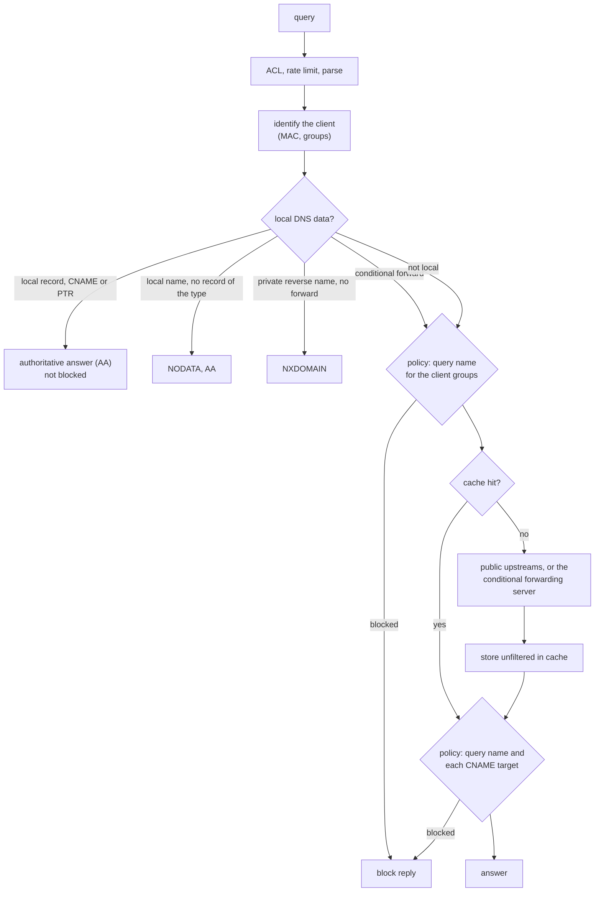
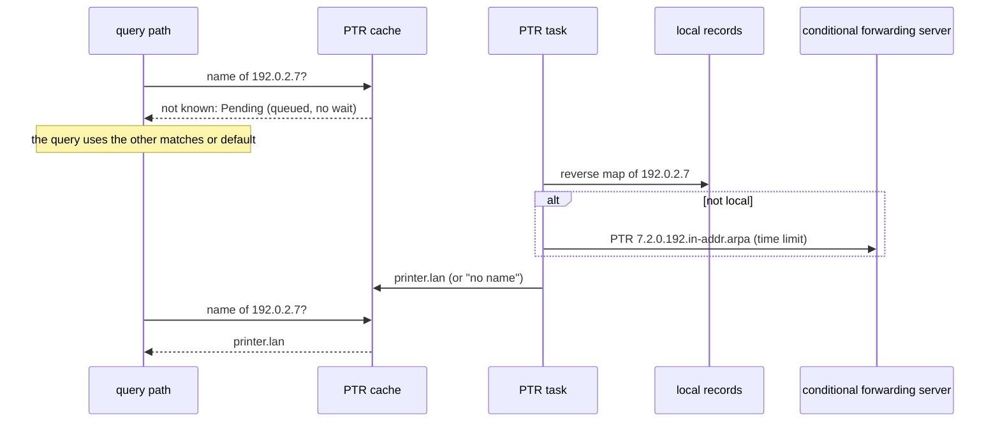
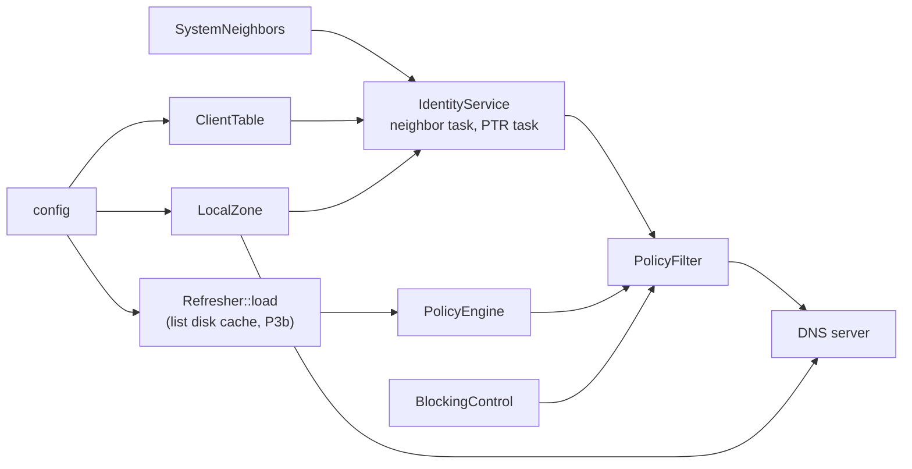

# Clients, local DNS and conditional forwarding

Part P3c. This page tells how rusthole finds the client of a query, how it answers local
names, and how the policy engine ([POLICY.md](POLICY.md)) runs in the DNS pipeline.

| Code | Content | I/O |
|---|---|---|
| `rusthole_core::clients` | Client precedence (`ClientTable`), the TTL map (`TtlLru`) | None. Pure. |
| `rusthole_core::localdns` | Local records, CNAMEs, the reverse map, conditional forwarding match, private reverse zones (`LocalZone`) | None. Pure. |
| `rusthole_dns::neighbors` | `/proc/net/arp` parser and reader, the neighbor snapshot | Reads a file. |
| `rusthole_dns::identity` | Client resolver, client cache, PTR task | Sockets (PTR to a local server only). |
| `rusthole_dns::policy_filter` | `PolicyFilter` (the `QueryFilter` of the policy engine), `BlockingControl` (the toggle) | None. |
| `rusthole_dns::handler` | The local DNS step and the forward route in the pipeline | Sockets. |
| `rusthole` bin, `run` and `engine` | Wiring, the first engine from list files on disk | Files. |

## The pipeline

- Local data comes first. A local name is never blocked: the owner made it.
- A conditionally forwarded name goes through the policy like any other name. Only the
  server changes.
- The answer check (deep CNAME check, amendment A4) runs on each reply, also on a cache hit.
  The cache holds the unfiltered answer.

## Client identity

### Facts

| Fact | Source | When |
|---|---|---|
| IP address | The source address of the query | Always. |
| MAC address | The kernel neighbor table, IPv4 only (`/proc/net/arp`, amendment A11) | Linux. Other systems have no table (development only). |
| Host name | A reverse lookup (PTR) of the client address | Only when the config has a `[[clients]]` entry with a host name. |

### Precedence

The first row that matches gives the groups. The rows are tested in this order:

| Order | `[[clients]]` entry | Example `id` |
|---|---|---|
| 1 | The exact IP address | `192.0.2.50` |
| 2 | The MAC address | `02:00:00:00:00:01` |
| 3 | The host name | `printer.lan` |
| 4 | The most specific CIDR block that holds the address. Same prefix length: the first entry in the config. | `192.0.2.128/25` beats `192.0.2.0/24` |
| 5 | No entry: the group `default` | |

- The result is the list of **enabled** groups of the entry. A disabled group, or a group
  that `[[groups]]` does not define, gives nothing. The first definition of a group name
  wins, as in the policy engine.
- `groups = []` gives no group: no list and no rule applies to the client.
- When the group `default` is disabled, a client with no entry has no group.
- An entry that does not parse, or a second entry with the same `id`, is skipped. The log
  shows it at start (`check-config` refuses it before).

### Client cache

`identify` runs on each query and reads only memory. It keeps the result for each client
address for 10 seconds (`CLIENT_CACHE_TTL_MS`), in a bounded map of 4096 entries
(`CLIENT_CACHE_ENTRIES`, least recently used out). The short time makes sure that a MAC
address that comes into the neighbor table later, or a host name that a PTR lookup finds
later, applies soon.

### Neighbor table (MAC addresses)

- A background task reads `/proc/net/arp` every 30 seconds (`NEIGHBOR_REFRESH`) on a blocking
  thread with a time limit of 2 seconds. It stores a new snapshot; the query path reads the
  latest snapshot with no lock and never reads the file.
- The parser reads at most 1 MiB and keeps at most 4096 entries (`MAX_NEIGHBORS`). It skips
  incomplete entries (no `ATF_COM` flag) and the all-zero MAC address. The first entry of an
  address wins.
- A read error keeps the old snapshot and logs one warning (not one each 30 seconds).
- On a system other than Linux the table is empty. Behind the `NeighborSource` trait, tests
  give a fake table (`StaticNeighbors`).
- A device that has not sent traffic is not in the kernel table yet. Its first queries use
  the other matches (IP, CIDR) or `default`.

### Host-name clients (PTR)

- The resolver asks for a name only when the config has a host-name client, and only when
  no IP or MAC entry matched (a host name cannot change the result then).
- The lookup is never on the query path. The query path puts the address in a bounded queue
  (256) and goes on. A full queue drops the address; it is asked again after 5 seconds.
- **The first queries of a new client use the default** (or its CIDR entry) until the name
  is known. While the lookup runs, the client result is not cached, so the name applies to
  the next query after the answer.
- Sources, in order: the local reverse map (`local_dns.records`), then the conditional
  forwarding server whose reverse zone holds the address. **Never the public upstreams.**
  An address that no rule covers gets "no name" with no query.
- An address in the `Pending` state is not queued again. The `Pending` state ends after 5
  seconds, so an address that waits in a long queue for more than 5 seconds can be queued a
  second time (known limit: at most one extra lookup).
- Time limit: 1 second for UDP and 1 second for the TCP retry.
- Cache (4096 entries): a name for its record TTL, at least 60 seconds and at most 1 hour;
  "no name" for 5 minutes; a timeout or an I/O error for 30 seconds.
- The match is exact: the PTR name `printer.lan` matches the client `printer.lan`, not
  `printer`.

## Local DNS (decision D13)

| Query | Answer |
|---|---|
| A name of `local_dns.records`, type A, AAAA or ANY | The records of the type, AA bit, TTL 300 s (`DEFAULT_LOCAL_TTL`). |
| The same name, another type (for example MX or HTTPS) | NODATA (NOERROR, no record), AA bit. No upstream query. |
| An alias of `local_dns.cnames` | The CNAME record (its `ttl`, else 300 s), then the next CNAME records and the local records of the last target, AA bit. |
| A CNAME query for an alias | The first CNAME record only. |
| The reverse name of a local address (`10.2.0.192.in-addr.arpa`, also `ip6.arpa` for AAAA records), type PTR or ANY | One PTR record for each local name of the address. |
| The same reverse name, another type | NODATA, AA bit. |

- Local data applies to class IN only.
- The answer owner names are lowercase.
- CNAME chains: at most 8 CNAME records (`MAX_CNAME_CHAIN`). A chain of exactly 8 CNAME
  records that ends at a local name also gets the records of that name. A loop
  (`a -> b -> a`) stops at the first name that comes again.
- A CNAME to a name that is not local: the answer holds the CNAME record only. The client
  must ask for the target. (dnsmasq refuses such a CNAME; rusthole accepts it.)
- A name with a CNAME and a record: the CNAME wins, and the start log reports it. A second
  CNAME for the same alias is ignored and reported.
- Local names are not blocked, also when a rule or a list names them.

## Conditional forwarding (decision D13)

A query goes to the `server` of a rule, not to the public upstreams, when:

1. the query name is `domain` or a subdomain of it. The match is on label boundaries: `lan`
   matches `nas.lan`, not `plan` or `nas.plan`. Two rules match: the longer domain wins.
2. else, the query name is in the reverse zone of `cidr`. A reverse name with k labels names
   a network of 8k bits (`2.0.192.in-addr.arpa` is `192.0.2.0/24`); it is in the zone when
   that network is inside `cidr`. For a full name this is CIDR containment of the address.
   Two rules match: the longer prefix wins. A tie: the first rule.

- The exchange uses the same code as the public upstreams (amendment A5): a random source
  port and ID from the OS CSPRNG, the reply must come from the server address with the same
  ID and question, a TCP retry on truncation, the upstream time limit, the in-flight limit.
- A loopback server gets a loopback source address (no firewall prompt on a development
  host).
- No health state and **no fallback to the public upstreams**: a failure gives SERVFAIL.
- The answer goes into the cache like a public answer, and the policy checks it.
- A disabled rule is ignored.

### Private reverse zones (`bogus-priv`)

A reverse name that no rule covers and that is inside one of these networks gets NXDOMAIN at
once, for all query types. The query never goes to the public upstreams, so private
addresses do not leak.

| IPv4 | IPv6 |
|---|---|
| `0.0.0.0/8`, `10.0.0.0/8`, `100.64.0.0/10`, `127.0.0.0/8`, `169.254.0.0/16`, `172.16.0.0/12`, `192.168.0.0/16`, `192.0.2.0/24`, `198.51.100.0/24`, `203.0.113.0/24` | `::1/128`, `fc00::/7`, `fe80::/10`, `2001:db8::/32` |

The documentation ranges are in the list because no public reverse data exists for them.
A reverse name for a larger zone (for example `192.in-addr.arpa`) is not private and goes
on.

### Reverse names with more labels

The network of a reverse name comes from the longest numeric suffix in front of
`in-addr.arpa` or `ip6.arpa`. The walk starts at the zone. It stops at the first label that
is not a decimal octet (IPv4, 4 at most) or one hex digit (IPv6, 32 at most). The labels in
front of that point do not change the network.

| Query name | Network | Result with no rule |
|---|---|---|
| `lb._dns-sd._udp.0.1.168.192.in-addr.arpa` (DNS-SD browse) | `192.168.1.0/32` | NXDOMAIN |
| `0/25.2.0.192.in-addr.arpa` (RFC 2317) | `192.0.2.0/24` | NXDOMAIN |
| `x.7.2.0.192.in-addr.arpa` | `192.0.2.7/32` | NXDOMAIN, not the local PTR of `192.0.2.7` |

- A conditional forward by `cidr` takes these names too, by the same network.
- Only a name with all labels (4 or 32) and no other label names a host. Only such a name
  gets the PTR records of the reverse map.
- A name that is not a valid domain name (for example with `/`) and a query of a class that
  is not IN get the reverse-zone checks too: the forward by `cidr`, else NXDOMAIN for a
  private zone. Local records do not apply to them.

## Policy filter

`PolicyFilter` implements the `QueryFilter` trait of the DNS crate.

- `identify(ip)`: the `ClientResolver` gives the MAC address and the group names.
- `decide_query`: `PolicyEngine::check` of the query name with the groups of the client.
- `decide_answer`: `PolicyEngine::check_chain` of the query name first, then each owner name
  and CNAME target of the answer. With `blocking.deep_cname_check = false`, only the query
  name counts.
- The engine is in an `ArcSwap` (`EngineHandle`). Part P3b stores a new engine in it; the
  query path never waits. Each check loads the engine once and makes the `GroupSet` from
  that engine, because a group set is valid only for the engine that made it.
- Replies (amendment A3): `blocking.mode` gives the reply for all query types. `null`:
  `0.0.0.0` for A, `::` for AAAA, NODATA for other types. A special domain gets NXDOMAIN.
  The TTL is `blocking.blocked_ttl`.
- `BlockingControl` holds the blocking toggle of [POLICY.md](POLICY.md): `disable(None)`,
  `disable(Some(duration))`, `enable()`, `remaining()`. A timer ends by itself at its
  deadline. A lock timeout counts as "blocking on" (the safe choice). Part P5 calls it from
  the API.
- An old filter that implements only `on_query` and `on_answer` still works: the new trait
  methods have default bodies.

### Query event (for statistics, part P4)

Each `QueryEvent` has a `policy` field (`PolicyInfo`):

| Field | Meaning |
|---|---|
| `client_mac` | The MAC address of the client, if known. |
| `groups` | The enabled groups of the client. |
| `matched` | Which entry kind matched: `Ip`, `Mac`, `Hostname`, `Cidr` or `Default`. |
| `decision` | The engine decision: action and reason (list ids, rule index, special domain, blocking off). `None` for local data or a name that is not a host name. |
| `cname_target` | The CNAME target that blocked the answer, when it is not the query name. |
| `forward_rule` | The index of the conditional forwarding rule, when the query went to its server. |

`AnswerSource::LocalDns` marks an answer from local data, NODATA for a local name, and
NXDOMAIN for a private reverse name.

## Wiring in `rusthole run`

- The list refresher (part P3b) builds the first engine from its disk cache
  (`<data_dir>/lists/<id>.txt` with its metadata file); it downloads nothing at load. The
  filter gets `Refresher::engine()`, and each later build swaps in a new engine. After the
  DNS server starts, `Refresher::start` starts the downloads with the upstream pool as the
  name lookup (part P5 wires this in `rusthole run`).
- Each build gets a new hash seed from the OS random source (`getrandom`). No build uses a
  fixed seed (tests only).
- Shutdown: the DNS server stops first, then the identity tasks. A start error of the
  server also stops the identity tasks. Tests prove both paths.

## Limits

| Item | Limit |
|---|---|
| Neighbor snapshot | 4096 entries, 1 MiB of `/proc/net/arp` |
| Neighbor read | 2 s time limit, each 30 s |
| Client cache | 4096 entries, 10 s |
| PTR queue | 256 addresses |
| PTR cache | 4096 entries |
| PTR exchange | 1 s (UDP) + 1 s (TCP retry) |
| Local CNAME chain | 8 records |
| Forward exchange | the upstream time limit, the in-flight limit |

## Tests

- Unit tests next to the code: precedence, disabled and unknown groups, duplicates, the TTL
  map, local answers, CNAME chains and loops, reverse names, forward routes, private
  reverse zones, the ARP parser and its bounds, the client resolver with MAC and PTR
  sources, the filter decisions, the toggle, the engine swap.
- Property tests: for any client config and any facts, `ClientTable::resolve` equals a
  reference model; a client never gets a group that its entry does not name; a disabled
  group never applies; the reverse zone match equals CIDR containment (IPv4 and IPv6); the
  domain match is on label boundaries; a local record always beats a forward.
- End-to-end tests (`crates/rusthole-dns/tests/policy_e2e.rs`, a real server on 127.0.0.1,
  fake upstreams, a fake neighbor table): a blocked name gets `0.0.0.0` / `::` / NODATA by
  type; a CNAME to a blocked target is blocked (also from the cache); an allowed name
  passes; a client in a group with no list is not blocked; a MAC client gets its group; a
  local record is answered with AA and no upstream query; a conditional forward goes to its
  server; a private PTR does not go upstream; blocking off allows all, and blocking comes on
  again when the timer ends.
- Bin tests: `rusthole run` wiring blocks a name from a list file on disk and answers a
  local record; the stop signal and a start error stop every task.
- Fuzz target `arp_parse` (bytes to the `/proc/net/arp` parser). The `dns_request` target
  now has local data and a forward rule.
- Manual fault injection (not committed). Each fault below made at least one test fail;
  then the fault was removed.

| Fault | Tests that failed |
|---|---|
| MAC before exact IP | `precedence_ip_mac_host_cidr_default` |
| Host name before MAC | `precedence_ip_mac_host_cidr_default`, `resolve_equals_reference` |
| CIDR entries not sorted (first CIDR wins) | `precedence_ip_mac_host_cidr_default`, `resolve_equals_reference` |
| Shortest CIDR wins | `precedence_ip_mac_host_cidr_default`, `resolve_equals_reference` |
| Disabled groups apply | `disabled_and_unknown_groups_give_nothing`, `first_group_definition_wins`, `resolve_equals_reference` |
| A client with no entry gets no `default` | `default_table_uses_default_group`, `resolve_equals_reference`, filter and identity tests |
| Answer check skips the CNAME targets | `cname_chain_check_and_query_name_first`, `old_trait_methods_use_the_policy` |
| Answer check skips the query name | `cname_chain_check_and_query_name_first`, `deep_cname_check_off_checks_the_query_name_only` |
| Answer check uses the first name only | `cname_chain_check_and_query_name_first`, `old_trait_methods_use_the_policy` |
| A cache hit skips the answer check | `blocks_by_type_and_checks_cname_targets`, `toggle_off_then_timer_ends` (end-to-end) |

## Interpretations

These choices are not fixed by the P3c spec. The owner can change them.

| Topic | Choice |
|---|---|
| Conditionally forwarded names | The policy applies (only local records are exempt). |
| Private reverse zones | All query types get NXDOMAIN, not only PTR. The documentation ranges are private too. |
| CNAME to a name that is not local | The answer holds the CNAME only. |
| CNAME and a record on one name | The CNAME wins; the start log reports it. |
| Host-name match | Exact, after the canonical form. No match on the first label only. |
| Local TTL | 300 s for local records and PTR records (the config has no field for it). |
| The client of a local answer | The event has the client and its groups, but no engine decision. |
