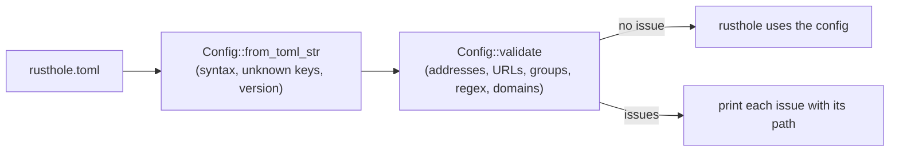

# rusthole.toml

rusthole reads one TOML file. The default path is `/etc/rusthole/rusthole.toml`. Use
`-c PATH` or the `RUSTHOLE_CONFIG` environment variable to change it.

- `rusthole check-config` reads the file, prints each problem with its TOML path (for example
  `rules[3].value`), and exits with code 1 when it finds a problem.
- `rusthole import teleporter.zip -o rusthole.toml` makes the file from a Pi-hole v6 export.
  See [IMPORT.md](IMPORT.md).

## Rules for the file

- `config_version = 1` is required. It is the first key. rusthole refuses an unknown version.
  A later rusthole changes an older file to the new version (the `migrate` step).
- Each section and each field has a default. A file with only `config_version = 1` is valid.
- An unknown key is an error. Thus a typing error does not go unseen.
- The file holds secrets (the password hash). rusthole writes it with mode 0600.
- An error message about the file gives the line, the column and the problem. It never quotes
  the text of the line or a string value, because that text can be a secret.
- Domain names can be Unicode. When rusthole loads the file, it changes each valid domain
  value to its canonical form: lowercase ASCII, no trailing dot, punycode (`xn--...`) for a
  Unicode name. This applies to exact rule values, `blocking.special_domains`, local record
  names, CNAME names and targets, conditional forwarding domains, and clients that are host
  names. Regex rules do not change. `rusthole import` writes the canonical form.
- v1 uses IPv4 transport only (amendment A11). `check-config` refuses an IPv6 address or
  block in a listen address, an upstream, a bootstrap address, a fallback, `acl.allow`, a
  client, or a conditional forwarding rule, with the issue "IPv6 is not supported in v1".
  DNS content is not transport: AAAA records and the `::` block answer stay valid.



## Sections

### `[server]`

| Field | Type | Default | Meaning |
|---|---|---|---|
| `dns_listen` | list of text | `["auto"]` | DNS addresses (UDP and TCP). `"auto"` means each IPv4 address on each local interface. Or give IPv4 addresses. `"auto"` cannot be mixed with addresses. |
| `dns_port` | integer | `53` | DNS port. 0 is not allowed. |
| `data_dir` | text | `/var/lib/rusthole` | Data directory: downloaded lists, the query database and the TLS files (in `tls/`). It must not be empty. A Windows build is for development only; its default is `rusthole-data` in the working directory. |
| `doh.enabled` | bool | `false` | DNS-over-HTTPS listener (`/dns-query`). DoH clients need a certificate that they trust, so turn it on after you set up TLS. The DoH listener needs `tls.mode` `file` or `local-ca`: the DoH TLS setup refuses `self-signed`. `check-config` does not report this, because a config_version 1 file with DoH on was valid before the `[tls]` section. |
| `doh.listen` | list of text | `["auto"]` | Like `dns_listen`. |
| `doh.port` | integer | `443` | DoH port. It must not be `dns_port` when DoH is on, because DNS also uses TCP. |
| `admin.enabled` | bool | `true` | Admin UI and REST API (HTTPS). |
| `admin.listen` | list of text | `["auto"]` | Like `dns_listen`. |
| `admin.port` | integer | `8443` | Admin port. When the admin listener is on, it must not be `dns_port`, and it must not be the DoH port when DoH is on. |

### `[upstreams]`

| Field | Type | Default | Meaning |
|---|---|---|---|
| `servers` | list of tables | `udp://9.9.9.9:53` and `udp://1.1.1.1:53` | The upstream servers. At least one is necessary. |
| `servers[].url` | text | | `8.8.8.8`, `8.8.8.8:53`, `udp://8.8.8.8:53`, `tcp://8.8.8.8:53`, `tls://dns.example:853` (DoT) or `https://dns.example/dns-query` (DoH). A plain DNS upstream must use an IP address. An IP address must be IPv4. A DoH URL without a path gets `/dns-query`. |
| `servers[].bootstrap` | list of IPv4 addresses | `[]` | Addresses of a DoT or DoH host name. Required for a host name, so that rusthole needs no DNS to find its own upstream. Only for `tls://` and `https://`. |
| `fallback_plain` | list of text | `[]` | Plain DNS upstreams (`udp://` or `tcp://` with an IPv4 address). rusthole uses them only while the clock is not valid (TLS needs a valid clock, and a Pi has no RTC). |
| `timeout_ms` | integer | `2000` | Time limit for one upstream query, 1 to 60000 ms. |

### `[blocking]`

| Field | Type | Default | Meaning |
|---|---|---|---|
| `enabled` | bool | `true` | False forwards all queries. |
| `mode` | text | `"null"` | `null`: `0.0.0.0` / `::` for A / AAAA, NODATA for other types. `nxdomain`: NXDOMAIN. `nodata`: NODATA. `ip`: `ipv4` / `ipv6` for A / AAAA, NODATA for other types. |
| `ipv4` | IPv4 address | none | Answer for A queries in mode `ip`. |
| `ipv6` | IPv6 address | none | Answer for AAAA queries in mode `ip`. Mode `ip` needs `ipv4` or `ipv6`. A missing one gives NODATA for its type. |
| `blocked_ttl` | integer | `2` | TTL of a blocked answer, in seconds. |
| `special_domains` | list of domains | `use-application-dns.net`, `mask.icloud.com`, `mask-h2.icloud.com` | These names get NXDOMAIN for all clients: the Firefox DoH canary and iCloud Private Relay. An empty list turns this off. |
| `deep_cname_check` | bool | `true` | Check each CNAME target in an upstream answer against the client policy. This stops CNAME cloaking. |

### `[cache]`

| Field | Type | Default | Meaning |
|---|---|---|---|
| `max_entries` | integer | `10000` | Maximum number of answers, at most 1000000. 0 turns the cache off. |
| `min_ttl` | integer | `0` | Lowest TTL in seconds. Not more than `max_ttl`. |
| `max_ttl` | integer | `86400` | Highest TTL in seconds. |
| `negative_ttl` | integer | `300` | TTL of NXDOMAIN and NODATA answers without an SOA record. |

### `[acl]`

| Field | Type | Default | Meaning |
|---|---|---|---|
| `auto_local` | bool | `true` | Allow loopback and each IPv4 subnet on a local interface. |
| `allow` | list of IPv4 CIDR blocks | `[]` | More allowed networks, for example `192.0.2.0/24`. Other clients get no answer. |

### `[rate_limit]`

| Field | Type | Default | Meaning |
|---|---|---|---|
| `queries` | integer | `1000` | Queries that one client can send in one interval. 0 turns the limit off. |
| `interval_seconds` | integer | `60` | Interval length. Must be more than 0 when `queries` is set. |

### `[stats]`

| Field | Type | Default | Meaning |
|---|---|---|---|
| `flush_interval_seconds` | integer | `60` | Seconds between two writes of the query log to disk. 0 keeps all data in RAM only. |
| `retention_days` | integer | `30` | Days of history in the database. |
| `recent_queries` | integer | `1000` | Size of the in-RAM ring of recent queries, at most 1000000. |

### `[lists]` and `[[lists.adlists]]`

| Field | Type | Default | Meaning |
|---|---|---|---|
| `refresh_interval_hours` | integer | `24` | Hours between two list refreshes. 0 turns the automatic refresh off. |
| `adlists[].id` | integer | | A unique number. |
| `adlists[].url` | text | | `http://` or `https://` URL. Each URL only once. |
| `adlists[].kind` | text | | `block` or `allow`. Allow beats block. |
| `adlists[].enabled` | bool | `true` | |
| `adlists[].groups` | list of group names | `["default"]` | The groups that use the list. `[]` means no group. |
| `adlists[].comment` | text | none | Free text. |

### `[[rules]]`

| Field | Type | Default | Meaning |
|---|---|---|---|
| `kind` | text | | `exact`: the value is one domain name. `regex`: the value is a pattern in the syntax of the Rust `regex` crate. The match is case-insensitive. The pattern has a size limit. Pi-hole extensions (`;querytype=`, `;invert`, `;reply=`) are not supported. |
| `action` | text | | `deny` or `allow`. Allow beats deny. |
| `value` | text | | The domain name or the pattern. |
| `enabled` | bool | `true` | |
| `groups` | list of group names | `["default"]` | `[]` means no group. |
| `comment` | text | none | Free text. |

### `[[groups]]`

| Field | Type | Default | Meaning |
|---|---|---|---|
| `name` | text | | A unique name: 1 to 64 characters from `a-z`, `0-9`, `-`, `_`, `.`. The first character is a letter or a digit. The group `default` must exist. |
| `enabled` | bool | `true` | A disabled group applies no list and no rule. |
| `comment` | text | none | Free text. |

When the file has no `[[groups]]`, rusthole uses one group: `default`.

### `[[clients]]`

| Field | Type | Default | Meaning |
|---|---|---|---|
| `id` | text | | An IPv4 address, an IPv4 CIDR block, a MAC address (`02:00:00:00:00:01`) or a host name. Each client only once. rusthole finds a MAC address in the kernel neighbor table. |
| `groups` | list of group names | `["default"]` | `[]` means no group: no list and no rule applies to the client. |
| `comment` | text | none | Free text. |

A client with no `[[clients]]` entry is in the group `default`.

### `[local_dns]`

| Field | Type | Default | Meaning |
|---|---|---|---|
| `records[].name` | domain | | Name of an A or AAAA record. |
| `records[].type` | text | | `A` or `AAAA`. |
| `records[].value` | IP address | | Its family must match the type. |
| `cnames[].name` | domain | | The alias. |
| `cnames[].target` | domain | | The target name. |
| `cnames[].ttl` | integer | none | TTL in seconds. |
| `conditional_forwarding[].enabled` | bool | `true` | |
| `conditional_forwarding[].cidr` | IPv4 CIDR block | | Reverse lookups (PTR) for this network go to `server`. |
| `conditional_forwarding[].server` | text | | An IPv4 address with an optional port: `IP` or `IP:PORT`. |
| `conditional_forwarding[].domain` | domain | none | Queries for this domain and its subdomains also go to `server`. |

### `[admin]`

| Field | Type | Default | Meaning |
|---|---|---|---|
| `password_hash` | text | empty | Argon2id PHC string (`$argon2id$v=19$m=...,t=...,p=...$SALT$HASH`). Empty means that no login is possible. Set it with `rusthole passwd`. |
| `totp_secret` | text | empty | Base32 TOTP secret (A-Z, 2-7, at least 16 characters). Empty turns TOTP off. |
| `session_ttl_seconds` | integer | `28800` | Session lifetime. More than 0. |
| `tls_cert_path` | text | none | The older form of `tls.cert_path`. It stays valid: with both admin paths and no `tls.mode`, the mode is `file`. Do not set it together with `tls.cert_path`. |
| `tls_key_path` | text | none | The older form of `tls.key_path`. Set both paths or neither. |
| `api_tokens[].name` | text | | A unique name. It must not be empty. |
| `api_tokens[].hash` | text | | Hash of the token: an Argon2id PHC string, or `sha256:` and 64 hex digits. |

rusthole never shows a secret in a log, an error message or the API.

### `[tls]`

One certificate serves the admin listener and the DoH listener. [TLS.md](TLS.md) explains the
modes and how to install the local CA on a device.

| Field | Type | Default | Meaning |
|---|---|---|---|
| `mode` | text | see the meaning | `file`: a certificate and a key from PEM files. `self-signed`: rusthole makes a self-signed certificate (admin UI only). `local-ca`: rusthole makes a local certificate authority and a server certificate; you install the CA on your devices. Without `mode`, the mode is `file` when the config gives a certificate and a key (here or in `admin`), otherwise `self-signed`. |
| `cert_path` | text | none | Certificate chain (PEM), the server certificate first. Only for mode `file`. |
| `key_path` | text | none | Private key (PEM). Only for mode `file`. Set both paths or neither. |
| `names` | list of host names | `[]` | Host names in a certificate that rusthole makes. rusthole also adds `localhost`, `127.0.0.1` and each local IPv4 address. At most 32 names. An IP address is not allowed here. A name has only letters, digits and `-` (no `_`), no label starts or ends with `-`, and the last label is not all digits, because TLS clients refuse other names. |

Rules:

- DoH clients accept only a certificate that they trust (amendment A6). The DoH listener
  needs mode `file` or `local-ca`. The DoH TLS setup refuses mode `self-signed`.
  `check-config` does not report this, so that older config_version 1 files stay valid.
- rusthole keeps the files that it makes in `<data_dir>/tls/`. A private key has mode 0600.

## Full example

A unit test parses and validates this example, so it stays correct.

```toml
# rusthole.toml: a full example. docs/CONFIG.md explains each field.
# All values here are examples. Addresses come from the documentation ranges
# 192.0.2.0/24, 198.51.100.0/24 and 2001:db8::/32. v1 uses IPv6 only for AAAA records.

config_version = 1

[server]
dns_listen = ["auto"]
dns_port = 53
data_dir = "/var/lib/rusthole"

[server.doh]
enabled = false
listen = ["auto"]
port = 443

[server.admin]
enabled = true
listen = ["192.0.2.2"]
port = 8443

[upstreams]
timeout_ms = 2000
fallback_plain = ["udp://192.0.2.53:53"]

[[upstreams.servers]]
url = "udp://9.9.9.9:53"

[[upstreams.servers]]
url = "8.8.8.8"

[[upstreams.servers]]
url = "tls://dns.example:853"
bootstrap = ["192.0.2.80", "192.0.2.82"]

[[upstreams.servers]]
url = "https://doh.example/dns-query"
bootstrap = ["192.0.2.81"]

[blocking]
enabled = true
mode = "null"
blocked_ttl = 2
special_domains = ["use-application-dns.net", "mask.icloud.com", "mask-h2.icloud.com"]
deep_cname_check = true

[cache]
max_entries = 10000
min_ttl = 0
max_ttl = 86400
negative_ttl = 300

[acl]
auto_local = true
allow = ["198.51.100.0/24"]

[rate_limit]
queries = 1000
interval_seconds = 60

[stats]
flush_interval_seconds = 60
retention_days = 30
recent_queries = 1000

[lists]
refresh_interval_hours = 24

[[lists.adlists]]
id = 1
url = "https://lists.example/hosts.txt"
kind = "block"
enabled = true
groups = ["default", "kids"]
comment = "Main block list"

[[lists.adlists]]
id = 2
url = "https://lists.example/allow.txt"
kind = "allow"
groups = ["default"]

[[rules]]
kind = "exact"
action = "deny"
value = "tracker.example"
groups = ["default"]

[[rules]]
kind = "regex"
action = "deny"
value = '(\.|^)ads\.example$'
groups = ["default", "kids"]
comment = "All subdomains of ads.example"

[[rules]]
kind = "exact"
action = "allow"
value = "cdn.example"
enabled = false
groups = ["default"]

[[groups]]
name = "default"
enabled = true

[[groups]]
name = "kids"
comment = "Tablets"

[[groups]]
name = "iot"

[[clients]]
id = "02:00:00:00:00:01"
groups = ["kids"]
comment = "Tablet"

[[clients]]
id = "192.0.2.50"
groups = ["default", "kids"]

[[clients]]
id = "192.0.2.128/25"
groups = ["iot"]

[[clients]]
id = "printer.lan"
groups = []
comment = "No list applies to this client"

[[local_dns.records]]
name = "nas.lan"
type = "A"
value = "192.0.2.10"

[[local_dns.records]]
name = "nas.lan"
type = "AAAA"
value = "2001:db8::10"

[[local_dns.cnames]]
name = "media.lan"
target = "nas.lan"
ttl = 300

[[local_dns.conditional_forwarding]]
cidr = "192.0.2.0/24"
server = "192.0.2.1"
domain = "lan"

[admin]
# Set the password with `rusthole passwd`. With no hash, no login is possible.
# password_hash = "$argon2id$v=19$m=19456,t=2,p=1$...$..."
session_ttl_seconds = 28800

[[admin.api_tokens]]
name = "monitoring"
hash = "sha256:0000000000000000000000000000000000000000000000000000000000000000"

[tls]
# The DoH listener needs mode "file" or "local-ca". For mode "file", set:
# mode = "file"
# cert_path = "/etc/rusthole/cert.pem"
# key_path = "/etc/rusthole/key.pem"
mode = "local-ca"
names = ["rusthole.lan"]
```
