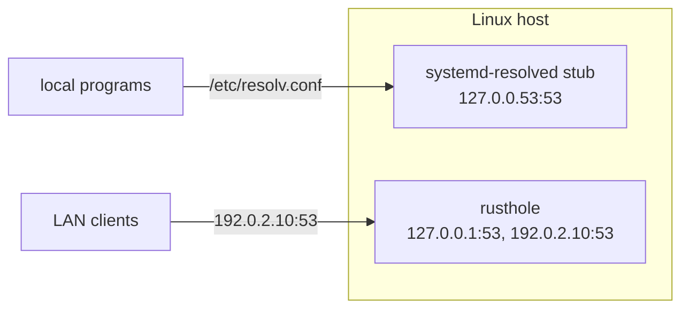

# Deploy rusthole

This page tells you how to run the DNS server on a Linux host. Part P8 adds the systemd unit
and the install script. Until then, start the server by hand.

## Start the server

1. Write a config file. `rusthole import` makes one from a Pi-hole export, or start from the
   example in [CONFIG.md](CONFIG.md).
2. Check it:

   ```bash
   rusthole check-config -c /etc/rusthole/rusthole.toml
   ```

3. Start the server:

   ```bash
   rusthole run -c /etc/rusthole/rusthole.toml
   ```

   rusthole logs each bound address at INFO (`DNS listening udp=... tcp=...`).
   `RUSTHOLE_LOG=debug` gives more detail.
4. Stop it with SIGTERM or SIGINT (Ctrl+C). rusthole stops to accept queries, gives the
   queries in flight 5 seconds to end, then stops all tasks.

Port 53 is a privileged port. Give the binary the capability, or run it from a systemd unit
with `AmbientCapabilities=CAP_NET_BIND_SERVICE` (part P8). Do not run rusthole as root.

```bash
sudo setcap cap_net_bind_service=+ep /usr/local/bin/rusthole
```

## Listen addresses

With `server.dns_listen = ["auto"]`, rusthole binds one UDP socket and one TCP socket on each
IPv4 address of each interface. It does not bind the wildcard address `0.0.0.0`. It scans the
interfaces each 30 seconds. It binds a new address and closes the sockets of an address that
went away.

On an OS other than Linux, `"auto"` binds `127.0.0.1` only. This is a development mode.

## The systemd-resolved stub listener

Ubuntu, Debian and other distributions run `systemd-resolved`. It has a stub DNS listener on
`127.0.0.53:53` (and `127.0.0.54:53`).



Usually no change is necessary. rusthole binds each address on its own, so the stub address
and the rusthole addresses do not clash. `"auto"` does not see `127.0.0.53`, because it is not
an interface address.

Replace the stub only when rusthole must also answer the local programs of the host, or when
a program on the host must use `127.0.0.53` for rusthole:

1. Turn off the stub listener:

   ```ini
   # /etc/systemd/resolved.conf.d/rusthole.conf
   [Resolve]
   DNSStubListener=no
   ```

2. Restart the service:

   ```bash
   sudo systemctl restart systemd-resolved
   ```

3. Point the host resolver at rusthole. Replace the `/etc/resolv.conf` link with a file:

   ```bash
   sudo rm /etc/resolv.conf
   echo "nameserver 127.0.0.1" | sudo tee /etc/resolv.conf
   ```

4. Check that nothing else uses port 53:

   ```bash
   sudo ss -lunpt 'sport = :53'
   ```

## Client access

By default (`acl.auto_local = true`), rusthole answers loopback and each subnet of a local
interface. It ignores UDP queries from other addresses (no answer, so no reflection), and it
answers TCP queries from them with REFUSED. Add more networks with `acl.allow`. rusthole logs
a warning once for each local subnet that is not private (RFC 1918, CGNAT or link-local).

## Check that it works

From a LAN client:

```bash
dig @192.0.2.10 example.com
dig @192.0.2.10 example.com +tcp
```

The second query of the same name comes from the cache, so its TTL is lower.
