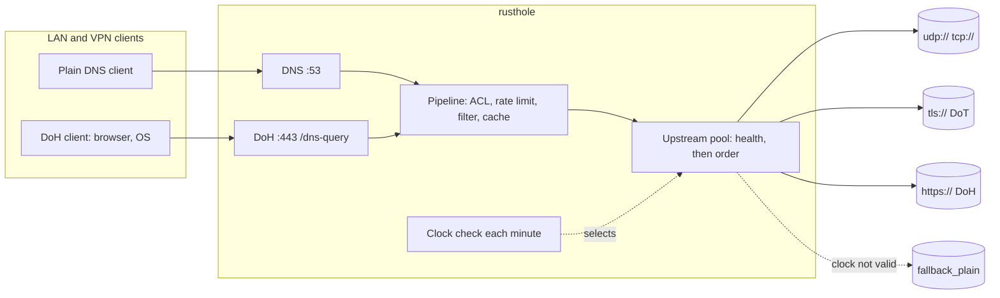
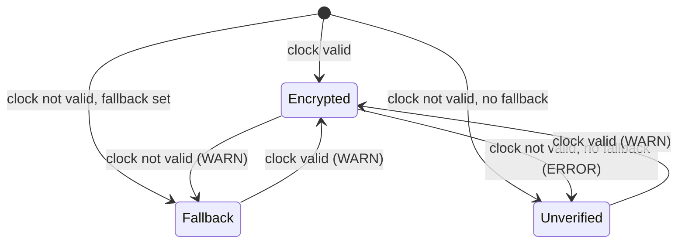

# DNS over HTTPS and DNS over TLS

rusthole can serve DNS over HTTPS (DoH, RFC 8484) to clients on your LAN and VPN. It can also
send its own queries to upstream servers over DNS over TLS (DoT, RFC 7858) or DoH.

- DoH server: one HTTPS listener, path `/dns-query`, GET and POST, HTTP/2 and HTTP/1.1.
- DoT and DoH upstreams: in `upstreams.servers`, mixed with plain upstreams.
- Clock fallback: plain DNS servers that rusthole uses while the system clock is not valid.

DoT serving (port 853) is not in v1. Thus the Android "Private DNS" setting (DoT only) cannot
use rusthole as its server. Android devices use rusthole over plain DNS, or a browser uses it
over DoH.



## DoH server

### Turn it on

DoH clients refuse a certificate that they do not trust, and they show no warning. Thus the
DoH listener needs `tls.mode = "file"` or `tls.mode = "local-ca"`. With `self-signed` (the
default when no certificate is set), `rusthole run` stops with an error that says this.
[TLS.md](TLS.md) explains the modes.

```toml
[server.doh]
enabled = true
listen = ["auto"]   # or IPv4 addresses, for example ["192.0.2.2"]
port = 443

[tls]
mode = "local-ca"
names = ["rusthole.lan"]   # set this before the first start
```

- `listen = ["auto"]` binds each IPv4 address of each local interface, and follows interface
  changes (the same rule as `dns_listen`). On an OS other than Linux (development only), it
  binds `127.0.0.1` only.
- v1 listens on IPv4 only (amendment A11).
- The DoH port must not be the DNS port or the admin port.

### Requests and replies

| Request | Reply |
|---|---|
| `GET /dns-query?dns=<base64url>` | 200, `application/dns-message` |
| `POST /dns-query`, `Content-Type: application/dns-message`, the DNS message as the body | 200, `application/dns-message` |
| POST with another content type | 415 |
| POST body longer than 65535 bytes | 413 |
| GET with a bad or missing `dns=` value, a message shorter than 12 bytes, or a message that is not a query | 400 |
| GET query string longer than 8192 characters, or `dns=` value longer than 4096 characters | 414 |
| Another method | 405 (with `Allow: GET, POST`) |
| Another path | 404 |

- The `dns=` value is base64url without padding (RFC 8484). A padded value is also accepted.
  A percent-encoded value is not valid base64url.
- RFC 8484 asks the client to send ID 0. rusthole accepts any ID and answers with the same ID.
- `Cache-Control: max-age=N`: N is the lowest TTL of the records in the reply. A reply with
  no record gets `max-age=0`. A cached answer has its aged TTLs, so N goes down too.
- A DNS error (for example NXDOMAIN or SERVFAIL) is a 200 reply with the DNS response code.

### The same pipeline as plain DNS

A DoH query goes through the same pipeline as a plain query: the client ACL, the rate limit,
local DNS data, the blocking policy, the cache, the upstreams and the statistics. A DoH client
is blocked like a plain client, and its queries are counted like plain queries. The query
event that the statistics get has the transport `Https`.

### Client address, ACL and rate limit

- The client address is the TCP peer address of the connection.
- rusthole does **not** read `X-Forwarded-For` or `Forwarded`. A client can write any header,
  and the ACL and the rate limit must use an address that the client cannot choose. Thus do
  not put a reverse proxy in front of the DoH listener: all queries would come from the proxy.
- The ACL check is at TCP accept, before the TLS handshake. An off-net client gets a closed
  connection and costs no TLS work.
- The pipeline checks the ACL again for each query, because the ACL can change while a
  connection is open (interface scan).
- A query over the rate limit gets a DNS REFUSED reply (status 200). Then the connection
  closes.

### Limits

| Limit | Value |
|---|---|
| TLS handshake | 10 s |
| Request headers (HTTP/1.1) | 10 s; at most 16 KiB of request line and headers |
| One request (body read and DNS answer) | 20 s; then 503 |
| Idle connection (no open request) | 30 s; then the connection closes |
| Open connections | 128 in total, 16 from one client address |
| Open HTTP/2 streams on one connection | 16 |
| HTTP/2 header list | 16 KiB |
| Requests on one connection | 1000; then the connection closes |
| POST body | 65535 bytes |

On shutdown, rusthole stops the DoH listener, lets open requests end (up to the shutdown
grace time of 5 s), and then closes all connections.

## Client setup

First install the CA certificate on each device when you use `local-ca`
([TLS.md, Install the local CA](TLS.md#install-the-local-ca-on-a-device)). Use a name from
`tls.names` in the DoH URL, and make sure that the device resolves that name to rusthole (for
example with a local DNS record in `[local_dns]`, or a `hosts` entry).

### Firefox

**Settings > Privacy and Security > DNS over HTTPS > Max Protection > Custom**, then give
`https://rusthole.lan/dns-query`.

- Firefox has its own certificate store. Import the CA there (see TLS.md), or set
  `security.enterprise_roots.enabled = true` on Windows and macOS.
- Firefox asks `use-application-dns.net` to find out if the network allows DoH. rusthole
  answers NXDOMAIN for it (amendment A3). This turns off the automatic DoH of Firefox, so that
  Firefox does not go around rusthole. A DoH setting that you make by hand still works.
- In `about:config`, `network.trr.mode = 3` uses DoH only. Mode 2 falls back to the system
  DNS when DoH fails.

### Chrome and Edge

**Settings > Privacy and security > Security > Use secure DNS > With: Custom**, then give
`https://rusthole.lan/dns-query`. Chrome uses the system certificate store (on Linux its own
NSS store, see TLS.md).

### Windows 11

1. Set the DNS server of the network adapter to the rusthole IPv4 address.
2. Run, in an administrator terminal:
   `netsh dns add encryption server=192.0.2.2 dohtemplate=https://rusthole.lan/dns-query`
   (use your rusthole address and name).
3. In **Settings > Network and internet > (adapter) > DNS server assignment**, set
   **DNS over HTTPS** to **On (manual template)**.

### Android

The Android "Private DNS" setting uses DoT only, and rusthole v1 does not serve DoT. Use
rusthole as the plain DNS server of the network (DHCP or the Wi-Fi settings), or set DoH in a
browser (Chrome, Firefox) with the CA installed.

### iOS and macOS

Apple systems take DoH settings from a configuration profile (`com.apple.dnsSettings.managed`
with `DNSProtocol = HTTPS` and `ServerURL = https://rusthole.lan/dns-query`). Install the CA
profile first.

### Test with curl

```sh
# GET (RFC 8484), with the local CA:
curl --cacert ca.pem -H 'accept: application/dns-message' \
  "https://rusthole.lan/dns-query?dns=AAABAAABAAAAAAAAB2V4YW1wbGUDY29tAAABAAE" | xxd

# curl as a DoH client:
curl --cacert ca.pem --doh-url https://rusthole.lan/dns-query https://example.com/
```

## Certificates

- The DoH listener and the admin listener use the same certificate ([TLS.md](TLS.md)).
- `local-ca`: rusthole makes a local CA once and a server certificate for `localhost`,
  `127.0.0.1`, each name in `tls.names` and each local IPv4 address. Install `ca.pem` on each
  device. The certificate name in the DoH URL must be one of these names.
- `file`: use a certificate from your own CA, or from a public CA (for example by ACME with a
  DNS challenge) for a name that resolves to rusthole on your LAN.
- `self-signed` is refused for DoH: a DoH client refuses such a certificate without a
  message, so DoH would fail with no hint.

## DoT and DoH upstreams

```toml
[upstreams]
fallback_plain = ["udp://192.0.2.53:53"]

[[upstreams.servers]]
url = "tls://dns.example:853"
bootstrap = ["192.0.2.80", "192.0.2.82"]

[[upstreams.servers]]
url = "https://doh.example/dns-query"
bootstrap = ["192.0.2.81"]

[[upstreams.servers]]
url = "udp://192.0.2.53:53"
```

- **Bootstrap addresses.** rusthole never resolves the name of a DoT or DoH upstream through
  the system resolver (the system resolver can be rusthole itself). It connects to the
  `bootstrap` IPv4 addresses, in order. The host name of the URL is the TLS SNI and the name
  that the certificate must have. A URL with an IP address (`tls://192.0.2.80`) needs no
  bootstrap; the certificate must then have that IP address.
- **Trust roots.** The system certificate store, or the bundled Mozilla roots when the system
  store is empty ([TLS.md](TLS.md#upstream-tls-dot-and-doh-client)).
- **Mixed pools.** Plain, DoT and DoH upstreams can be in one list. rusthole tries them by
  health, then in config order, at most 3 for one query. A timeout, a TLS error, a bad reply
  or an HTTP error makes the query go to the next upstream and counts as a failure in the
  health state machine. When all DoT connections of an upstream are full, the query goes to
  the next upstream, but that is a local limit and does not count as a failure.
- **DoT.** 2-byte length framing. At most 2 connections for each upstream, each one with up
  to 32 queries at the same time (pipelining). One connect runs at a time, so a burst of
  queries does not open a connection for each query. A reply counts only when its ID belongs
  to an open query and its question is the same. A connection closes after 20 s with no
  query, or after 64 wrong replies. After about 100000 events (queries and reads), a
  connection takes no new query and closes when its open queries end; the next query opens
  a new connection.
- **DoH.** HTTP/2 only (ALPN `h2`). One connection for each upstream carries all queries. It
  closes after 30 s with no query. Each query is a POST with `application/dns-message` and ID
  0. The reply must have status 200, the same content type, at most 65535 bytes, ID 0 and the
  same question. The client gets its own ID back.
- **Time limits.** `upstreams.timeout_ms` limits each try: connect, TLS handshake, write and
  read. When a reused connection gives a connection error (the server closed it, or a write
  failed), rusthole tries once more on a new connection, because a server can close an idle
  connection at any time. A timeout is not tried again: the query goes to the next upstream
  at once, so a slow upstream costs one `timeout_ms`. After a timeout, the connection stays
  in use when data came on it after the query was sent (the upstream is slow for this name
  only). Else rusthole does not use the connection again.

## Clock fallback

A TLS certificate check needs a correct clock. A Raspberry Pi has no real-time clock: after a
boot, its clock can be in 1970 until NTP sets it. But NTP can need DNS, and DNS over DoT or
DoH needs a correct clock.

rusthole checks the clock at start and each minute (`clock_plausible`: the clock is not more
than two days before the build time of the binary).



- **Clock valid:** all upstreams in `upstreams.servers`.
- **Clock not valid, `fallback_plain` set:** the DoT and DoH upstreams are skipped (no query,
  no probe, no health change). The plain upstreams in `upstreams.servers` and the
  `fallback_plain` servers are used. rusthole logs a WARN once.
- **Clock not valid, no fallback:** rusthole logs an ERROR once that explains the risk, and
  keeps trying the encrypted upstreams. Their certificate checks can fail, so DNS can stop
  until NTP sets the clock.
- When the clock is valid again, rusthole logs a WARN and goes back to the encrypted
  upstreams.

Set `fallback_plain` on a device without a real-time clock. Queries go over plain DNS only
while the clock is wrong, which is usually a few seconds after a boot.
