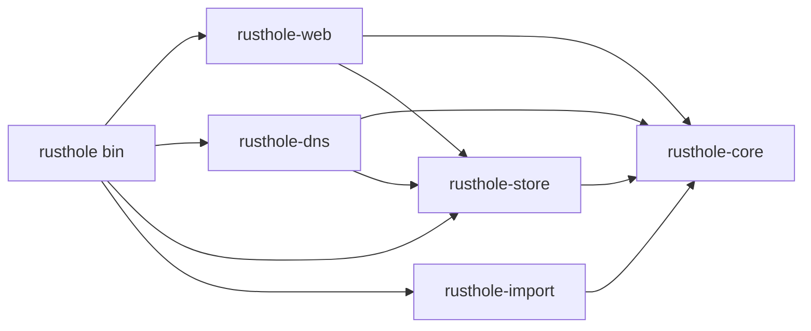

# Engineering rules

These rules apply to all code in this repo. [PLAN.md](PLAN.md) has the approved decisions
(D1–D17) and the parts (P0–P8).

## Layout



| Crate | Rule |
|---|---|
| `rusthole-core` | Pure. No I/O, no clock, no threads, no async runtime. `now` is an input. |
| `rusthole-import` | Reads files. All conversion logic is pure and has tests. |
| `rusthole-dns`, `rusthole-store`, `rusthole-web` | Thin I/O shell around policy from `rusthole-core`. |
| `rusthole` | CLI and wiring only. |

## Code rules

1. **No unsafe.** `unsafe_code = "forbid"` is set for the workspace. Do not change it.
2. **Lints.** `cargo clippy --workspace --all-targets -- -D warnings` must pass. Use
   `#[allow(...)]` only on one item, and add a comment that says why. Clippy reads only the
   nearest `clippy.toml`: `crates/rusthole-core/clippy.toml` repeats the root settings and
   forbids `Instant::now` and `SystemTime::now`. Change both files together.
3. **No panic in production code.** Do not use `unwrap`, `expect`, `panic!` or slice
   indexing that can fail. Return an error. Tests can use `unwrap`.
4. **Dependencies.** Add a crate to `[workspace.dependencies]` in the root `Cargo.toml`, then use
   `name = { workspace = true }` in the member. Use rustls, never OpenSSL. `cargo deny check` must pass.
5. **Pure core, I/O shell.** Policy (matching, ACL, retry, backoff, ban, budgets) is a pure
   function or a pure state machine in `rusthole-core`. It gets `now` as an input.
6. **Time.** Use a monotonic clock (`std::time::Instant` or `tokio::time::Instant`) for
   durations, timeouts and deadlines. Use the wall clock only for timestamps that people read.
7. **Every wait has a time limit.** Each network read, write, connect, lock and `join` has a
   timeout.
8. **State machines.** Use an `enum` for the state and an `enum` for the event. A transition
   function returns the next state. An event that the state does not expect is logged at
   ERROR with the full state and event, and the machine goes to a safe state.
9. **Bounded loops.** A loop that drives a state machine has a provable bound
   (`for _ in 0..=MAX_STEPS`). Reaching the bound logs an ERROR and stops safely. A test
   proves the bound. A service main loop can be unbounded; a comment at the loop says why.
10. **Cleanup.** Every exit path (error, give-up, panic) stops the tasks it started.
    A test proves this.
11. **Bounded memory.** Every map or queue that grows from network input has a size limit
    (for example an LRU).
12. **Fault injection.** For safety-critical logic (ACL, auth, ban, policy), put a fault
    in by hand (for example an off-by-one). A test must fail. Then remove the fault.
13. **Comments and docs** use ASD-STE100 Simplified Technical English: short sentences,
    active voice.
14. **Private data.** Never commit a real Pi-hole export, real MAC addresses, real client
    names, password hashes or tokens. Tests use synthetic fixtures.

## Tests

- Unit tests next to the code.
- Property tests (`proptest`) for every parser and every state machine invariant.
- Fuzz targets in `fuzz/` for every parser of untrusted input (DNS packets, lists, config,
  Teleporter import, HTTP request bodies). Add the target to `fuzz/Cargo.toml`.

## Commands

On Windows (development):

```bash
cargo fmt --all
cargo clippy --workspace --all-targets -- -D warnings
cargo test --workspace
```

On Linux through WSL (the build output goes to drive D):

```bash
wsl -d Ubuntu-22.04 -- bash /mnt/e/bohdan/rusthole/scripts/linux.sh test --workspace
wsl -d Ubuntu-22.04 -- bash /mnt/e/bohdan/rusthole/scripts/linux.sh fuzz domain_parse 60
```

Static musl build (amendment A2). The script installs zig and cargo-zigbuild on drive D:

```bash
wsl -d Ubuntu-22.04 -- bash /mnt/e/bohdan/rusthole/scripts/musl-build.sh
```

Fuzz targets: `domain_parse`, `config_parse`, `teleporter_zip`, `pihole_toml`, `dns_request`,
`cache_ops`.

Temporary files go to `D:\tmp`, not to drive C.

## Network in tests (no Windows firewall prompt)

On Windows, a program that listens on a non-loopback address opens the Windows Defender
Firewall prompt. The owner does not want this prompt. So:

1. Tests bind only to `127.0.0.1` with port 0 (the OS picks a free port). Never bind
   `0.0.0.0` or a LAN address in a test.
2. Interface auto-detect in tests uses a fake interface list (loopback only).
3. A socket that talks to a loopback upstream binds to `127.0.0.1:0`, not `0.0.0.0:0`.
   Production code picks the bind address from the upstream address.
4. On an OS other than Linux, `server.dns_listen = "auto"` binds `127.0.0.1` only
   (development mode), and logs this at INFO.
5. Run `rusthole run` with real interfaces only in WSL or on Linux, never on Windows.
   On Windows, manual runs use `127.0.0.1` listen addresses.
6. A test that must bind a non-loopback address is `#[cfg(target_os = "linux")]`.

## Build folders

Use one build folder per platform, and reuse it, so incremental builds work:

| Platform | Build folder |
|---|---|
| Windows | `target\` in the repo (the default) |
| Linux (WSL) | `/mnt/d/tmp/rusthole-target-linux` (set by `scripts/linux.sh`) |
| Fuzz (WSL, nightly) | `/mnt/d/tmp/rusthole-target-linux/fuzz` (set by `scripts/linux.sh fuzz`) |

- Do not set another `--target-dir` or `CARGO_TARGET_DIR`. Cross builds (for example musl)
  use the Linux folder: cargo puts them in a `<target-triple>/` subfolder.
- Windows and Linux cannot share one folder: their host builds overwrite each other.
- Dev and test builds keep line tables only for our crates and no debug info for
  dependencies (see `[profile.dev]` in `Cargo.toml`). The owner asked for this to make
  builds faster and smaller. Do not remove it.
