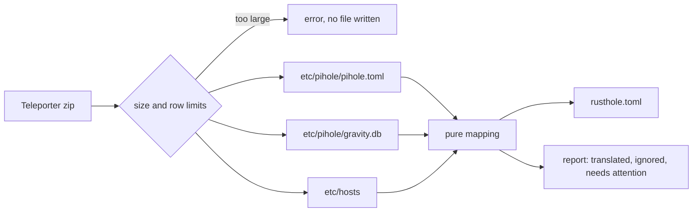

# Import from Pi-hole v6

`rusthole import` reads a Pi-hole v6 Teleporter export (a zip file) and writes a rusthole
config file.

```bash
rusthole import pi-hole-teleporter.zip -o rusthole.toml
rusthole check-config -c rusthole.toml
```

- The default output is `./rusthole.toml`. The command does not replace a file that exists.
  Use `--force` to replace it.
- The command writes the file atomically (temp file, flush, rename) with mode 0600 on Unix.
- The command prints a report with three sections: **Translated** (now in the config),
  **Ignored** (not needed, no action) and **Needs your attention** (not translated, or
  changed). Each item has one line.
- The import never copies or prints a password hash, a TOTP secret or an app password.
  Set a new admin password with `rusthole passwd`.



## Limits

A hostile zip cannot use all memory. The import refuses the file with a clear error when:

| Limit | Value |
|---|---|
| Entries in the zip | 1000 |
| Uncompressed size of one entry that the import reads | 256 MiB |
| Uncompressed size of all entries that the import reads | 512 MiB |
| Rows in one gravity.db table | 100000 |
| SQLite VM steps for all reads of gravity.db | 2000 million |
| Length of one SQLite value or row | 1 MiB |

The import counts the bytes that it really decompresses. It does not trust the sizes in the
zip headers. It opens `gravity.db` read-only from memory (no temp file; a WAL-mode file is
opened as a rollback-mode copy). The file is untrusted, so the import follows the SQLite
advice for such files: it sets low SQLite limits and the `DEFENSIVE` flag before it reads the
schema, turns off triggers, views and functions from the schema, and stops all reads after a
fixed number of VM steps. It accepts each table only when it is a plain table: a view, a
virtual table (for example `fts5`) or a table with a generated column is refused with an
error. A generated column can compute a very large value from a small file.

## Zip entries

| Entry | What the import does |
|---|---|
| `etc/pihole/pihole.toml` | Translated: see the key table. If it is missing, the settings keep the rusthole defaults (reported). |
| `etc/pihole/gravity.db` | Translated: see the table list. Required. |
| `etc/hosts` | Translated: each entry becomes a local A or AAAA record. Localhost, loopback, broadcast, multicast and `ip6-` entries are ignored. A name on `0.0.0.0` or `::` is a manual block in Pi-hole (dnsmasq serves this file): it is reported, not imported; add an exact deny rule for it. |
| `etc/pihole/pihole-FTL.db` | Ignored: the query history stays in Pi-hole. |
| `etc/pihole/dhcp.leases` | Ignored: DHCP is out of scope. |
| Each other entry | Ignored. |

## gravity.db tables

| Table | rusthole field | Notes |
|---|---|---|
| `group` | `[[groups]]` | Group id 0 (Default) becomes `default`, with its enabled flag and description. Each other name is changed to a valid rusthole name (lowercase; `a-z`, `0-9`, `-`, `_`, `.`). A changed or a duplicate name is reported. |
| `adlist` | `[[lists.adlists]]` | `id`, `address` -> `url`, `enabled`, `comment`. `type` 0 -> `kind = "block"`, 1 -> `kind = "allow"`. Another type, a URL that is not `http://` or `https://` (for example `file://`), or a duplicate is reported and not imported. |
| `adlist_by_group` | `lists.adlists[].groups` | Exact membership. A list with no group gets `groups = []` (reported): no client uses it, as in Pi-hole. |
| `domainlist` | `[[rules]]` | `type` 0 -> exact allow, 1 -> exact deny, 2 -> regex allow, 3 -> regex deny. An exact domain is normalized (lowercase, punycode). A regex must compile with the Rust `regex` crate (case-insensitive, size limit). A regex with a Pi-hole extension (`;querytype=`, `;invert`, `;reply=`), a regex that does not compile, a bad domain or an unknown type is reported and not imported. No row is dropped without a report line. |
| `domainlist_by_group` | `rules[].groups` | Exact membership. A rule with no group gets `groups = []` (reported). |
| `client` | `[[clients]]` | `ip` -> `id`: an IP address, a CIDR block, a MAC address (normalized to lowercase) or a host name. An IPv6 address that starts with `::` (for example `::1`) is an address. An interface (`:eth0`) is not supported and is reported. A duplicate client is reported. |
| `client_by_group` | `clients[].groups` | Exact membership. A client that is only in a non-default group stays only in that group. Thus, when that group has no list, the client is not blocked, as in Pi-hole. A client in no group gets `groups = []` (reported). |
| Link to an unknown group id | none | Reported. |
| `gravity`, `antigravity`, `info`, views, other tables | none | Ignored. rusthole downloads the lists itself. |

## pihole.toml keys

| Key | rusthole field, or what the import does | Why |
|---|---|---|
| `dns.upstreams` | `upstreams.servers` as `udp://IP:PORT` | Pi-hole forwards over plain UDP. `IP#port` becomes `IP:port`. An entry that is not an IP address is reported. An empty list keeps the rusthole defaults (reported). |
| `dns.hosts` | `local_dns.records` | Each `"IP name [name ...]"` gives one record per name. A bad line is reported. |
| `dns.cnameRecords` | `local_dns.cnames` | `"name[,name...],target[,ttl]"`. A bad entry is reported. |
| `dns.revServers` | `local_dns.conditional_forwarding` | `"active,CIDR,server[#port][,domain]"`. `active` -> `enabled`. A bad entry is reported. |
| `dns.blocking.active` | `blocking.enabled` | |
| `dns.blocking.mode` | `blocking.mode` | `NULL` -> `null`, `NXDOMAIN` -> `nxdomain`, `NODATA` -> `nodata`. `IP` and `IP-NODATA-AAAA` -> `ip` with the address from `dns.reply.blocking.IPv4` / `IPv6` when `force4` / `force6` is true. Without a fixed address, Pi-hole uses its interface address, which the export does not hold: rusthole then uses `null` (reported). A missing address family gives NODATA (reported). |
| `dns.reply.blocking.force4`, `IPv4`, `force6`, `IPv6` | `blocking.ipv4`, `blocking.ipv6` | Only for mode `IP` and `IP-NODATA-AAAA`. |
| `dns.blockTTL` | `blocking.blocked_ttl` | |
| `dns.CNAMEdeepInspect` | `blocking.deep_cname_check` | A value that is not true or false is reported. |
| `dns.specialDomains.mozillaCanary` | `blocking.special_domains` | `false` removes `use-application-dns.net`; `true` keeps it. |
| `dns.specialDomains.iCloudPrivateRelay` | `blocking.special_domains` | `false` removes `mask.icloud.com` and `mask-h2.icloud.com`; `true` keeps them. |
| `dns.rateLimit.count` | `rate_limit.queries` | |
| `dns.rateLimit.interval` | `rate_limit.interval_seconds` | 0 with a non-zero count is reported, and 60 s stays. |
| `dns.cache.size` | `cache.max_entries` | A value above 1000000 is reduced (reported). |
| `database.maxDBdays` | `stats.retention_days` | 0 turns the Pi-hole query database off: rusthole then sets `stats.flush_interval_seconds = 0` (RAM only) and keeps the default retention. |
| `database.DBinterval` | `stats.flush_interval_seconds` | Ignored when `maxDBdays = 0`, so that it does not turn the disk writes on again. |
| `webserver.session.timeout` | `admin.session_ttl_seconds` | 0 keeps the rusthole default (reported). |
| `dns.dnssec` | reported when true | rusthole v1 does not validate DNSSEC. It sets the DO bit and passes the upstream AD bit through. |
| `dns.interface` | reported when set | rusthole listens on `server.dns_listen`. |
| `dns.listeningMode` | reported when not `LOCAL` | rusthole answers loopback and local subnets (`acl.auto_local`) and `acl.allow`. |
| `dns.domainNeeded`, `dns.bogusPriv`, `dns.expandHosts` | reported when true | rusthole has no such option. |
| `misc.dnsmasq_lines` | reported (count only) | Custom dnsmasq lines need a manual translation. |
| `misc.etc_dnsmasq_d` | reported when true | The files in `/etc/dnsmasq.d` are not in the export. |
| `webserver.port` | reported | The admin UI uses `server.admin.port` (HTTPS, default 8443). |
| `webserver.headers` | reported when set | rusthole sets its own security headers. |
| `webserver.api.pwhash` | reported when set; never copied or printed | The Pi-hole hash is not Argon2id. Set a new password with `rusthole passwd`. |
| `webserver.api.totp_secret` | reported when set; never copied or printed | Set up TOTP again in rusthole. |
| `webserver.api.app_pwhash` | reported when set; never copied or printed | Make an API token in rusthole. |
| `dhcp.active` | reported when true | DHCP is out of scope. |
| Each other `dns.*` key | ignored, one line per key | Not used by rusthole. |
| Each other key in `dhcp`, `ntp`, `resolver`, `database`, `webserver`, `files`, `debug`, `misc` | ignored, one line per section with the key count | Not used by rusthole; the line says why. |

## Tests

- A synthetic export in the shape of a real home setup (2 groups, 9 lists with 1 disabled,
  5 exact allow, 20 exact deny, 9 regex deny, 13 clients with 2 only in the second group,
  4 upstreams, mode `NULL`, `dnssec = true`, a password hash) imports to an exact expected
  config and report.
- Property tests: each `domainlist` row ends up in the config or in the report; group
  membership stays exact; the output config is always valid; the SQLite and zip layer loses
  nothing.
- SQLite tests: a generated column, an `fts5` virtual table and a value above the length limit
  each give an error. A small step budget stops the read. The test schema has a view and a
  trigger, as a real file has, to prove that the limits accept a real schema.
- Fuzz targets: `teleporter_zip` (any bytes) and `pihole_toml` (any text).
- To write the synthetic export to a file:
  `cargo run -p rusthole-import --features testkit --example write_fixture -- fixture.zip`
- To write one valid seed for each fuzz target (CI does this before each fuzz run):
  `cargo run -p rusthole-import --features testkit --example write_fixture -- --seeds fuzz/corpus`
- Each report line escapes control characters (ESC becomes the text `\u{1b}`). A zip entry
  name or a TOML key from the export thus cannot send terminal escape sequences.
- Group membership property: the expected groups come from the gravity input, not from the
  mapper output. Each input group must reach the config (with its flags) or have a report
  line, and two groups never get one name.
