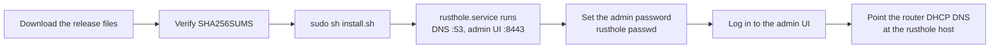

# Install rusthole

This page tells you how to install rusthole on a Linux host with systemd. Supported hosts:

- Ubuntu and Debian on x86_64 (amd64).
- Raspberry Pi OS 64-bit (or another aarch64 Linux) on a Raspberry Pi 3, 4 or 5.

rusthole is one static binary. The web UI is in the binary. The binary needs no other
library. A Raspberry Pi with a 32-bit OS cannot run it: install the 64-bit OS.



## 1. Download and verify

Each release on the [releases page](https://github.com/warchant/rusthole/releases) has these
files:

| File | Content |
|---|---|
| `rusthole-x86_64-linux-musl` | The binary for x86_64. |
| `rusthole-aarch64-linux-musl` | The binary for aarch64 (Raspberry Pi 64-bit). |
| `install.sh` | The install script. It also does upgrades. |
| `uninstall.sh` | The uninstall script. |
| `rusthole.service` | The systemd unit. |
| `rusthole.toml` | The default config. |
| `SHA256SUMS` | The SHA-256 checksum of each file above. |

1. Download all files into one empty folder. Replace `VERSION` with the release tag, for
   example `v0.0.1`:

   ```sh
   mkdir rusthole-release && cd rusthole-release
   base=https://github.com/warchant/rusthole/releases/download/VERSION
   for f in rusthole-x86_64-linux-musl rusthole-aarch64-linux-musl install.sh \
       uninstall.sh rusthole.service rusthole.toml SHA256SUMS; do
       curl -fLO "$base/$f"
   done
   ```

2. Verify the checksums. Each line must say `OK`:

   ```sh
   sha256sum -c SHA256SUMS
   ```

   Do not continue when a line says `FAILED`. Download the files again.

## 2. Install

Run the install script as root, in the folder with the release files:

```sh
sudo sh install.sh
```

The script does these steps. You can run it again: it does not change a config that
exists.

1. It finds the CPU type (`x86_64` or `aarch64`) and selects the binary. It stops on
   another CPU type.
2. It makes the system user `rusthole` (no login shell, no home directory).
3. It installs the binary to `/usr/local/bin/rusthole`.
4. It makes `/etc/rusthole` and `/var/lib/rusthole` (mode 0750, owner `rusthole`).
5. It writes the default config `/etc/rusthole/rusthole.toml` (mode 0600) only when no
   config exists. Then it checks the config.
6. It installs `/etc/systemd/system/rusthole.service`, enables it, and starts it.
7. It prints the admin URL, the TLS fingerprint and the next step.

Options:

| Option | Effect |
|---|---|
| `--binary PATH` | Use this binary. |
| `--import FILE` | Make the config from a Pi-hole v6 Teleporter export. See [section 4](#4-import-from-pi-hole). |
| `--disable-resolved-stub` | Turn off the systemd-resolved stub listener. See [section 5](#5-systemd-resolved). |
| `--no-start` | Install and enable the service, but do not start it. |

The default config listens on each IPv4 address of the host (`dns_listen = ["auto"]`), uses
two public upstream servers, and has one block list. [CONFIG.md](CONFIG.md) explains each
field.

### The systemd unit

The service runs as the user `rusthole`, not as root. Its only capability is
`CAP_NET_BIND_SERVICE` (it binds port 53). The unit makes the file system read-only for
the service, except `/etc/rusthole` and `/var/lib/rusthole`. The comments in
`rusthole.service` give each hardening option and why rusthole needs what it allows.
`systemd-analyze security rusthole` shows the exposure level of the unit.

The unit has `Type=notify`: `systemctl start rusthole` returns when all listeners are
bound. `systemctl stop rusthole` sends SIGTERM; rusthole gives the queries in flight
5 seconds, then stops.

## 3. First login

With no password, no login is possible. Set the password as the user `rusthole`:

```sh
sudo -u rusthole rusthole passwd -c /etc/rusthole/rusthole.toml
```

Run the command as the user `rusthole`, not as root. Reason: the command writes the
config file again. As root, the new file belongs to root with mode 0600. Then the service
(the user `rusthole`) cannot read its config, and rusthole does not start at the next
restart. `install.sh` prints the same command.

The command reads the password two times, with no echo. In a script, give the two lines on
stdin (never on the command line). The running service uses the new password at the next
login. A restart is not necessary.

Then open the admin UI: `https://<host address>:8443/`.

The certificate is self-signed (`tls.mode = "self-signed"`), so the browser shows a
warning. Before you accept it, compare the SHA-256 fingerprint in the browser with the
fingerprint that `install.sh` printed. You can also find it in the log:

```sh
journalctl -u rusthole | grep fingerprint
```

To use DNS over HTTPS, read [TLS.md](TLS.md) and [DOH.md](DOH.md) first: DoH clients need a
certificate that they trust.

Optional: turn on TOTP (a second login factor) with
`sudo -u rusthole rusthole passwd -c /etc/rusthole/rusthole.toml --totp`.

## 4. Import from Pi-hole

1. In Pi-hole v6, open **Settings > Teleporter** and click **Export**. You get a zip file.
2. Copy the zip file to the rusthole host.
3. Install with the import option:

   ```sh
   sudo sh install.sh --import pi-hole_teleporter.zip
   ```

The import works only when no config exists. When a config exists, the script stops. Move
the old config away first:

```sh
sudo mv /etc/rusthole/rusthole.toml /etc/rusthole/rusthole.toml.old
```

The import prints a report: what it translated, what it ignored, and what needs your
attention. The Pi-hole password is not imported. Set a new one (section 3).
[IMPORT.md](IMPORT.md) has the full mapping.

Stop Pi-hole before you start rusthole on the same host: both use port 53.

## 5. systemd-resolved

Ubuntu and Debian run `systemd-resolved`. It has a stub DNS listener on `127.0.0.53:53`.
rusthole binds each address on its own, so rusthole and the stub do not clash. Usually no
change is necessary: local programs on the host use the stub, and the stub uses the
upstream servers of the host.

Use `--disable-resolved-stub` only when a program must use port 53 on `127.0.0.53`, or
when you want to free that address:

```sh
sudo sh install.sh --disable-resolved-stub
```

The script then:

1. Writes `/etc/systemd/resolved.conf.d/rusthole.conf` with `DNSStubListener=no`, and
   restarts `systemd-resolved`.
2. Points `/etc/resolv.conf` at `/run/systemd/resolve/resolv.conf`. This file names the
   upstream servers of the host (from DHCP or netplan), not rusthole. Thus the host keeps
   working DNS when rusthole stops.

Consequences:

- Local programs on the host do not go through rusthole. They are not blocked.
- Programs that use the D-Bus API of systemd-resolved (for example `resolvectl`) still work.
- When `/etc/resolv.conf` is a file (not a link), the script does not change it. Make sure
  that it does not name `127.0.0.53`.
- `uninstall.sh` removes the drop-in and restores the old `/etc/resolv.conf` link.

To make the host itself use rusthole, write `nameserver 127.0.0.1` in `/etc/resolv.conf`
instead (see [DEPLOY.md](DEPLOY.md)). Then the host has no DNS when rusthole stops.

The script never changes systemd-resolved without this option.

## 6. Firewall ports

Open these ports for the LAN only. Do not open them to the internet.

| Port | Protocol | Use | Config |
|---|---|---|---|
| 53 | UDP and TCP | DNS | `server.dns_port` |
| 8443 | TCP | Admin UI and REST API (HTTPS) | `server.admin.port` |
| 443 | TCP | DNS over HTTPS (only when `server.doh.enabled = true`) | `server.doh.port` |

For example, with `ufw` and the LAN `192.0.2.0/24`:

```sh
sudo ufw allow from 192.0.2.0/24 to any port 53
sudo ufw allow from 192.0.2.0/24 to any port 8443 proto tcp
sudo ufw allow from 192.0.2.0/24 to any port 443 proto tcp   # only with DoH
```

rusthole also has its own client ACL: it answers only loopback and the local subnets
(and the networks in `acl.allow`).

## 7. Upgrade

1. Download and verify the new release (section 1).
2. Run the install script again:

   ```sh
   sudo sh install.sh
   ```

The script replaces the binary and the unit, keeps the config and the data, and restarts
the service. The steps:

1. The script checks the existing config with the new binary (from a temp path). When the
   new binary refuses the config, the script stops. The old binary and the running service
   stay as they are.
2. The script stops the service. Then it replaces the binary and sets the owner and the mode
   of `/etc/rusthole`, `/var/lib/rusthole` and the config. When a later step fails, the
   script starts the service again.
3. The script refuses a symbolic link at these paths. Reason: root changes the owner and the
   mode, and a link could point root at another file. `chown -h` is a second guard.
4. The script starts the service again (not with `--no-start`).

Read the release notes first: a new config version is changed by rusthole
itself at the start.

## 8. Uninstall

```sh
sudo sh uninstall.sh            # remove the service and the binary; keep config and data
sudo sh uninstall.sh --purge    # also remove /etc/rusthole, /var/lib/rusthole and the user
```

`--purge` also removes the TLS files and the local CA. When you used the local CA on your
devices, remove it there too ([TLS.md](TLS.md#remove-the-local-ca)).

## 9. Troubleshooting

First look at the status and the log:

```sh
systemctl status rusthole
journalctl -u rusthole -e
```

### Port 53 is in use

With `dns_listen = ["auto"]`, rusthole logs a WARN `cannot listen; retry at the next
interface scan` for each address that it cannot bind. When it can bind no address, the
service does not start. `install.sh` also prints a warning. Find the other program:

```sh
sudo ss -lunpt 'sport = :53'
```

- `systemd-resolved` on `127.0.0.53` or `127.0.0.54` is not a problem (section 5).
- `dnsmasq`, `pihole-FTL`, `named`, `unbound` or another DNS server on `0.0.0.0:53` or on a
  LAN address: stop it and disable it, for example `sudo systemctl disable --now dnsmasq`.
  Then `sudo systemctl restart rusthole`.
- `lxd` and `libvirt` start a `dnsmasq` on the address of their own bridge. `"auto"` tries
  that address too, and logs the WARN at each interface scan. To stop this, set
  `server.dns_listen` to the LAN address, for example `dns_listen = ["192.0.2.10"]`.

### Clients outside the LAN get no answer

This is by design. rusthole answers only loopback, the subnets of the local interfaces, and
the networks in `acl.allow`. Other UDP clients get no answer (so rusthole cannot be used for
a reflection attack). Other TCP clients get REFUSED. For a VPN network, add it:

```toml
[acl]
allow = ["192.0.2.0/24"]
```

### The clock of a Raspberry Pi

A Raspberry Pi has no real-time clock. After a boot it can have a wrong date until NTP sets
the clock. Effects:

- DoT and DoH upstreams need a valid clock (TLS). Until the clock is valid, rusthole uses
  `upstreams.fallback_plain`. With no fallback, it logs an ERROR and keeps trying. Add a
  plain fallback when you use only encrypted upstreams ([DOH.md](DOH.md#clock-fallback)).
- rusthole does not renew a certificate with a wrong clock ([TLS.md](TLS.md#time-and-the-clock)).
- NTP needs DNS. When the Pi uses rusthole as its own resolver and the clock is wrong, the
  plain fallback lets NTP find its servers.

Check the clock with `timedatectl`. `System clock synchronized: yes` means that NTP set it.

### The admin UI says "misdirected request"

The browser used a name that is not in the certificate or the config. Use the IP address of
the host, or add the name to `tls.names`.

## Build from source

Release builds use [cargo-zigbuild](https://github.com/rust-cross/cargo-zigbuild) for static
musl binaries, and bun for the web UI:

```sh
bash scripts/release-build.sh x86_64-unknown-linux-musl aarch64-unknown-linux-musl
```

The script builds `web/dist`, builds each binary, checks that it is static and that it holds
the built UI, and copies it to `target/release-out/rusthole-<arch>-linux-musl`.

The smoke test starts a binary on loopback addresses and checks DNS, blocking, a local
record, the login, the statistics, DoH, the UI and a clean stop:

```sh
bash scripts/smoke-test.sh target/release-out/rusthole-x86_64-linux-musl
```

CI runs it on each pull request. The release workflow (`.github/workflows/release.yml`)
runs on each `v*` tag: it builds both binaries, runs the smoke test, makes `SHA256SUMS`,
and creates the GitHub release.
