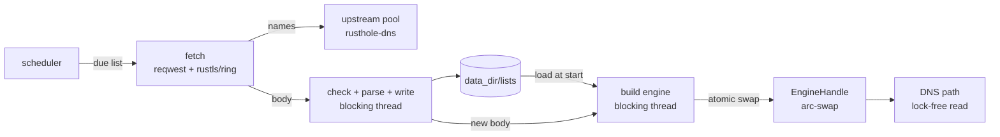
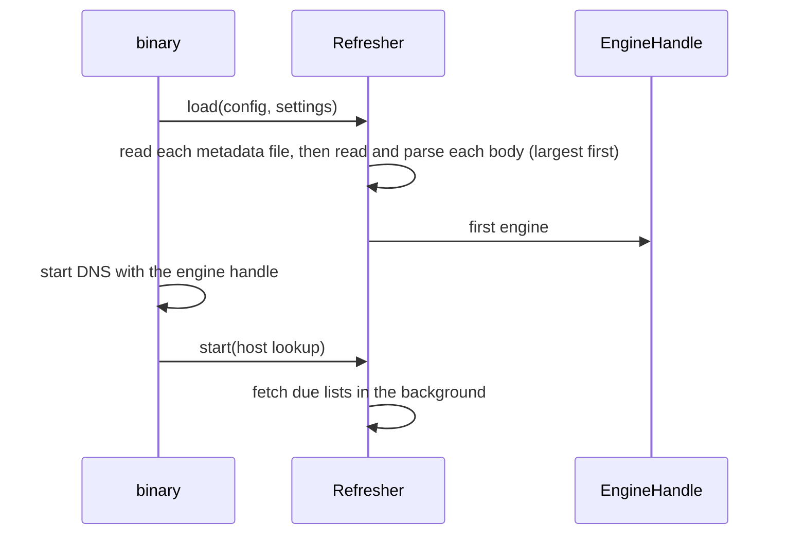
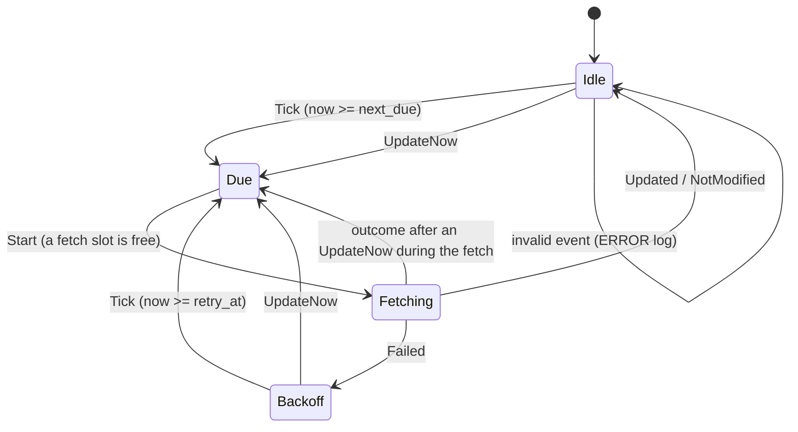
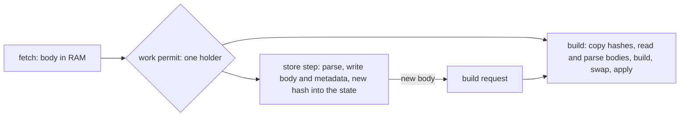

# List refresher

The list refresher keeps the adlists up to date (part P3b). It downloads each list on a
schedule, keeps a copy on disk, builds a new policy engine and swaps it into the DNS path.
The DNS path never waits for a build.

- Pure policy: `rusthole_core::refresh` (the refresh state machine, the schedule, the
  metadata file and its merge rules). It reads no clock.
- I/O shell: the crate `rusthole-lists` (download, disk cache, scheduler, builder, status).



## Start



1. `Refresher::load` reads the disk cache only. It needs no network. It builds the first
   engine from the cached lists and swaps it in.
2. The binary starts the DNS server with `Refresher::engine()`.
3. `Refresher::start(lookup)` starts the downloads. Production uses
   `DnsServer::host_resolver()` as the lookup (see "Name lookup").

`rusthole run` does these steps (part P5). The policy filter gets the shared cell of
`Refresher::engine()` (`EngineHandle::shared`). The admin API uses the same refresher for
the list status, "update now" and `set_config` after each config write. At the stop,
`Refresher::shutdown` runs with a time limit of 5 s.

A missing or corrupt cache file is a WARN, never a crash: the list is due at once and the
next fetch replaces the file.

## Refresh state machine

One machine for each enabled list. A disabled list has no machine.



- `Updated`, `NotModified` and `Failed` are the outcomes of one fetch.
- "Update now" in `Due` changes nothing. In `Fetching` it sets a flag: when the fetch ends,
  the list is due again. Thus a fetch always starts after the request (the URL can have
  changed during the fetch).
- Invalid events: an outcome when no fetch runs, a `Start` when the list is not due, and time
  that goes back. The machine logs the state and the event at ERROR and goes to `Idle` with
  the next scheduled time. This is the safe state: no fetch runs.
- Step bound: each event is one transition. From any state, at most 2 events (`UpdateNow`,
  then `Start`) start a fetch. The rank function is `steps_to_fetch` (2 for `Idle` and
  `Backoff`, 1 for `Due`, 0 for `Fetching`); each of these events lowers it by one. A
  property test proves the bound for any reachable state.

## Schedule

| Rule | Value |
|---|---|
| Interval | `lists.refresh_interval_hours` (1 to 168; 0 turns the schedule off). |
| Next due after a success | `now + interval + jitter`. |
| Jitter | `0 ..= min(interval / 10, 10 min)`, whole seconds, from a fixed hash of the list id. The same list always gets the same jitter, so tests are stable. |
| First due at start | No copy on disk: at once. A copy: `interval + jitter` after the last success, but the wait is never more than `interval + jitter` (the wall clock can be wrong after boot on a Pi with no real-time clock). |
| Backoff after a failure | 60 s, doubled for each next failure, capped at the interval. |
| `refresh_interval_hours = 0` | No automatic refresh. "Update now" works. A list with no copy is fetched once at start. A failed fetch retries with backoff (cap 6 h) until one fetch works. |
| Fetches at the same time | At most 3 (setting `max_concurrent`, 1 to 4). One fetch at a time for each list. The limit counts each fetch task that runs, also a fetch of a list that was disabled, removed or given a new URL during the fetch. |
| Scheduler wake-up | At the next due time, after each fetch, after "update now", and at least every 60 s. |

## Download limits (amendment A8)

| Limit | Value |
|---|---|
| Schemes | `http` and `https` only, also for each redirect. |
| Redirects | At most 3. The fourth one is an error. |
| Connect timeout | 15 s |
| Read timeout | 30 s |
| Total timeout | 180 s for one fetch, with the body. |
| Body size | 64 MiB after decompression (`DEFAULT_MAX_BODY`). The body is read in chunks and counted, so a gzip bomb stops at the limit. A `Content-Length` above the limit stops the fetch at once. |
| Decompression | gzip and deflate. |
| Conditional GET | `If-None-Match` (ETag) and `If-Modified-Since` (Last-Modified), only when a good body is on disk. |
| Proxy | None. Proxy variables in the environment are not used. |
| TLS | rustls with the ring provider from `rusthole-tls` (system roots, then the bundled Mozilla roots). HTTP/1.1 only. |
| Name lookup | rusthole's own upstream pool (see below), 15 s time limit. |
| Parse | The limits of `rusthole_core::lists` (4 000 000 entries, 4096 bytes for each line). A list over a limit is a failure; the old copy stays. |
| Stored header values | An ETag or Last-Modified value longer than 512 bytes, or with control characters, is not kept. |
| Stored error text | At most 300 bytes. |

## Name lookup

Downloads do not use the system resolver. A host whose `/etc/resolv.conf` points at
rusthole itself must still fetch its lists at start. `rusthole_dns::HostResolver` (from
`DnsServer::host_resolver()`) asks the upstream pool for A records only (amendment A11). The
lookup does not pass the client ACL, the filter or the DNS cache. A URL with an IP address
needs no lookup.

## Disk layout

```text
<data_dir>/lists/
    <list-id>.txt     the raw body (after decompression)
    <list-id>.json    the metadata
```

Metadata fields (`ListMeta`, format version 1):

| Field | Meaning |
|---|---|
| `version` | 1 |
| `url` | The URL that gave the body. A cache for another URL is not used. |
| `etag`, `last_modified` | The validators for the conditional GET. |
| `body_hash` | SHA-256 of the body file (lowercase hex). |
| `size_bytes` | Size of the body file. |
| `entries` | `valid`, `invalid` and `skipped` counts of the body. |
| `last_success` | The last success: a new body, the same body, or "not modified" (Unix seconds). |
| `last_attempt` | The last try (Unix seconds). |
| `changed_at` | When the body last changed (Unix seconds). |
| `last_error` | The error of the last try, or `null`. |

Write rules (decision D5, less SD card wear):

- Each write is atomic: a temp file in the same directory, write, fsync, rename, and an fsync
  of the directory (Unix).
- A new body: the refresher parses it first. Only a usable body replaces the old file. Then
  it writes the metadata.
- The same body again (same hash, for example a server with no ETag): no body write.
- "Not modified", the same body or a failure: the refresher writes the metadata only when a
  field changed. The times are fields, so a later success writes the small metadata file.
  A second "not modified" with the same time writes nothing. A failure with the same error
  text and the same time writes nothing.
- Each build reads the body files again and checks the hash. A body that does not match its
  hash (a crash between the body write and the metadata write, or a damaged file) is not
  used. The list is then fetched again with no conditional headers.
- The refresher never deletes a cache file. `DiskCache::remove(id)` is for the API
  (`DELETE /lists/{id}`).

## Concurrency rules



- **Time.** The shell reads the monotonic time after it gets the state lock. Thus the
  machine of a list gets its events in time order, also when two threads step it.
- **Running fetches.** The state has a map of the running fetches (list id and fetch
  number). A list in the map does not start a second fetch. The global limit counts the map.
  A fetch stays in the map until its task ends. When the list is disabled, removed or gets a
  new URL during the fetch, the fetch is "not live": its result writes no file and does not
  change the machine. A list that is enabled again starts its next fetch after the old one
  ends. The shell checks "live" just before each write. A config change during the write
  itself (some milliseconds) can still leave the files of that one fetch on disk; the state
  then gets the facts of these files, and the machine does not change.
- **Work permit.** One permit (a semaphore with one permit) for the heavy blocking work:
  the store step of a new body (parse, write) and the build (read, parse, build, swap). At
  most one parse or build runs at a time.
  - The store step puts the new hash in the state before it gives back the permit. The build
    copies the hashes after it gets the permit. Thus a build never reads a body that does
    not agree with its copied hash, and a list never leaves the engine because of a fetch
    during a build.
  - The blocking thread holds the permit until it ends, also after its async caller timed
    out. A build that took too long still blocks the next build until it stops. `building`
    stays true until the build thread ends.
  - Wait limits for the permit: a build waits at most its build limit (10 min). A store step
    waits at most the build limit plus 5 min, and then counts as a failed fetch (no file
    changes).
  - A "not modified" answer and a failed fetch write only the small metadata file. They do
    not take the permit.
- A body that waits for the permit stays in RAM. Thus at most `max_concurrent` bodies (each
  at most 64 MiB) can be in RAM at the same time.

## Engine build and swap

- One build at a time, on a blocking thread (`spawn_blocking`), with the work permit. A
  request that comes during a build gives one more build after it (a `Notify` keeps one
  permit, so many requests give one build).
- A build reads and parses one list at a time from disk, largest first, and drops the text
  before the next list. It does not keep parsed lists in RAM between builds.
- Each build gets a new hash seed from the OS random source (`getrandom`), the defence
  against hash flooding of docs/POLICY.md. If the OS source fails, the build uses
  `PolicyEngine::build` (a random seed from the standard library). A fixed seed is never
  used outside tests.
- The swap is one atomic store (`arc-swap`). The old engine is freed on the blocking
  thread when the last query that holds it ends. A `GroupSet` is valid for one engine only:
  make it from the engine of the same `EngineHandle::load()`.
- The DNS path reads with `EngineHandle::load()`: no lock, no wait.
- A "not modified" answer or the same body does not start a build.
- A build checks the cancel token between lists and before the swap. After a shutdown or
  after its time limit (10 min), a build never swaps.

## Status (for the API)

`Refresher::status()` gives, for each list: `id`, `url`, `kind`, `enabled`, `groups`,
`state` (`never`, `updating`, `ok`, `error`), `phase` (the machine state), `failures`,
`last_update` (the last try), `last_success`, `last_error`, `entries` (`valid`, `invalid`,
`skipped`), `size_bytes`, `next_due` and `in_engine`. It also gives the schedule
(`interval_hours`, `next_run`, `running`) and the engine (`generation`, `building`,
`last_build`, `unique_domains`, `entries`, `memory_bytes`, `issues`).

- `state` is `updating` while the list is due or a fetch runs, else `error` when the last try
  failed, else `ok` after a success, else `never`.
- `update_now(UpdateTarget::One(id) | UpdateTarget::All)` returns at once with the number of
  lists. An unknown or disabled list is an error.
- `set_config(config)` applies added and removed lists, URL, kind, group, enabled and
  interval changes, and asks for a build. A new URL is fetched again.

## Tasks and shutdown

| Task | Stops on |
|---|---|
| Builder (service loop) | the cancel token |
| Scheduler (service loop) | the cancel token |
| One task for each running fetch | the cancel token |

`Refresher::shutdown(deadline)` cancels all tasks and waits at most `deadline`. A build on a
blocking thread cannot stop at once: it stops at the next list and never swaps after the
cancel. Dropping the `Refresher` also cancels all tasks. Each lock has a time limit (2 s),
and each blocking step has a time limit (metadata load 60 s, store step 5 min, build 10 min).
A store step whose time limit passes counts as a failed fetch, and the body is checked again
with the next fetch. Its blocking thread keeps the work permit until it ends, and its late
result is not used (the fetch number does not match).

## Measured peak memory

The test `crates/rusthole-lists/tests/swap_memory.rs` counts every heap byte with a counting
allocator. It serves a synthetic hosts-format list (`0.0.0.0 <name>`, names of about 25
characters) from a local HTTP server, lets the refresher load it, then serves a second
version (5 % of the names changed) and measures one full refresh: fetch, check, parse, write,
build and swap, with the old engine in use the whole time.

Run: `cargo test --release -p rusthole-lists --test swap_memory -- --include-ignored --nocapture --test-threads 1`.

Results on x86_64 (Windows 11 host, release build, 2026-11-18):

| Names | List text | Heap before | Peak during refresh | At the swap (old + new engine) | Heap after |
|---|---|---|---|---|---|
| 100 000 | 3.1 MB | 4.3 MB | 12.9 MB | 8.6 MB | 4.3 MB |
| 1 000 000 | 31.5 MB | 41.0 MB | 128.6 MB | 81.9 MB | 41.0 MB |
| 3 lists of 33 334 (one "update now" for all) | 3.1 MB | 4.4 MB | 9.9 MB | 8.7 MB | 4.4 MB |
| 3 lists of 333 334 (one "update now" for all) | 31.8 MB | 41.3 MB | 96.6 MB | 82.5 MB | 41.3 MB |
| 3 lists of 1 000 000 (one "update now" for all) | 96.6 MB | 116.4 MB | 287.9 MB | 232.9 MB | 116.5 MB |

- The rows with 3 lists (tests `three_lists_at_once_100k`, `three_lists_at_once_1m` and
  `three_lists_at_once_3m`) measure 3 lists that change at the same time. The work permit
  lets one parse or build run at a time. Thus the peak is about old engine + new engine +
  the parse of one list (the largest), not the parse of all lists at the same time: for
  3 x 1 000 000 names, 116 + 116 + about 56 MB.
- Bodies that wait for the permit also stay in RAM (at most `max_concurrent` bodies, each at
  most 64 MiB). A body that waits during a build adds its size to the build peak. Streaming
  each body to a file in the cache directory (not done) would remove this part.
- The peak for 1 000 000 names is **above** the 64 MB of amendment A10. Old engine (41 MB) +
  new engine (41 MB) alone is 82 MB at the swap.
- The highest point is in the parse, before the swap: the body text (31.5 MB), the entry
  buffer of the parse (31.5 MB, its capacity is the text size) and the copy that
  `lists::parse` makes when it shrinks that buffer at the end (`shrink_to_fit`), plus the old
  engine. The fetch step and the build step both parse the body, so both reach about this
  point.
- The heap after the refresh equals the heap before it: the old engine is freed after the
  swap. The fast test (100 000 names, not ignored) asserts this.
- The numbers count heap bytes that the program asked for. They do not include allocator
  overhead or the binary. D6 asks for RSS on aarch64; that measurement is part P8.
- The counting allocator (`peak_alloc`) does each `realloc` as a new block, a copy and a
  free, so it counts the old and the new block of a shrink together. A real allocator can
  shrink a block in place. Thus a part of the 128.6 MB peak can be an effect of the counter.
  The value at the swap (82 MB, old + new engine) has no realloc and is above the target in
  any case.
- Possible changes to lower the peak (not done, they change `rusthole_core::lists`, part
  P3a): a parse that reads the text in parts, or a first capacity estimate below the text
  size so that no shrink copy is needed. Either one can remove up to about 30 MB from the
  peak for 1 000 000 names.

## Tests

- Unit tests and property tests for the machine and the schedule (`rusthole-core`,
  `refresh::tests`): any event sequence keeps a valid state and an invalid event gives
  `Idle`; the backoff grows and caps; "update now" always leads to a fetch that starts after
  the request; the step bound (rank function); the next due time is in the future and within
  the interval plus the jitter; the first due time is bounded for any wall clock; the
  metadata round trip and `parse_meta` never panics.
- Fetch tests (`tests/fetch.rs`, local HTTP server on 127.0.0.1): conditional GET, 304 with
  no conditional request, HTTP errors, bad schemes, the exact redirect limit (3 work, 4 do
  not, no redirect to `ftp`), the exact body limit with and without `Content-Length`, gzip
  decode and a gzip bomb, a silent server (timeout), name lookup through the given lookup and
  a failed lookup, and HTTPS with a self-signed certificate from `rusthole-tls`.
- Refresher tests (`tests/refresher.rs`): 200 then 304 (no body write, metadata unchanged at
  the same time, only the metadata at a later time, no rebuild), the same body with no ETag,
  a server error (backoff, old copy stays), corrupt cache files (refetch, no conditional
  request), start from the disk cache with the network down, a fresh cache that is not
  fetched at start, a body that fails to parse (old copy stays), "update now" targets, the
  global fetch limit, shutdown during a fetch, `set_config`, the swap test (queries get the
  old engine during a slow build, a newly blocked name is blocked after the swap,
  four requests during a build give two builds), and shutdown during a build (no swap).
  Concurrency tests: a fetch of a disabled list still counts for the limit, a list never has
  two fetches, the result of a fetch of a changed or removed list is not used (no file), a
  body that a fetch stores during a build keeps the list in the engine, a build waits until a
  stored body is in the state, and a build that took too long blocks the next build.
- Unit test (`refresher::tests`): an "update now" that waits for the lock does not lose
  against a step that another thread did during the wait.
- DNS test (`rusthole-dns/tests/e2e.rs`): `HostResolver` uses the upstream pool, does not fill
  the cache, reports an error code, and fails (no hang) after the server stops.
- Fuzz target `list_meta`: any bytes through `parse_meta`; a parsed value renders and parses
  to the same value.

### Manual fault injection

Each fault was put in by hand, the tests ran, and the fault was removed (not committed).

| Fault | Tests that failed |
|---|---|
| Body limit: `>` became `>=` in the chunk loop | `body_limit_is_exact_with_content_length`, `body_limit_is_exact_without_content_length` |
| Body limit: no check in the chunk loop | `body_limit_is_exact_without_content_length`, `gzip_is_decoded_and_a_gzip_bomb_is_rejected` |
| Body limit: `Content-Length` check `>` became `>=` | `body_limit_is_exact_with_content_length` |
| Body limit one byte too high | `body_limit_is_exact_with_content_length`, `body_limit_is_exact_without_content_length`, `gzip_is_decoded_and_a_gzip_bomb_is_rejected` |
| Swap: no swap | 7 refresher tests, for example `queries_use_the_old_engine_during_a_slow_build`, `start_from_disk_with_the_network_down` |
| Swap: the old engine is kept alive | `refresh_frees_the_old_engine_100k` |
| Swap: no cancel check after the hook (swap after shutdown) | `shutdown_during_a_build_never_swaps` |
| Build: no body hash check | `corrupt_cache_files_give_a_refetch` |
| Build: one build for each request (no coalescing) | `queries_use_the_old_engine_during_a_slow_build` |
| Machine: no backoff cap | `failures_back_off_and_cap_at_the_interval`, `manual_mode_has_no_schedule`, `backoff_grows_and_caps` |
| Machine: "update now" ignored during a fetch | `update_now_during_a_fetch_fetches_again`, `update_now_always_leads_to_a_fetch` |
| Machine: an invalid event keeps the state | `invalid_events_go_to_idle`, `any_sequence_keeps_valid_state` |
| Schedule: jitter one second above the maximum | `next_due_is_in_the_future` |
| Schedule: a wall clock that is behind changes the wait | `initial_due_follows_the_last_success` |
| Time: the shell reads the time before it gets the state lock | `update_now_reads_the_time_after_the_lock` |
| Fetches: no check for a running fetch of the same list | `a_list_never_has_two_fetches` |
| Fetches: a disabled list leaves the map of running fetches | `a_fetch_of_a_disabled_list_still_counts`, `a_list_never_has_two_fetches` |
| Fetches: the result of a fetch that is not live is used | `a_fetch_of_a_changed_list_is_not_used` |
| Work permit: the store step takes no permit | `a_body_stored_during_a_build_keeps_the_list_in_the_engine`, `a_build_waits_until_a_stored_body_is_in_the_state` |
| Work permit: the store step gives back the permit before the new hash is in the state | `a_build_waits_until_a_stored_body_is_in_the_state` |
| Work permit: the build thread gives back the permit at its start | `a_build_that_took_too_long_blocks_the_next_build`, `a_body_stored_during_a_build_keeps_the_list_in_the_engine` |
| Body limit: the chunk check ignores the size of the new chunk | `body_limit_is_exact_without_content_length` |
| Swap: no swap (second run, after the concurrency changes) | 11 of 20 refresher tests |
| Swap: no cancel check after the hook (second run) | `shutdown_during_a_build_never_swaps`, `a_build_that_took_too_long_blocks_the_next_build` |

## Interpretations

These choices are not fixed by the P3b spec. The owner can change them.

| Topic | Choice |
|---|---|
| `refresh_interval_hours = 0` | No schedule. A list with no copy is fetched once at start; a failed fetch retries with backoff (cap 6 h). |
| "Update now" during a fetch | The list is fetched again after the running fetch. |
| Metadata write after "not modified" | Written when a field changed. The success time is a field, so each later success writes the small file (once a day for each list with the default interval). |
| Same body with a 200 answer | Counts as "not modified": no body write, no build. |
| A disabled list | No machine, no fetch. Its cache files stay. |
| A list that is disabled, removed or given a new URL during its fetch | The fetch runs to its end and counts for the limits. Its result is not used and writes no file. A list that is enabled again (or has the new URL) is fetched after the old fetch ends. |
| A list with no good copy | Not in the engine. The status entries are 0. |
| HTTP version | HTTP/1.1 only (no HTTP/2 code in the binary). |
