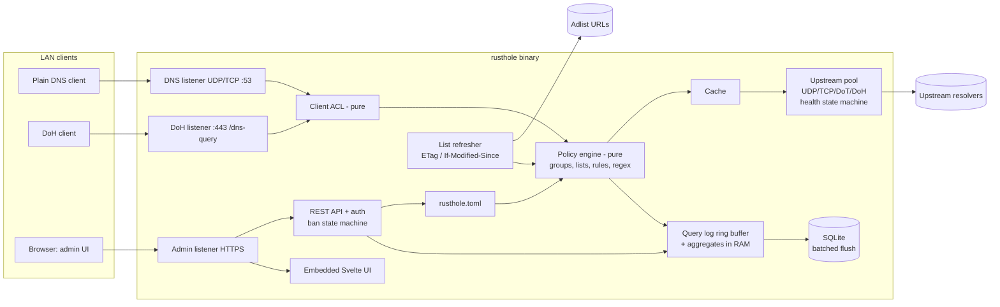
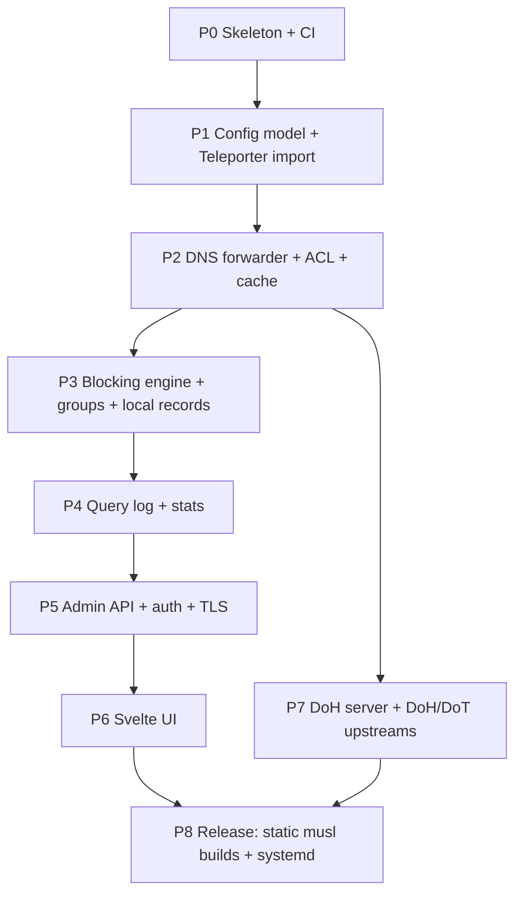
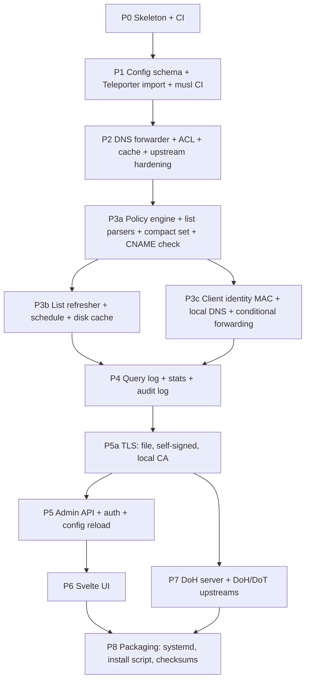

# rusthole: plan

Status: APPROVED on 2026-11-17. The owner said "yes" to D1–D17. Section 8 amends the plan
after an independent review; where section 8 and the earlier sections differ, section 8 wins.
The part split in section 8 replaces the split in section 4.

Repo: GitHub org `warchant`. License: MIT OR Apache-2.0.

## 1. Goal

rusthole is a DNS ad blocker for a home or small office network.

- It replaces a running Pi-hole. It imports a Pi-hole v6 Teleporter export.
- It is safer than Pi-hole. It is one static binary, it has no unsafe code in our crates,
  and every admin endpoint needs a login.
- It is a base for the owner's custom features. The owner defines these later.

It is not a line-by-line Pi-hole rewrite.

## 2. Facts from the sample export (Pi-hole v6 Teleporter)

| Item | Value | Effect on the plan |
|---|---|---|
| Files | `pihole.toml`, `gravity.db`, `pihole-FTL.db`, `etc/hosts`, `dhcp.leases` | Import reads the first four. DHCP is out of scope. |
| Adlists | 9 URLs (1 disabled), about 370k entries | `gravity.db` has the URLs only. rusthole downloads the lists itself. |
| Domain rules | 5 exact allow, 20 exact deny, 9 regex deny | Regex uses no Pi-hole extensions. All fit the Rust `regex` crate. |
| Groups | 2 groups | Groups are needed for parity. |
| Clients | 13 clients. 12 by MAC address, 1 by IP. | rusthole must find a client's MAC from the neighbor table. |
| Client groups | 2 clients are only in the second group. That group has no adlists. | These clients are not blocked. The import must keep this. |
| Upstreams | 4 plain DNS servers | Forwarding mode. |
| Blocking mode | `NULL` (answer `0.0.0.0` / `::`) | Default reply mode. |
| `dnssec` | `true` | See decision D12. |
| Password | `pwhash` (not Argon2id) | Cannot import. See decision D10. |

The sample stays out of the repo. Tests use synthetic fixtures only.

## 3. Architecture

### Crates (Cargo workspace)

| Crate | Content | I/O |
|---|---|---|
| `rusthole-core` | Config model, policy engine, ACL, list parsers, regex translation, cache policy, state machines (ban, upstream health, list refresh) | None. Pure functions. `now` is an input. |
| `rusthole-import` | Pi-hole v6 Teleporter reader | Reads a zip and SQLite. |
| `rusthole-dns` | Listeners, upstream clients, request pipeline | Sockets. |
| `rusthole-store` | Query log, stats, SQLite flush | SQLite. |
| `rusthole-web` | REST API, auth, TLS, embedded UI | HTTP. |
| `rusthole` (bin) | CLI, wiring, signals, systemd notify | Process. |
| `web/` | Svelte + Vite UI | Node at build time only. |
| `fuzz/` | cargo-fuzz targets | None. |

## 4. Parts

Each part is one branch and one pull request. Each part can be reviewed, shipped and
reverted alone.

| Part | Content | Done when |
|---|---|---|
| P0 | Workspace, lints (`unsafe_code = "forbid"`, clippy pedantic), rustfmt, cargo-deny, CI (fmt, clippy, test, deny), proptest and cargo-fuzz setup | CI is green on an empty workspace. |
| P1 | `rusthole.toml` schema and validation. `rusthole import teleporter.zip` writes a `rusthole.toml`. It reports each item it cannot translate. | Import of a synthetic v6 export gives the expected TOML. Proptest: config serialize then parse gives the same value. Fuzz: config parser, import reader. |
| P2 | UDP/TCP listeners, client ACL (local subnets), upstream pool (UDP/TCP) with health state machine and failover, cache (positive and negative), per-client rate limit | `dig @rusthole` works on Linux. Off-net clients get REFUSED. Fuzz: request handler. |
| P3 | List download and parse (hosts, domain-only, ABP `\|\|x^`), exact and regex rules, groups, clients by IP/CIDR/MAC, reply modes, local A/AAAA/CNAME records, `/etc/hosts` import, conditional forwarding | Sample-shaped fixture blocks and allows the same as Pi-hole. Proptest: allow beats deny; group membership. Fuzz: list parser, regex translation. |
| P4 | Query log ring buffer, per-client and per-domain counters, batched SQLite flush, retention | No disk write between flushes. Proptest: counters equal the log. |
| P5 | REST API, Argon2id login, optional TOTP, API tokens, login ban state machine, CSRF, Host-header check, security headers, TLS (file or self-signed) | No route works without a session except login and static assets (test lists all routes). Ban bound test. |
| P6 | Svelte UI: dashboard, query log, lists, rules, groups, clients, settings | UI builds into the binary. Main flows work in a browser. |
| P7 | DoH server (RFC 8484, GET and POST), DoH and DoT upstreams | `curl` and Firefox DoH work. Fuzz: DoH request decode. |
| P8 | x86_64 and aarch64 musl static builds, systemd unit, install script | Binary runs on Ubuntu x86_64 and Raspberry Pi OS 64-bit. |

## 5. Decisions (all approved)

| ID | Decision | Approved rule |
|---|---|---|
| D1 | "No unsafe" scope | `unsafe_code = "forbid"` in all our crates. Dependencies (tokio, rusqlite, ring) contain unsafe code, and SQLite and ring contain C. cargo-deny checks advisories, licenses and sources. |
| D2 | "Single TOML" scope | `rusthole.toml` holds all settings, adlist URLs, rules, groups and clients. A data directory holds downloaded lists, the query DB and the self-signed cert. The UI edits the TOML with `toml_edit` (comments stay) and writes it atomically (temp file, fsync, rename). |
| D3 | Groups and clients | Full parity: groups; clients by IP, CIDR or MAC; lists and rules attach to groups. MAC comes from the kernel neighbor table (IPv4 and IPv6). |
| D4 | Regex engine | Rust `regex` crate: linear time, so no ReDoS. Match is case-insensitive. The import reports Pi-hole extensions (`;querytype=`, `;invert`, `;reply=`). Support for them comes later. |
| D5 | SD-card wear | Query log and counters live in RAM. Flush to SQLite in one batch every 60 s (configurable; 0 = RAM only). WAL mode, `synchronous=NORMAL`. A crash loses up to 60 s of log. Lists are refetched only when changed (ETag / If-Modified-Since). The compiled block set lives in RAM only. |
| D6 | Memory target | Target: 1M blocked domains in less than 64 MB RSS on aarch64. Measure in P3. |
| D7 | Client ACL | Default allow: loopback, plus each subnet on a local interface (IPv4 and IPv6). Rescan when interfaces change. Extra CIDRs in config. Other clients get REFUSED. The ACL also applies to DoH and to the admin UI. |
| D8 | Listeners | Three listeners: DNS (53 UDP/TCP), DoH (443, `/dns-query`), admin (8443 HTTPS). Each can be turned off or moved in config. |
| D9 | Web security | Only login and static assets work without a session. Cookies: `Secure`, `HttpOnly`, `SameSite=Strict`. CSRF token on each write. Host-header check (DNS rebinding). Strict CSP. |
| D10 | Auth | One admin. Argon2id hash in the TOML. Optional TOTP. Hashed API tokens. Login ban per IPv4 address and per IPv6 /64, with exponential backoff and a bounded (LRU) map. The Pi-hole password is not imported: you set a new one with `rusthole passwd`. |
| D11 | DNS stack | tokio. `hickory-proto` for the wire format. Our own handler and upstream pool. |
| D12 | DNSSEC | v1: send the DO bit, pass the upstream AD bit through (trust the upstream). Local validation is a later part. |
| D13 | Local DNS | Local A/AAAA/CNAME records, `/etc/hosts` import, conditional forwarding (reverse lookup for client names). All in P3. |
| D14 | UI build | `cargo build` does not run Node. `rust-embed` embeds `web/dist`. If `web/dist` is missing, a placeholder page is embedded, so a Rust-only build still works. CI builds the UI before the release build. |
| D15 | Release | `cargo-zigbuild` for x86_64 and aarch64 musl. systemd unit runs as a non-root user with `AmbientCapabilities=CAP_NET_BIND_SERVICE`. |
| D16 | Tests and fuzzing | proptest in `rusthole-core` and `rusthole-import`. cargo-fuzz targets on nightly in WSL or Linux CI (cargo-fuzz works badly on Windows MSVC). |
| D17 | Engineering rules | Pure core with `now` as input. Monotonic clock for durations. Timeout on each wait. State machines log invalid transitions at ERROR and go to a safe state. Bounded loops with a rank-function test. Cleanup on all exit paths. Manual fault injection for safety-critical logic. |

## 6. Resolved and open questions

Resolved:

1. Repo: GitHub org `warchant`, license MIT OR Apache-2.0.
2. DoH is for the LAN and VPN only. The D7 ACL applies to DoH. No open DoH path.
3. Regex match is case-insensitive (part of D4).

Open:

1. Custom features: the owner defines them later. The policy engine stays open for them.

## 7. Assumptions

- Target OS is Linux only. Windows builds are for development only.
- The DNS listener runs on a host with a fixed LAN address.
- No DHCP server.
- No full recursive resolver. Forwarding only.

## 8. Review amendments (DECIDED 2026-11-17)

An independent review (Fable 5.2, 2026-11-17) found no blocker. These amendments come from it.

Owner answers:

- A1: owner has no preference. Decision: use `ring` (easier static musl build).
- A2, A3, A5, A6, A7, A8: yes.
- A4: owner said "do all kinds of security hardenings". Decision: yes (CNAME cloaking is a
  tracking bypass).
- A9: yes to blocking toggle with timer, list management, statistics and audit log.
  No to offline start and config reload. The disk cache of lists (P3b) still loads at start.
- A9 statistics focus (owner): which domains each client resolves (grouped), how many times,
  and when (histograms by hour of day). A raw query table is less important: keep only a
  small recent-query ring buffer in RAM.
- A10: owner said "do everything". Decision: use the new split below.

| ID | Amendment | Source |
|---|---|---|
| A1 | Pin the TLS crypto provider to `ring`: `default-features = false` + `ring` for rustls, tokio-rustls, hyper-rustls, rcgen; `rustls-no-provider` for reqwest. Ban `aws-lc-sys` and `aws-lc-rs` in `deny.toml`. | M3 |
| A2 | Prove the static build early: from P1, CI builds `x86_64-unknown-linux-musl` and `aarch64-unknown-linux-musl` with `cargo-zigbuild` and checks that the binary is static. P8 keeps only packaging. | M4 |
| A3 | A blocked name is blocked for all query types: NULL mode gives `0.0.0.0`/`::` for A/AAAA and NODATA for other types (HTTPS/SVCB too). ANY gets an RFC 8482 answer. A "special domains" list, on by default: Firefox DoH canary (`use-application-dns.net` → NXDOMAIN), iCloud Private Relay (`mask.icloud.com`, `mask-h2.icloud.com` → NXDOMAIN). | M2 |
| A4 | Deep CNAME check: after the upstream answer, each CNAME target goes through the client's policy. The cache holds the unfiltered answer; the policy runs on every reply. | M1 |
| A5 | Upstream hardening in P2: random source port and CSPRNG ID per query; accept only from the upstream address with the same ID and question; TCP retry on TC; EDNS size 1232; obey the client UDP size and set TC; cache key holds qname, qtype, qclass and DO bit; TTL clamp; bound on in-flight queries. Listeners bind one UDP and one TCP socket per local address (not the wildcard), and rebind on interface change. Docs and the install script handle the systemd-resolved stub on port 53. | M5, M6 |
| A6 | DoH rules: DoH clients need a trusted certificate (a file, or a local CA that rusthole makes and you install on devices). The self-signed fallback is for the admin UI only. The DoH server uses HTTP/2 with ALPN, and has limits on body size, GET length, header time, connections and streams. Each DoH/DoT upstream has bootstrap IP addresses. When the clock is wrong after boot (no RTC on a Pi), a configured plain-DNS fallback is used until the clock is valid. | M9 |
| A7 | Secrets and first run: `rusthole.toml` and the TLS key are written with mode 0600; rusthole warns when they can be read by others. The API never returns secrets. With no password set, all logins fail; you set the password with `rusthole passwd` only. A semaphore limits parallel Argon2 checks. TOTP and API-token failures count in the ban machine. A TOTP code cannot be used twice. The UI does not overwrite a config file that changed on disk since it was read. | M11 |
| A8 | Engineering hardening: lints `indexing_slicing`, `string_slice`, `unreachable`; `Instant::now`/`SystemTime::now` are not allowed in `rusthole-core`; CI checks that `rusthole-core` has no tokio. Pinned nightly for fuzz; no `-D warnings` on the fuzz job; cargo-deny also checks `fuzz/Cargo.lock`. Off-net UDP clients get no REFUSED answer (drop, no reflection). Warning when a local subnet is not private. List fetch limits (size, time, decompression, http/https only). Regex size limit. IDN names are changed to punycode at the input edge. TLS roots: system roots, then bundled `webpki-roots`. | m3–m6, m8–m10 |
| A9 | Pi-hole features added to scope: enable or disable blocking with a timer (a state machine); list refresh schedule, "update now" and status per list; "which list blocks this domain" search (scan of list files on disk); subscribed allow lists and regex allow rules; statistics (queries over time, query types, upstream share, top domains, top blocked, top clients); audit log of admin actions; start with list files on disk when the network is down; config reload without restart (a bad config keeps the old one). | M12 |
| A10 | New part split (see below). P1 adds `config_version` and a key-by-key import mapping table (translated, ignored, reported). Client identity uses a `NeighborTable` trait: the pure core gets a snapshot; a bounded cache refreshes on a period; no lookup on the hot path; an unknown MAC uses the default group; IPv6 neighbors come from netlink. Memory: compact set (arena or `fst`) with a list bitmask per domain and a list mask per group; 64 MB is the peak during a refresh. | M7, M8, M10, m1, m2 |

Proposed part split (A10):

