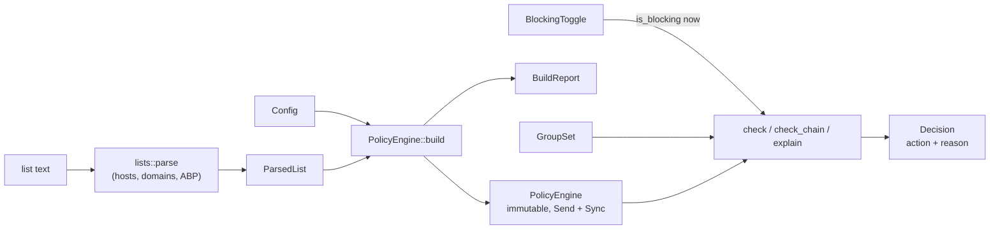
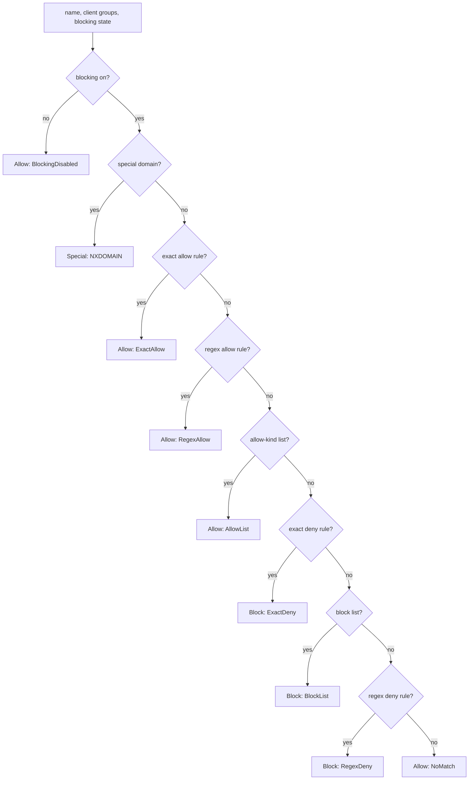
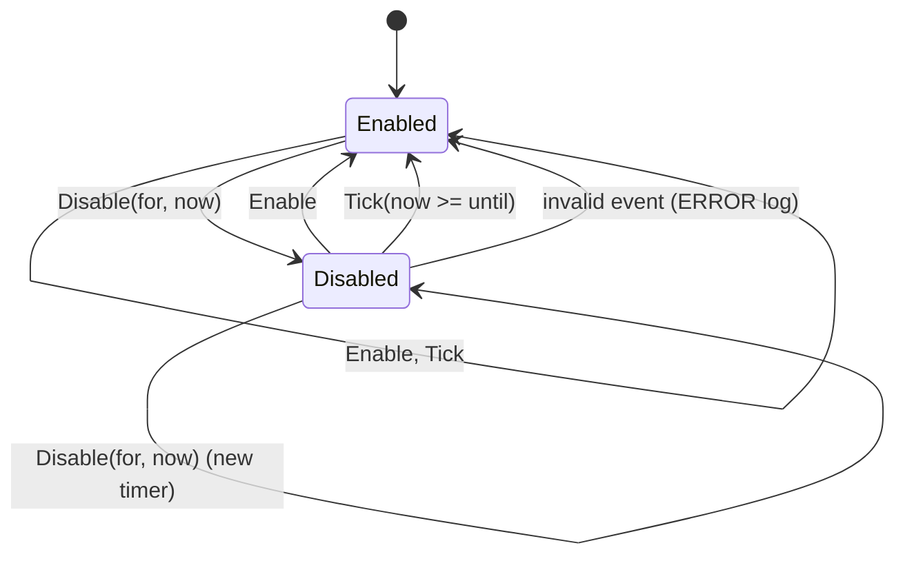
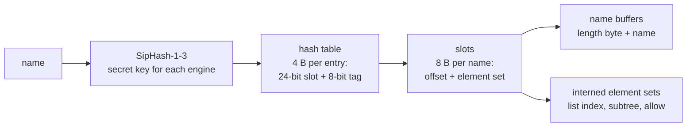

# Policy engine

The policy engine decides if rusthole blocks a name for a client. It is in `rusthole-core`
(modules `policy`, `lists` and `blocking_state`). It is pure: it does no I/O and reads no
clock. (`PolicyEngine::build` takes a hash seed from `std::hash::RandomState`; give a seed to
`PolicyEngine::build_with_seed` for a build that uses only its inputs.) Part P3b downloads
the lists, part P3c finds the groups of a client, and the DNS crate turns a decision into DNS
records.

## Decision order

The order follows Pi-hole v6. The first step that matches gives the decision.

1. **Blocking off.** The caller gives the state of the blocking toggle. When blocking is
   off, each name is allowed.
2. **Special domains** (amendment A3): `blocking.special_domains` get NXDOMAIN for all clients,
   also for clients with no group. The match is exact (not subdomains). An empty list turns
   this step off.
3. **Allow**: an exact allow rule, a regex allow rule, or an entry of an allow-kind list. Any
   allow beats any deny.
4. **Exact deny rule** → block.
5. **Block list entry** → block.
6. **Regex deny rule** → block.
7. Else → allow.

The result is a `Decision`:

- `action`: `Allow`, `Block(BlockReply)` or `Special(SpecialReply::Nxdomain)`. `BlockReply`
  comes from `blocking.mode`: `Null`, `Nxdomain`, `Nodata` or `Ip { ipv4, ipv6 }`. A blocked
  name is blocked for all query types; the DNS crate makes the records (A3).
- `reason`: the step. It names the rule (its index in `rules` of the config) or the lists
  (the first four list ids, and a flag when more lists matched).
- `name_index`: the name in a CNAME chain that decided (0 is the query name).

`check` does not allocate. A regex match allocates a small set only when a regex matched.

## Groups

A rule or a list applies to a client only through a group that both have and that is
enabled. `PolicyEngine::client_groups` makes the `GroupSet` of a client:

| Client | `client_groups` argument | Groups |
|---|---|---|
| No `[[clients]]` entry | `None` | `default` |
| `groups = []` | `Some(&[])` | none: no rule and no list applies |
| `groups = ["kids"]` | `Some(&["kids"])` | `kids` |

- A disabled group gives nothing: it is not in a `GroupSet`, and it is not in the group mask
  of a rule or a list.
- A rule or a list with `groups = []` applies to no client.
- A `GroupSet` is valid only for the engine that made it. Make it again after each rebuild.

Interpretation: the P3a spec says "a client with no groups uses default". `docs/CONFIG.md`
says that `groups = []` means "no list and no rule". The engine keeps both: an unknown client
(no groups known) uses `default`, and an explicit empty list means no group. This keeps the
clients of the Pi-hole sample that are in a group with no lists unblocked.

## Matching

| Source | Matches |
|---|---|
| Exact rule | The name only. |
| Regex rule | The `regex` crate, case-insensitive, with a size limit. One `RegexSet` for each action. |
| Hosts or domain-only list entry | The name only. |
| ABP list entry `\|\|name^` | The name and each subdomain. `xexample.com` does not match `example.com`. |

The engine compares canonical names: lowercase ASCII, no trailing dot, punycode for Unicode
names (amendment A8).

### List entries and list kind

- In an **allow-kind** list (`kind = "allow"`), each entry allows.
- In a **block-kind** list, each entry blocks. An `@@||name^` entry in a block-kind list is
  **not used**: only an allow-kind list can allow a name. A third-party block list thus
  cannot make an allow that beats the deny rules of the owner. The build counts these
  entries in `ListBuildInfo::ignored_allow_entries`.

### List formats

`lists::parse(text, ListFormat::Auto, limits)` finds the format of each line, because many
lists mix the formats. The config needs no format field.

| Line | Result |
|---|---|
| `0.0.0.0 a.example b.example` (any IP address first) | Exact entries. |
| `a.example` | Exact entry. |
| `\|\|a.example^` | Subtree entry. |
| `@@\|\|a.example^` | Subtree allow entry (see above). |
| `\|\|a.example^$third-party` | Skipped: ABP options. |
| `example.com##.ad`, `/regex/`, `\|https://...`, `\|\|a.*.example^` | Skipped: other ABP syntax. |
| `#`, `!` comments, `[Adblock Plus 2.0]`, empty lines | Comments. |
| `localhost`, `broadcasthost`, `ip6-localhost` and similar | Skipped: local names. |
| `0.0.0.0` or a name with a numeric top-level label | Skipped: IP address. |
| `lan` (one label) | Skipped: blocking one label is almost always an error. |
| `bad name!` | Invalid: counted, with a sample. Not fatal. |

The parser also accepts inline `#` comments, CRLF line ends and a UTF-8 byte order mark. It
changes a Unicode name to punycode.

Limits (constants in `lists`, given in `ParseLimits`):

| Limit | Value | When it is exceeded |
|---|---|---|
| Line length | 4096 bytes | The line is counted as invalid. |
| Entries in one list | 4 000 000 | `ListError::TooManyEntries` (the list is not used). |
| Text size | 512 MiB | `ListError::TooLarge`. |
| Invalid samples | 10, each at most 120 characters | Not kept. |

## CNAME chain (amendment A4)

`check_chain(groups, blocking, &[query, target1, target2, ...])` checks each name with the
same decision order. The first blocked name blocks the whole answer, and
`Decision::name_index` names it. An allow on the query name does **not** allow a blocked
CNAME target: the target needs its own allow. This is the deep CNAME inspection of Pi-hole.
A special domain as a CNAME target also decides (NXDOMAIN). When
`blocking.deep_cname_check` is false, only the query name is checked.

## Which list or rule matches (A9)

`explain(Some(&groups), name)` lists every rule and list entry of these groups that matches
the name, not only the first one. `explain(None, name)` lists all enabled rules and lists, also
those in no enabled group. Each `Match` has the source (rule index or list id and entry kind),
the effect (allow, deny, special), the matched name (a parent for a subtree entry) and the
enabled groups of the source. It uses the compiled set; it reads no file.

## Blocking toggle (A9)

`blocking_state::BlockingToggle` is a pure state machine. The shell gives `now` as a
`MonoTime` from a monotonic clock.

- `is_blocking(now)` and `remaining(now)` use the state and `now` only. A timer counts as
  ended at its deadline, also with no `Tick`.
- Invalid events: time that goes back, a zero duration, a duration longer than 366 days, a
  deadline that overflows. The machine logs the state and the event at ERROR, goes to
  `Enabled` (blocking on) and returns the error.
- A second `Enable` and a new `Disable` are normal events.
- The machine has no loop: each event is one transition, and a timer needs at most one
  `Tick` to end.
- Start it with `BlockingToggle::new(config.blocking.enabled)`. The toggle is the only
  source of the blocking state for `check`.

## Compiled set

- Each unique name is stored once, in byte buffers. The set takes over the buffer of a
  `ParsedList` when most of its names are new, so these names are not copied. Other names
  are copied into 1 MiB chunks.
- One slot (8 bytes) for each name: a 32-bit logical offset and an element set.
- An element is a list index (16 bits) and two flags (subtree, allow). A name in one list
  holds its element inline in the slot. A name in more lists points to an interned set of
  elements, stored once for all names with the same set. Thus up to 65 536 lists cost little
  memory.
- Each list and each rule has a group mask (one bit per group).
- The hash is SipHash-1-3 with a secret 128-bit key. List text comes from the network. If a
  list author knows the key, the author can make names that fill one part of the table.
  Then the build time grows with the square of the number of such names, and each lookup in
  that part is slow (hash flooding). `PolicyEngine::build_with_seed(config, lists, seed)`
  takes the key seed. Part P3b must get the seed from the OS random source for each build.
  `PolicyEngine::build` gets a seed from `std::hash::RandomState`. The same seed and input
  give the same engine, so the fuzz target uses a fixed seed.
- Second defence: an insert probes at most `MAX_PROBE` (1024) entries after its home entry.
  When a name needs more, the set takes a new key (made from the old key) and builds the
  table again. One build takes at most `MAX_REHASH` (4) new keys. After that, an insert has
  no probe limit; the build still ends, because the table always has empty entries. The
  report gives `set_rehashes` and `set_max_probe`. A lookup probes at most
  `set_max_probe + 1` entries for each name.
- A lookup hashes the name and probes the table. A subtree lookup also hashes each parent
  name, but only when the set has subtree entries. A lookup does not allocate.
- Build: the engine reads the lists one at a time. Give the largest list first for the lowest
  peak.

### Measured memory and speed

The test `crates/rusthole-core/tests/policy_memory.rs` counts every heap byte with a counting
allocator. It makes synthetic names of about 25 characters (for example
`pixel-3e8.media-cdn.net`); every tenth entry is a subtree entry. The config also has nine
regex deny rules (they match none of the names), so each lookup also runs the regex set. The
lists are made lazily during the build, so the peak includes the list that is being made and
added.

Run: `cargo test --release -p rusthole-core --test policy_memory -- --include-ignored --nocapture`.
Dev builds of our crates are not optimized, so take numbers from `--release`.

Results on x86_64 (Windows 11 host, release build, 2026-11-18):

| Case | Unique names | Input list (largest) | Peak heap during build | Heap after build | Lookups per second |
|---|---|---|---|---|---|
| One list | 100 000 | 2.7 MB | 5.2 MB (51 B/name) | 4.6 MB | 3.4 M to 5.0 M |
| Three lists, 140 000 entries | 100 000 | 1.6 MB | 6.2 MB (62 B/name) | 4.4 MB | 2.8 M to 6.0 M |
| One list | 1 000 000 | 27.0 MB | 44.0 MB (43 B/name) | 43.4 MB | 2.4 M to 4.5 M |
| Three lists, 1 400 000 entries | 1 000 000 | 16.2 MB | 56.5 MB (56 B/name) | 42.2 MB | 2.3 M to 4.2 M |

- A second run after the change to the keyed hash (Linux in WSL on the same host, release
  build, 2026-11-18) gave the same memory numbers. Lookups per second were 6.4 M, 6.1 M,
  3.7 M and 4.8 M (rows in table order). No build took a new key, and the longest probe was
  18, 16, 35 and 29 entries (`MAX_PROBE` is 1024). The test asserts no rehash and a probe
  below 1024.
- The D6 target is 64 MB for 1 000 000 names. The peak is below it in both cases. The fast
  tests (100 000 names, not ignored) assert at most 64 bytes per name at the peak.
- The memory numbers are the same in each run. The lookup rate changed from run to run,
  because other builds used the same host at the same time; the table gives the range of
  four runs. The rate is for one thread.
- The heap after the build includes the list buffer that the set took over (one flags byte
  per entry is not used after the build).
- The peak starts from a finished `ParsedList`. The parse step (part P3b) holds the list text
  and the entry buffer at the same time, so its peak is about the text size plus the entry
  buffer. P3b must parse one list at a time.
- The numbers do not include the old engine during a refresh: old + new set is the concern of
  part P3b.
- The lookup mix: one third names in the set, one third subdomains of names in the set (each
  walks the parent names), one third names not in the set.
- The numbers count heap bytes that the program asked for, on x86_64. They do not include
  allocator overhead or the binary. D6 asks for RSS on aarch64; that measurement is not done
  yet (part P8).

## Rule and set limits

| Limit | Value |
|---|---|
| Lists in one engine | 65 536 |
| Unique names in one engine | 16 777 215 |
| Name buffers in one engine | 4 GiB |
| One regex pattern | 1024 characters, 256 KiB compiled (`pattern` module) |
| All regex rules of one action | 16 MiB compiled; over it, each regex is matched alone (same result, slower) |

## Build report

`PolicyEngine::build` never fails. It skips each value that it cannot use and reports it:

- `lists`: for each list that the iterator gave: entries, new names, ignored `@@` entries,
  and the status (`Used`, `Disabled`, `NotInConfig`, `Duplicate`, `TooManyLists`, `SetFull`).
- `missing_lists`: enabled lists of the config that the iterator did not give.
- `issues`: bad exact rule values, bad regex patterns, unknown groups, duplicate group names
  or list ids, bad special domains, bad `blocking.ipv4`/`ipv6`.
- `unique_domains`, `entries`, `memory_bytes`, `peak_build_bytes` (estimates from capacities).
- `set_rehashes`, `set_max_probe`: new hash keys of the compiled set and its longest probe
  (see "Compiled set"). A `set_rehashes` value that is not zero means very bad luck or a list
  with names that were made to collide.

## Interpretations

These choices are not fixed by the P3a spec. The owner can change them.

| Topic | Choice |
|---|---|
| Client groups | An unknown client gets `default`. `groups = []` gets no group. |
| `@@` in a block-kind list | Not used. Only an allow-kind list can allow. |
| `blocking.enabled` | The engine does not read it. The caller starts the toggle with it (`BlockingToggle::new(config.blocking.enabled)`) and gives `is_blocking(now)` to each check. |
| Special domain as a CNAME target | It decides the answer (NXDOMAIN), like a blocked target. |
| Line that is too long | Counted as invalid, not fatal. Too many entries is fatal for the list. |
| Group masks | One mask per list and per rule (over groups), not one mask per group (over lists). The result is the same; this form is smaller when there are many lists. |
| Single-label names and local host names in lists | Skipped and counted. |

## Tests

- Unit tests for each list format and edge case, the decision order, groups, CNAME chains,
  `explain`, the build report and the toggle.
- Property tests: allow beats any deny; group isolation (the decision for a client equals
  the decision of an engine with only the client's groups); the decision does not depend on
  the order of rules, entries or lists; parse(render(entries)) round trip for hosts, domain
  and ABP formats; a subtree entry matches every subdomain and no lookalike; a chain is
  blocked if and only if a name in it is blocked; the toggle keeps a valid state for any
  event sequence, a timer ends exactly at its deadline, one event is one step.
- Fuzz targets (`fuzz/`): `list_parse`, `policy_check`, `regex_rules`.
- Manual fault injection (not committed): each fault below made at least one test fail.

| Fault | Tests that failed |
|---|---|
| Exact deny rule before the allow steps | `decision_order`, `allow_beats_any_deny` |
| Regex deny before block list | `decision_order` |
| Allow-kind list ignored | `decision_order`, `allow_beats_any_deny`, `abp_allow_entries_need_an_allow_kind_list` |
| Group mask test always true | `groups_isolate_rules_and_lists`, `group_isolation`, `explain_lists_every_match`, `many_lists` |
| Disabled group counts (mask and `GroupSet`) | `groups_isolate_rules_and_lists`, `group_isolation` |
| Exact list entry matches its parent's subdomains | `subtree_and_exact_matching` |
| Chain check skips a CNAME target | `chain_blocked_iff_some_name_blocked` |
| Timer ends one step after the deadline | `timer_ends_exactly_at_deadline`, `timer_expires_exactly`, `new_disable_replaces_timer` |
| Invalid toggle event keeps the state | `invalid_events_go_to_enabled`, `any_sequence_keeps_valid_state` |
| Block list before the allow-kind list | `decision_order`, `allow_beats_any_deny` |
| List group mask not checked | `groups_isolate_rules_and_lists`, `group_isolation`, `many_lists` |
| Set: no probe limit on insert | `probe_limit_takes_a_new_key`, `spent_rehash_budget_still_finds_every_name` |
| Set: no new key after a too-long probe | `probe_limit_takes_a_new_key`, `spent_rehash_budget_still_finds_every_name` |
| Set: old hash used after a rehash | `probe_limit_takes_a_new_key` |
| Set: lookup probe bound one too short | `merges_lists_and_interns_sets`, `subtree_and_exact_matching`, `cname_chain` and others |
