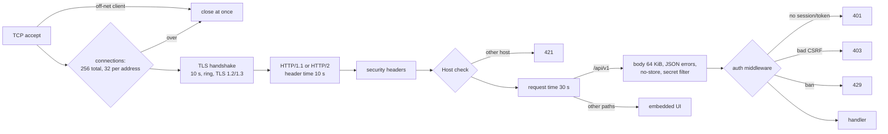
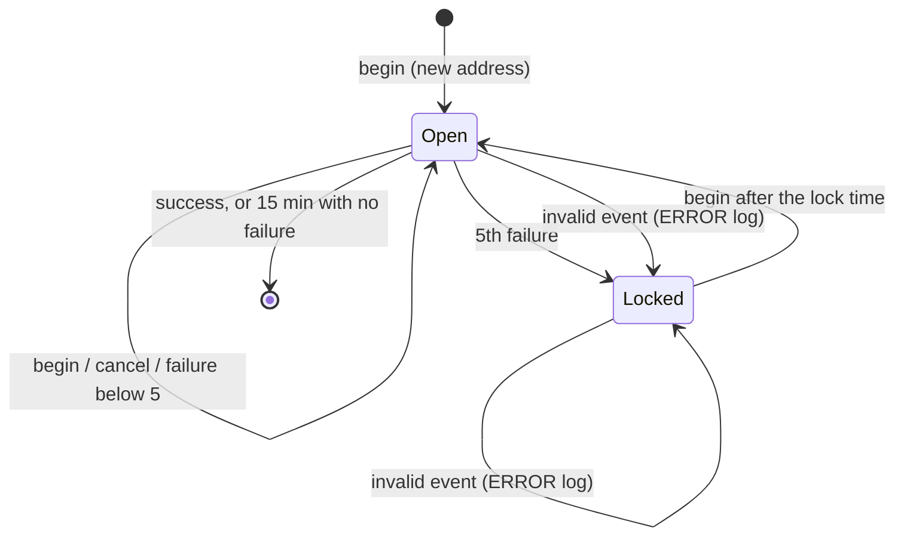
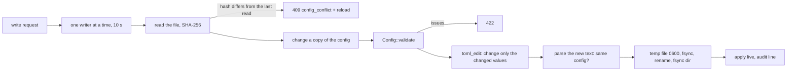

# Security of the admin API (part P5)

This document describes how the admin listener protects the API and the config file.
[PLAN.md](PLAN.md) has the decisions (D7, D9, D10, A7, A11). [API.md](API.md) has the JSON
contract. The code is in `crates/rusthole-web` and in the pure modules `rusthole_core::ban`
and `rusthole_core::session`.

## 1. Request path

## 2. Listener

| Item | Rule |
|---|---|
| Addresses | `server.admin.listen`, IPv4 only (A11). `"auto"` is each local IPv4 address on Linux, and `127.0.0.1` on other systems (development mode). The listener does not rebind when the interfaces change; a restart does. |
| Client ACL (D7) | The same ACL as DNS: loopback, the local subnets, `acl.allow`. A client outside it is closed at accept, before TLS. The ACL and the Host list are rebuilt each 30 s from the interfaces, and after each config change. |
| TLS | `rusthole-tls::admin_server_config`: the ring provider, TLS 1.3 and 1.2, ALPN `h2` and `http/1.1`. All three TLS modes work (`file`, `self-signed`, `local-ca`). |
| Limits | 256 connections, 32 for one client address, 64 HTTP/2 streams on one connection, TLS handshake 10 s, request header 10 s (HTTP/1.1), idle 10 s, request 30 s, stalled response 40 s, request body 64 KiB. |
| Idle limit | Each connection has an idle watchdog (all protocols). A connection with no request in flight and no activity for 10 s gets a graceful close; after 1 s more it is dropped. The end of the TLS handshake, the start of a request and the end of a response count as activity. So a client that sends nothing, only part of the HTTP/2 preface, or an HTTP/2 preface with no request, cannot keep a connection slot. A request in flight is not idle. The handler has the request time limit (30 s), and each frame of the response body is activity. A connection with a request in flight and no activity for 40 s is closed too: so a peer that never reads the response (or sets an HTTP/2 send window of 0) cannot keep a slot. |
| Shutdown | Stop accept, close the connections gracefully, stop the rest after 3 s. A test proves that no task stays. |

## 3. Security headers

Every response (UI files, API answers and errors) has:

| Header | Value |
|---|---|
| `Content-Security-Policy` | `default-src 'none'; script-src 'self'; style-src 'self'; img-src 'self' data:; font-src 'self'; connect-src 'self'; base-uri 'none'; form-action 'self'; frame-ancestors 'none'` |
| `Strict-Transport-Security` | `max-age=31536000` |
| `X-Content-Type-Options` | `nosniff` |
| `Referrer-Policy` | `no-referrer` |
| `Permissions-Policy` | every feature off (`camera=()`, `geolocation=()`, ...) |
| `Cross-Origin-Opener-Policy` | `same-origin` |
| `Cross-Origin-Resource-Policy` | `same-origin` |
| `X-Frame-Options` | `DENY` |

API answers also have `Cache-Control: no-store`. UI files under `/assets/` (hashed names) have
`Cache-Control: public, max-age=31536000, immutable`; `index.html` has `no-cache`.

## 4. Host check (DNS rebinding)

The `Host` header (or the HTTP/2 `:authority`) must name this server: a name in `tls.names`,
`localhost`, `127.0.0.1`, a local IPv4 address or a bound admin address, with the admin port.
Without a port, only port 443 matches. An IPv6 literal never matches (A11). Other hosts get
421 `misdirected_request`. The check is a pure function (`host::host_allowed`) with a
property test and the fuzz target `host_header`.

## 5. Authentication

Only `POST /auth/login` and the anonymous probe `GET /auth/session` work without
credentials (and the UI files outside `/api/`). The router is built from one route table;
the auth middleware reads the access level of each route from the same table. A route
that is not in the table needs auth (deny by default). A test calls each route of the table
without credentials and expects 401.

### 5.1 Password (D10, A7)

- `admin.password_hash` is an Argon2id PHC string. `rusthole passwd` makes it with the OWASP
  parameters: 19 MiB memory (`m=19456`), 2 iterations, 1 lane, 16-byte random salt, 32-byte
  output. A stored hash with a memory cost over 256 MiB or more than 16 iterations is refused,
  so a bad config value cannot use all memory.
- A semaphore allows 2 Argon2 checks at the same time. A check waits at most 10 s for a slot
  (503 after that) and runs at most 30 s on a blocking thread.
- With no password in the config, every login fails with 401 `password_not_set`. There is
  no setup endpoint. Set the password with `rusthole passwd` (the password is read two
  times from the terminal, with no echo; at least 10 bytes). A running rusthole reads the
  changed file at the next login (a login reads the file at most once in 2 s, after the ban
  check).

### 5.2 TOTP

- RFC 6238: HMAC-SHA1, 6 digits, 30 s steps, one step before and after. The code compare is
  constant-time; all steps of the window are checked.
- A code is accepted only for a step after the last accepted step, so a code cannot be used
  two times. The last step is in memory: a restart clears it (a code of the last 90 s can be
  used once more after a restart).
- Login with TOTP on and no code gives 401 `totp_required`. The password is not checked then,
  and the answer does not count in the ban.
- Set up TOTP in the UI (`/auth/totp/setup`, then `/auth/totp/confirm` with a code; the
  setup ends after 10 minutes) or with `rusthole passwd --totp` (the CLI checks one code
  before it writes the secret). `rusthole passwd --disable-totp` turns it off.

### 5.3 Sessions

- The session id is 32 random bytes (OS random source), base64url. The server keeps only its
  SHA-256 hash as the map key, so a lookup never compares the secret id.
- Cookie: `__Host-rusthole_session=<id>; Path=/; Secure; HttpOnly; SameSite=Strict`, no
  `Max-Age` and no `Domain`. Logout clears it and deletes the session at once.
- Lifetime (`rusthole_core::session`, pure, `now` is an input): the absolute limit is
  `admin.session_ttl_seconds` (default 8 hours); the idle limit is 1 hour (or the absolute
  limit when it is shorter). Each request moves the idle limit. At most 64 sessions; a new
  session pushes out the expired sessions, then the one with the oldest request. Sessions are
  in memory only: a restart logs everybody out.
- A request with a stale cookie gets 401 and does not count in the ban.

### 5.4 CSRF

Each session has a CSRF token (32 random bytes, base64url). The login response and
`GET /auth/session` give it. Every request that is not `GET` or `HEAD` and uses the session
cookie must have `X-CSRF-Token` with the same value, else 403 `csrf_failed`. The compare is
constant-time (`subtle`).

### 5.5 API tokens

- Format `rh_` and 43 base64url characters (32 random bytes). `POST /tokens` shows the token
  one time. The config keeps `sha256:<hex>` of the token, a prefix (`rh_` and 4 characters)
  and the creation time.
- `Authorization: Bearer <token>`. The server compares the SHA-256 of the token with every
  token hash in constant time. An Argon2id token hash (allowed by the config schema) is
  checked with the password slots. CSRF does not apply to a bearer token, and the cookie is
  not read when the header is present.
- Ban (section 6): a locked address gets 429 also with a valid token. A `sha256:` match
  uses no ban try, so parallel requests with a valid token all pass. Only the slow Argon2id
  check reserves a try. A token that does not match counts as a failure. A valid token
  gives its try back and does not reset the failure count: a token holder must not get
  more password or TOTP guesses.
- A token cannot create tokens and cannot use the TOTP paths (403). A revoke (`DELETE
  /tokens/{id}`) removes the hash from the config; the next request with the token gets
  401. The "last used" time and address are in memory only.

## 6. Login ban (D10, A7)

`rusthole_core::ban` is a pure state machine with `now` (monotonic) as an input. The key is
the client IPv4 address (an IPv6 address would use its /64).

- Failed passwords, TOTP codes and API tokens count. Also the password checks of
  `POST /tokens`, `/auth/totp/setup` and `/auth/totp/disable`.
- An attempt reserves a try before the slow check (`begin`), so parallel attempts cannot
  pass the threshold (`failures + pending ≤ 5`). An attempt that stops in the middle (a
  closed connection) counts as a failure. A `sha256:` API token check is fast and reserves
  no try (section 5.5).
- Lock times: 60 s, then 120 s, 240 s, ... up to 1 hour. A correct password (with its TOTP
  code when TOTP is on), or 15 minutes with no failure, removes the entry. A valid API
  token does not remove it.
- During a lock the server answers 429 `rate_limited` with `Retry-After` and does not check
  the password. The audit log gets `auth.login_failed` for each failure and `auth.ban` for
  each lock.
- An event that the state does not expect (a finish with no started attempt) is logged at
  ERROR with the state and the event, and the address is locked (the safe state).
- The table has at most 4096 addresses (LRU). An attacker with more than 4096 addresses can
  push out old entries; on a home network the ACL limits the possible addresses.
- Property tests: with no success, no event sequence lets more than 5 attempts start in any
  60 s window; failures plus pending tries never pass the threshold; an invalid event always
  leaves the address locked.

## 7. Config writes (D2, A7)

- `toml_edit` keeps comments, key order and formatting. Items of `[[rules]]`, `[[groups]]`,
  `[[clients]]`, `[[lists.adlists]]`, local DNS and API tokens are matched by their stable id,
  so a comment stays with its item.
- The new text is parsed again and must give the wanted config, else nothing is written
  (500).
- A hand edit of the file (the hash differs) gives 409 `config_conflict`. The server reads
  the file again; a valid file becomes the running config at once, an invalid file is logged
  and the old config stays.
- The parser errors of `toml_edit` can quote the file; they are never shown or logged.
- Live apply: lists, rules, groups and the blocking mode (a new engine build), clients and
  local DNS (the client resolver and the local zone), cache, TTL and rate limit settings, and
  `acl.allow`. Listener, upstream, statistics and TLS changes need a restart: the settings
  answer has `restart_required: true`.

## 8. Secrets

- No response has the password hash, the TOTP secret or a token hash. The response types
  have no such fields.
- The secret filter (a last check on every JSON answer of the API) looks for these values of
  the current config. A response with one of them is replaced with 500 and an ERROR log line
  (the log line names only the kind). The TOTP setup answer has the new, pending secret
  (it is not in the config until the confirm).
- A test logs in with TOTP and a token configured, calls every `GET` route and checks that
  no answer has a secret.
- The audit log never has a password, a code or a token.

## 9. Embedded UI

`build.rs` embeds `web/dist` when `web/dist/index.html` exists, else the placeholder page in
`crates/rusthole-web/placeholder`. `cargo build` never runs bun or Node. A path that is not a
file and has no extension gets `index.html` (the UI routes); a missing file with an extension
gets 404, so a script URL never gets HTML. An unknown `/api/` path gets a JSON 404, never the
UI. The UI has no inline script or style (the CSP refuses them).

## 10. Tests and fault injection

Integration tests run a real listener on `127.0.0.1` (port 0) over HTTPS with a reqwest
client that trusts the local CA of the test: login (good, bad, TOTP required, TOTP code
reuse), ban with `Retry-After`, CSRF, bearer token and revoke, Host check, security headers,
idle expiry with an injected clock, config writes that keep comments, hand edit 409, secrets,
audit lines, UI files, SPA fallback, the placeholder, the body limit, a slow header
connection that closes, silent connections that close after the idle limit (nothing after
TLS, part of the HTTP/2 preface, an HTTP/2 preface with no request, an HTTP/2 request with
a send window of 0), valid tokens that use
no ban try and reset no failure, the ACL close, and the shutdown.

Manual fault injection (not committed). Each fault made at least one test fail; then the
fault was removed.

| Fault | Tests that failed |
|---|---|
| Route `GET /settings` marked public | `every_route_needs_auth_except_the_public_ones`, `every_route_is_unique_and_below_the_api` |
| Auth skipped for routes that are not `Auth` (deny by default broken) | `every_route_needs_auth_except_the_public_ones`, `login_logout_and_session`, `bearer_token_works_without_csrf_and_fails_after_revoke`, `totp_required_reused_code_and_disable` |
| CSRF check removed | `csrf_is_checked_on_writes_with_a_session` |
| Secret filter turned off | `secret_filter_replaces_a_leaking_response` |
| Ban reservation `>=` changed to `>` | `parallel_attempts_cannot_pass_the_threshold`, `invariants_hold`, `at_most_threshold_attempts_in_a_window` |
| Ban lock at the 6th failure (`>=` changed to `>`) | `five_failures_lock_for_one_minute`, `locks_double_up_to_the_cap`, `parallel_attempts_cannot_pass_the_threshold` |
| A handler puts the token hash in `GET /tokens` (the secret filter changes it to 500) | `secrets_never_in_any_get_response` |
| Idle watchdog never closes the connection | `silent_connections_close_after_the_idle_limit` |
| Idle check uses the idle limit for the requests in flight | `idle_decision` |
| A stalled response never closes (no stall limit) | `silent_connections_close_after_the_idle_limit` |
| A valid Argon2id token ends its ban try with `Success` (resets the failures) | `valid_token_uses_no_ban_try_and_resets_no_failure` |
| A `sha256:` token check reserves a ban try (held 50 ms) | `valid_token_uses_no_ban_try_and_resets_no_failure` |
| Lock check removed from the token path | `valid_token_uses_no_ban_try_and_resets_no_failure` |
| A new TOTP secret keeps the replay record | `new_totp_secret_clears_the_replay_record` |
