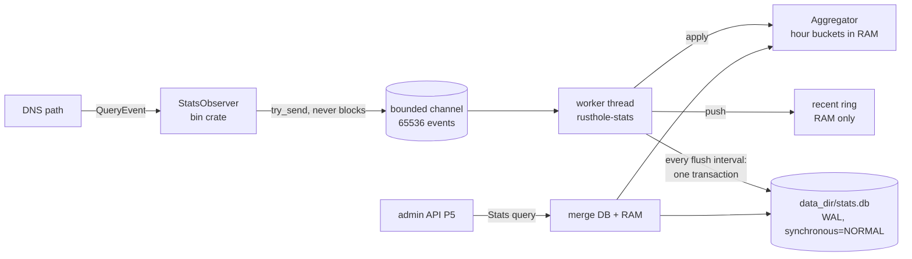

# Statistics store (part P4)

This document describes how rusthole counts queries, where it keeps the counts, and when it
writes to disk. [PLAN.md](PLAN.md) has the decisions (D5, A9). [API.md](API.md) has the JSON
shapes. [CONFIG.md](CONFIG.md) has the `[stats]` settings.

The owner focus (PLAN.md A9): which domains each client resolves (grouped by registrable
domain), how many times, and when (hour-of-day histograms). A raw query table is not kept.
Only a small ring of recent queries stays in RAM.

## 1. Flow



| Part | Crate | I/O |
|---|---|---|
| Event type, aggregation, key bound, grouping, paging, histograms, flush and retention timing | `rusthole-core::stats` | None. `now` is an input. |
| SQLite schema, flush, retention, reads, audit log, worker thread, shutdown | `rusthole-store` | SQLite file, one thread. |
| `QueryObserver` adapter and start/stop wiring | `rusthole` (bin), `stats_observer.rs` | None. |

The adapter is in the bin crate, so `rusthole-store` does not depend on `rusthole-dns`.

## 2. What is counted

Each answered query gives one event with: the wall-clock time (UTC seconds), the client IP,
the full query name, the query type, the status, the reason (when known), the upstream (when
the answer came from one) and the answer time.

| `QueryEvent` (P2) | Status |
|---|---|
| verdict `BlockedQuery` or `BlockedAnswer` | `blocked` |
| source `Cache` | `cached` |
| source `Upstream` | `forwarded` |
| source `Filter`, not blocked | `local` |
| source `Local`, rcode REFUSED | `refused` |
| source `Local`, other rcode | `error` |

For each UTC hour, the aggregate keeps:

- for each (client IP, full name): `total`, `blocked`, `cached`, `forwarded`, `local`,
  `first_seen`, `last_seen`;
- for each query type: a count;
- for each upstream: a count and the sum of the answer times (for `avg_ms`);
- for each reason (`list:{id}`, `rule:{id}`, ...): a count.

A separate timeline keeps totals in 10-minute buckets (for the 24 h timeline), and the
counts of each (client IP, full name) in 10-minute buckets for the last 160 buckets (for
the 24 h timeline with a `client` or `domain` filter, part P5).

Client totals, domain totals and all top lists come from the (client, name) rows at query
time.

## 3. Bounds in RAM

| Item | Bound | When the bound is reached |
|---|---|---|
| Keys in the hour buckets (pairs, types, upstreams, reasons) | 100,000 (`DEFAULT_MAX_KEYS`) | At 3/4 of the bound the store flushes early (at most once in 5 s). At the bound the oldest hour bucket is evicted and counted (`evicted_buckets`, `evicted_events`). |
| 10-minute buckets | 160 | The oldest bucket goes out. |
| (10-minute bucket, client, name) keys | 100,000 (`MAX_PAIR_TIMELINE_KEYS`), and 160 buckets | At 3/4 of the bound the store flushes early. At the bound the oldest 10-minute bucket goes out. |
| Event channel | 65,536 events | The event is dropped and counted (`dropped_events`). A WARN is logged at most once in 10 s. |
| Recent queries | `stats.recent_queries` | The oldest query goes out. No memory is reserved at the start. |
| Client identities (MAC, name) | 4,096 | One old identity goes out. |
| Audit lines in RAM-only mode | 10,000 | The oldest line goes out. |
| (client, name) rows that one query reads from the database | 250,000 (`MAX_QUERY_PAIRS`) | The query stops and gives `StoreError::TooLarge` (P5 answers with an error). The DNS path does not stop. |

In RAM-only mode (`flush_interval_seconds = 0`) the hour buckets stay in RAM. The retention
runs once a day and evicts the hours older than `retention_days`. The key bound evicts more
old hours when needed.

## 4. Database schema

File: `<data_dir>/stats.db`. Mode: WAL, `synchronous=NORMAL`, busy timeout 5 s. The schema
version is in `PRAGMA user_version` (now 2; version 2 adds `timeline_pairs`). At open, the store runs the missing migrations in
one transaction. A file from a newer version is an error (the store then runs in RAM-only
mode and logs an ERROR). An empty file is a valid start.

Names and clients are stored one time and referenced by integer ids. The big tables are
`WITHOUT ROWID` with the primary key as the only index. This makes one `hourly` row about
31 to 33 bytes (measured, section 8).

| Table | Columns | Key |
|---|---|---|
| `meta` | `key`, `value` | `key` (`last_retention_day`) |
| `clients` | `id`, `ip`, `mac`, `name`, `first_seen`, `last_seen` | `id`; `ip` is unique |
| `domains` | `id`, `name`, `first_seen` | `id`; `name` is unique |
| `hourly` | `hour_utc`, `client_id`, `domain_id`, `total`, `blocked`, `cached`, `forwarded`, `local`, `first_seen`, `last_seen` | (`hour_utc`, `client_id`, `domain_id`) |
| `hourly_types` | `hour_utc`, `qtype`, `count` | (`hour_utc`, `qtype`) |
| `hourly_upstreams` | `hour_utc`, `upstream`, `count`, `sum_us` | (`hour_utc`, `upstream`) |
| `hourly_reasons` | `hour_utc`, `reason`, `count` | (`hour_utc`, `reason`) |
| `timeline` | `bucket` (Unix seconds / 600), `total`, `blocked`, `cached`, `forwarded`, `local` | `bucket` |
| `timeline_pairs` | `bucket`, `client_id`, `domain_id`, `total`, `blocked`, `cached`, `forwarded`, `local` | (`bucket`, `client_id`, `domain_id`) |
| `audit` | `id`, `at`, `action`, `target`, `actor`, `client_ip`, `ok`, `detail` | `id` (AUTOINCREMENT); index on `at` |

`hour_utc` is Unix seconds / 3600. Times are Unix seconds (UTC). The store keeps full names.
It calculates the registrable domain at query time (section 7).

`domains.first_seen` is the first query of the name. A flush sets it when it adds the name.
It changes it only when the snapshot has an earlier query (after a clock jump), so a flush
seldom writes an old `domains` row again.

File access (Unix): the store makes `stats.db` with mode 0600 and a new data directory with
mode 0700. SQLite gives `stats.db-wal` and `stats.db-shm` the mode of the main file. When an
existing `stats.db` can be read by the group or by others, the store logs a WARN and does not
change the mode.

### Growth from random names

The `domains` table gets one row for each new name, and the `hourly` table gets one row for
each new (hour, client, name). A client that sends random names (malware with a domain
generation algorithm, or a scanner) can add up to 1,000 names each 60 s with the default rate
limit: 1.44 million names a day, and about 43 million (client, name) pairs in 30 days. At
about 32 bytes for each `hourly` row, plus the name row and its index, this is about 150 MiB a
day for each such client (an estimate, not measured), and about 4.5 GiB in 30 days.

The store protects the process, not the disk:

- the RAM aggregate has a key bound (section 3);
- a query reads at most 250,000 (client, name) rows (`MAX_QUERY_PAIRS`). Above this, the
  query gives `StoreError::TooLarge`, and the statistics pages of this range show an error.
  `GET /clients/seen` always reads 30 days, so it also gives this error on a flooded
  database.
  The DNS path does not stop. SQLite still groups all rows of the range in its own page cache
  and temp files before it gives the first row. So a query on a flooded database holds the
  database lock longer, and a flush can wait up to 10 s and then try again later.

The rate limit of the DNS server and `retention_days` are the real limits on the disk. A
lower `retention_days` gives a smaller worst case.

## 5. Flush (decision D5)

```mermaid
sequenceDiagram
    participant W as worker
    participant R as RAM (Aggregator)
    participant D as SQLite
    W->>D: lock (time limit 10 s)
    W->>R: take all hour buckets and 10-minute buckets
    alt nothing to write and no retention due
        W-->>D: unlock, no write
    else
        W->>D: BEGIN; upsert clients, domains, hourly, types, upstreams, reasons, timeline, timeline_pairs
        W->>D: delete timeline_pairs older than 160 buckets
        W->>D: retention (once a day); COMMIT
        alt error
            W->>R: put the data back (key bound still holds)
        end
        W-->>D: unlock
    end
```

- One transaction every `stats.flush_interval_seconds` (default 60 s). The upsert adds the
  new counts to the counts in the row (`total = total + excluded.total`, `first_seen = min`,
  `last_seen = max`).
- No disk write between two flushes. A test proves it: the write counter of the store,
  `total_changes()` of SQLite, and the size and time of `stats.db` and `stats.db-wal` do not
  change while events come in and queries run.
- A flush with no data and no retention due writes nothing. An idle server does not write.
- A failed flush puts the data back into RAM. The next try comes after the interval (or after
  5 s when the key bound is near).
- A crash (or a power cut) loses at most one flush interval of counts, plus the events in the
  channel. With `synchronous=NORMAL` in WAL mode, a power cut can also lose the last committed
  transaction; the file stays consistent.
- Shutdown: the worker takes the events that are still in the channel, flushes once with a
  time limit (5 s from the bin), and stops. When the database lock is not free in time, the
  final flush gives up (the data is lost) and the thread still stops.

Queries and the flush use the same database lock. A query reads SQLite and RAM while it holds
the lock, so it never counts data two times and never misses data that a flush is writing.

## 6. Retention

The retention runs in the flush transaction, once for each UTC day (the day of the last run is
in `meta`). It keeps `retention_days` whole days before the current hour, and deletes:

- rows of `hourly`, `hourly_types`, `hourly_upstreams`, `hourly_reasons` before the cutoff
  hour, and `timeline` buckets before it;
- `domains` that no `hourly` row uses;
- `clients` with no `hourly` row and a `last_seen` before the cutoff;
- `audit` lines before the cutoff.

`retention_days = 0` is handled as 1 day.

## 7. Queries

All query functions are in `rusthole_store::Stats`. They block; P5 calls them from
`spawn_blocking`. Each takes `now` (Unix seconds) and returns plain structs from
`rusthole_core::stats::query`.

| API (docs/API.md) | Function |
|---|---|
| `GET /stats/summary` | `Stats::summary` |
| `GET /stats/timeline` | `Stats::timeline` |
| `GET /stats/hours` | `Stats::hours` |
| `GET /stats/top/domains`, `/top/blocked` | `Stats::top_domains` |
| `GET /stats/top/clients` | `Stats::top_clients` |
| `GET /stats/query-types` | `Stats::query_types` |
| `GET /stats/upstreams` | `Stats::upstreams` |
| top blocking lists and rules | `Stats::top_reasons` |
| `GET /stats/clients` | `Stats::clients` |
| `GET /stats/clients/{key}` | `Stats::client` |
| `GET /stats/clients/{key}/domains` | `Stats::client_domains` |
| `GET /stats/domains` | `Stats::domains` |
| `GET /stats/domains/{name}` | `Stats::domain` |
| `GET /clients/seen` | `Stats::seen_clients` |
| `GET /queries/recent` | `Stats::recent` |
| `GET /audit` | `Stats::audit` (and `Stats::append_audit` to write) |

Rules:

- **Ranges.** `24h`, `7d`, `30d` are aligned to their buckets (600 s, 3600 s, 14400 s), as
  API.md section 1.3 says. The statistics other than the timeline use whole UTC hours: the
  hours that start in `from..to`. The first hour is the first full hour at or after `from`,
  and the last hour is the current (partial) hour. Thus `24h` gives exactly 24 distinct
  hours, and the hour-of-day histogram counts each hour of the day one time. `7d` and `30d`
  start on an hour, so they are not changed. For `24h`, the summary and the top lists do not
  count the 0 to 50 minutes between `from` and the first full hour, but the 10-minute
  timeline counts them. So the sum of the `24h` timeline can be a little larger than the
  `24h` summary.
- **Timeline with a filter.** The 24 h timeline has 144 buckets of 10 minutes, also with a
  `client` or `domain` filter (API.md section 5.2). The filtered timeline reads
  `timeline_pairs` and the RAM pair buckets. Each flush writes the pair buckets of the
  snapshot and deletes the rows older than 160 buckets, so the table holds about one day.
  The `7d` and `30d` timelines read the hour buckets as before.
- **UTC offset.** The offset is clamped to -840..840 and rounded down to a whole hour:
  +5:30 gives +5, -3:30 gives -4. The response gives the offset that was used.
- **Registrable domain.** The `psl` crate (the Public Suffix List is compiled into the code)
  gives eTLD+1. A single label, a public suffix (`co.uk`), the root and each name in `arpa`
  are their own base.
- **Client key.** The MAC address when known, else the IP address. The store merges the
  addresses of one MAC. Other parts give the MAC and the name with
  `Stats::set_client_identity`; the next flush writes it to `clients`.
- **Pages.** Long collections use a keyset cursor (an opaque text). Each item has a unique
  sort key, so a page never repeats or loses an item. Groups of
  `GET /stats/clients/{key}/domains` are paged as a whole: a group is never split. A bad
  cursor gives an error (P5 answers 400).
- **First seen.** A client's `first_seen` comes from the `clients` table (all stored data).
  A name's `first_seen` in `GET /stats/domains/{name}` comes from the `domains` table and the
  RAM buckets (all stored data, API.md section 5.7). Its `last_seen` is the last query in the
  range. A `clients` or `domains` row stays while the client or the name has rows in
  `hourly`, so `first_seen` can be older than the retention.
- **Client identity.** Each flush writes the known MAC and name of each address in the
  snapshot, so a new `clients` row gets them also when the identity came before the first
  flush of the address. An identity that the 4,096-item bound evicts before the flush of its
  address is lost; the address then has its IP as key until the next
  `Stats::set_client_identity`.
- **Many addresses for one key.** A filter on a client key with many addresses (for example
  IPv6 privacy addresses) runs one SQL statement for each 256 addresses and adds up the
  results.

## 8. SD-card wear and measured size

Writes:

| Source | Writes |
|---|---|
| Statistics flush | At most 1 transaction per flush interval: 60 per hour with the default 60 s. 0 when no query came. |
| Retention | Inside one flush, once a day. |
| Audit log | 1 small transaction per admin action (written at once, see below). |
| Recent queries | Never (RAM only). |

Audit choice: each audit line is written at once, in its own small transaction. Admin actions
are rare, so the wear is small, and a crash loses no audit line. In RAM-only mode the lines
stay in RAM.

Measured with `cargo test -p rusthole-store --test size -- --ignored --nocapture`: one day of
synthetic traffic, 20 clients and 2,000 names, 1,440 flushes (one for each minute). Host: a
Windows 11 desktop with NTFS, debug build (dependencies at opt-level 1). A Raspberry Pi with an
SD card is slower; the row counts and sizes are the same.

| Traffic model | Events | `hourly` rows | `stats.db` after one day | Bytes per row | Flush mean | Flush max |
|---|---|---|---|---|---|---|
| Typical: 50 popular names each hour, each other name about 2 times a day | 125,732 | 101,732 | 3.2 MiB | 33.5 | 1.3 ms | 29 ms |
| Worst case: each client queries each of the 2,000 names in each hour | 984,000 | 960,000 | 28.7 MiB | 31.3 | 32.2 ms | 1.4 s |

With `retention_days = 30`, the typical model gives about 100 MiB and the worst case about
860 MiB. The flush max includes the first flush (schema pages and the first retention) and
WAL checkpoints.

Not measured: the daily retention flush on a full 30-day database. Its step that deletes
unused names (`DELETE FROM domains WHERE id NOT IN (SELECT DISTINCT domain_id FROM hourly)`)
reads all of `hourly` while it holds the database lock, so queries wait for it once a day.

## 9. Known gaps (follow-ups)

- **Resolved (P5): the 24 h timeline with a filter.** The contract of API.md wins (option two
  of the earlier text): the store keeps 10-minute counts of each (client, name) for the last
  160 buckets in `timeline_pairs` (schema version 2). The cost: one more upsert for each
  (bucket, client, name) in each flush, and about one day of these rows on disk.
- The reason of a blocked query comes from the policy decision (P3c). A rule reason is
  `rule:{id}` with the stable rule id of the API (P5); the bin keeps a map from the rule
  index of the engine to the id and swaps it at each config change. Between a config change
  and the next engine build, a rule reason can name the id of the old index.
- The bin copies the MAC address (neighbor table) and the local name of each client address
  into the store once a minute (`Stats::set_client_identity`), so a client with a known MAC
  has its MAC as key.
- The `[stats]` setting is `recent_queries` ([CONFIG.md](CONFIG.md)). The API field
  `stats.recent_queries_size` maps to it (API.md section 12).
- The key bound (100,000) is a constant, not a config setting.
