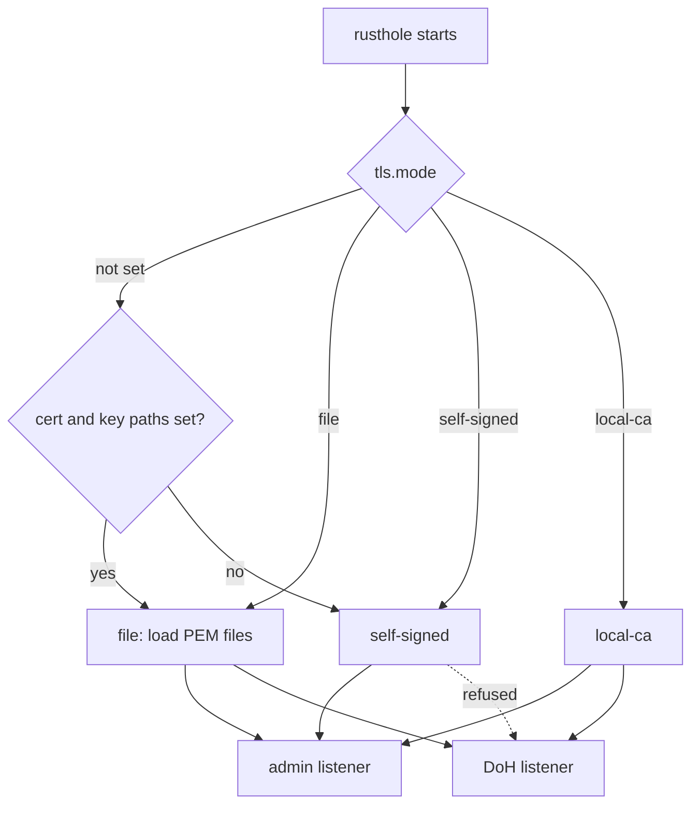
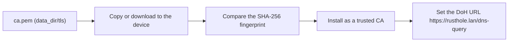

# TLS

rusthole uses TLS on two listeners: the admin UI (port 8443) and DNS-over-HTTPS (DoH, port
443). One certificate serves both listeners. The `[tls]` section of `rusthole.toml` sets where
the certificate comes from ([CONFIG.md](CONFIG.md#tls)).

The TLS library is rustls with the `ring` crypto provider (amendment A1). rusthole has no
OpenSSL and no aws-lc. Each rustls config gets the provider explicitly; rusthole does not
install a process-wide default provider.

## The three modes

| Mode | Certificate | Admin UI | DoH | Device setup |
|---|---|---|---|---|
| `file` | Your PEM files (for example from your own CA or from ACME) | yes | yes | None, if the devices trust your CA |
| `self-signed` | rusthole makes it | yes (the browser shows a warning) | **no** | Accept the warning once |
| `local-ca` | rusthole makes a local CA and a server certificate | yes | yes | Install the CA certificate once on each device |



### Mode `file`

```toml
[tls]
mode = "file"
cert_path = "/etc/rusthole/cert.pem"
key_path = "/etc/rusthole/key.pem"
```

- `cert_path` holds the certificate chain in PEM form. The server certificate is the first
  one. At most 16 certificates.
- `key_path` holds the private key in PEM form: PKCS#8 (`BEGIN PRIVATE KEY`), PKCS#1
  (`BEGIN RSA PRIVATE KEY`) or SEC1 (`BEGIN EC PRIVATE KEY`). The key must not have a
  password.
- rusthole refuses a key that does not belong to the certificate.
- An expired certificate is not an error. rusthole logs a WARN with the date and uses it.
- The older fields `admin.tls_cert_path` and `admin.tls_key_path` still work. When both are
  set and `tls.mode` is not set, the mode is `file`.

### Mode `self-signed`

This is the default when the config gives no certificate. It is for the admin UI only.

- rusthole makes an ECDSA P-256 key and a certificate that is valid for 365 days.
- The certificate names (SANs) are `localhost`, `127.0.0.1`, each name in `tls.names`, and
  each local IPv4 address.
- rusthole keeps the files and uses them again after a restart. It makes a new certificate
  when less than 30 days are left, or when the names change (for example a new local
  address).
- rusthole logs the SHA-256 fingerprint. Compare it with the fingerprint that the browser
  shows before you accept the warning.

### Mode `local-ca`

Use this mode for DoH when you have no certificate from a CA that your devices trust.

```toml
[tls]
mode = "local-ca"
names = ["rusthole.lan"]
```

- At the first start, rusthole makes a local certificate authority (CA). The CA is valid
  for 10 years. The CA key file has mode 0600.
- rusthole issues a server certificate from the CA. It is valid for 365 days. rusthole
  issues a new one when less than 30 days are left, or when the names change.
- rusthole prints the path of the CA certificate (`<data_dir>/tls/ca.pem`) at start. Install
  this file on each device (see [Install the local CA](#install-the-local-ca-on-a-device)).
  The admin UI will also serve it for download (part P5).
- **rusthole never replaces the CA by itself.** A new CA means that you must install it
  again on each device. When the CA files cannot be used (`ca.key` is missing, a file is
  not valid, the key does not match), rusthole stops with an error. Repair the files, or
  remove `ca.pem` and `ca.key` to make a new CA. One case is different: `ca.key` without
  `ca.pem` is the result of a crash during the first start, so rusthole makes a new CA
  (see [Files](#files)).
- When less than 30 days are left on the CA, rusthole logs a WARN. It keeps the CA.

#### Name constraints

The CA has name constraints (RFC 5280, section 4.2.1.10). A device that trusts the CA
accepts a certificate from it only for these names:

- `localhost` and each name in `tls.names` when rusthole made the CA, with their subdomains.
- The private IPv4 networks `10.0.0.0/8`, `172.16.0.0/12`, `192.168.0.0/16`, `127.0.0.0/8`,
  `169.254.0.0/16`, and `100.64.0.0/10` (used by VPNs).
- Each local IPv4 address outside these networks when rusthole made the CA.

Thus a stolen CA key cannot make a certificate for a public site that your devices accept.

Each name in `tls.names` must be a valid host name: letters, digits and `-` only, no label
that starts or ends with `-`, and a last label that is not all digits. TLS clients refuse a
CA with another name in its constraints, for every name. Thus `check-config` reports such
a name, and the certificate store refuses it before it writes a file.

**Set `tls.names` before the first start.** A name that you add later is not in the CA. The
server certificate then leaves out that name, and rusthole logs a WARN. To add the name,
remove `ca.pem` and `ca.key`, start rusthole, and install the new CA on each device.

## DoH needs a trusted certificate

A DoH client (a browser or an operating system) does not show a certificate warning. It
refuses an untrusted certificate without a message (amendment A6). Thus:

- With `server.doh.enabled = true`, the mode must be `file` or `local-ca`.
- The DoH server config builder (`doh_server_config`) refuses mode `self-signed` with an
  error that says why.
- `rusthole check-config` does not report this. A config_version 1 file with DoH on and no
  TLS setup was valid before the `[tls]` section, and it stays valid.
- The admin listener accepts all three modes.

## Files

rusthole keeps the files that it makes in `<data_dir>/tls/`. The default `data_dir` is
`/var/lib/rusthole`.

| File | Mode | Content |
|---|---|---|
| `tls/` | 0700 | The directory. |
| `self-signed.pem`, `self-signed.key` | 0644, 0600 | Mode `self-signed`. |
| `ca.pem`, `ca.key` | 0644, 0600 | The local CA. Install `ca.pem` on devices. Keep `ca.key` secret. |
| `server.pem`, `server.key` | 0644, 0600 | The server certificate from the local CA. |

- rusthole writes each file atomically: a temp file in the same directory, flush to disk,
  rename, flush of the directory. A crash does not leave a half file.
- rusthole writes the key before the certificate. After a crash between the two writes, the
  pair does not match, and rusthole makes a new pair at the next start. For the local CA,
  a `ca.key` without `ca.pem` gives a new CA at the next start, with a WARN: no device can
  trust a CA certificate that was never written. Any other problem with `ca.pem` or
  `ca.key` stops TLS with an error, because rusthole never replaces a usable CA by itself.
- When rusthole loads a key file that the group or others can read, it logs a WARN
  (amendment A7). Fix it with `chmod 600 FILE`.
- Windows builds are for development only. They do not set or check Unix file modes.

## Reload without a restart

The certificate store (`CertStore`) gives rustls the current certificate for each new
connection. The caller asks the store to reload:

- Mode `file`: rusthole reads the files again when the size or the modification time of the
  certificate file or the key file changed. Thus a renewal tool (for example an ACME client)
  can replace the files.
- Modes `self-signed` and `local-ca`: rusthole makes a new certificate when renewal is due or
  when the names changed.
- A reload that fails (a bad file, a key that does not match, a missing file) keeps the
  current certificate. Open connections do not change.

## Time and the clock

Certificates hold wall-clock dates, and TLS peers check them against their own wall clock.
Thus the renewal rules use the wall clock (Unix seconds), not a monotonic clock. This is the
one exception to the monotonic-clock rule in [ENGINEERING.md](ENGINEERING.md). The rules are
pure functions with `now` as an input (`needs_renewal`, `plan_cert`); the store reads the
clock.

- `needs_renewal(not_before, not_after, now)` is true if and only if
  `now >= not_after - 30 days` or `now < not_before`.
- A Raspberry Pi has no real-time clock. It can start with a date in 1970 until NTP sets
  the clock. `clock_plausible(now, build_time)` is false when the clock is more than two days
  before the build time of the binary. With such a clock, rusthole keeps a usable
  certificate and does not renew it, because a new certificate would have wrong dates.
  When rusthole must make a certificate with such a clock (the first start, or new names),
  the certificate starts at the build time. Thus a CA from the first start is still valid
  after NTP sets the clock.
- Part P7 uses `clock_plausible` to select the plain DNS fallback (`upstreams.fallback_plain`)
  for DoT and DoH upstreams until the clock is valid (amendment A6). See
  [DOH.md](DOH.md#clock-fallback).

## Upstream TLS (DoT and DoH client)

`client_config(alpn)` makes the rustls client config for DoT and DoH upstreams
(amendment A8):

- Trust roots come from the system store (`rustls-native-certs`). When the system store gives
  no root, rusthole uses the bundled Mozilla roots (`webpki-roots`) and logs a WARN.
- ALPN: `h2` for DoH, none for DoT. The caller sets it.
- TLS 1.3 and TLS 1.2 only, with the cipher suites of the ring provider (AES-GCM and
  ChaCha20-Poly1305, ECDHE key exchange).

## Install the local CA on a device

First copy `ca.pem` to the device, or download it from the admin UI (part P5). Then compare
the SHA-256 fingerprint on the device with the fingerprint in the rusthole log. Some systems
need the extension `.crt`: rename the file to `rusthole-ca.crt`.



### Android

1. Open **Settings > Security and privacy > More security settings > Encryption and
   credentials > Install a certificate > CA certificate**. The menu names are different on
   some devices; search the settings for "CA certificate".
2. Select the file and confirm.
3. Chrome uses the user CA store. Most other apps do not trust user CAs (Android 7 and
   later).
4. Firefox for Android has its own store. Open **Settings > About Firefox** and tap the logo
   five times. Then turn on **Settings > Secret settings > Use third party CA
   certificates**.

Note: the Android "Private DNS" setting uses DNS-over-TLS (port 853), not DoH.

### iOS and iPadOS

1. Open the file in Safari or in Files. iOS shows "Profile downloaded".
2. Open **Settings > General > VPN and Device Management**, select the profile, and tap
   **Install**.
3. Open **Settings > General > About > Certificate Trust Settings** and turn on full trust
   for the rusthole CA. Without this step, iOS does not trust the CA for TLS.

### Windows

1. Rename the file to `rusthole-ca.crt` and open it.
2. Click **Install Certificate**, select **Local Machine**, and select **Place all
   certificates in the following store > Trusted Root Certification Authorities**.

Or, in an administrator terminal: `certutil -addstore -f Root rusthole-ca.crt`

### Linux

Debian and Ubuntu:

```sh
sudo cp ca.pem /usr/local/share/ca-certificates/rusthole-ca.crt
sudo update-ca-certificates
```

Fedora and RHEL:

```sh
sudo cp ca.pem /etc/pki/ca-trust/source/anchors/rusthole-ca.pem
sudo update-ca-trust
```

Arch Linux: `sudo trust anchor ca.pem`

Chrome and Chromium on Linux use their own NSS store: open
**Settings > Privacy and security > Security > Manage certificates > Authorities > Import**.

### macOS

Open **Keychain Access**, import the file into the **System** keychain, open the
certificate, and set **Trust > When using this certificate** to **Always Trust**.

Or: `sudo security add-trusted-cert -d -r trustRoot -k /Library/Keychains/System.keychain ca.pem`

### Firefox (desktop)

Firefox has its own certificate store.

1. Open **Settings > Privacy and Security > Certificates > View Certificates > Authorities**.
2. Click **Import**, select the file, and select **Trust this CA to identify websites**.

On Windows and macOS, Firefox can also use the system store: set
`security.enterprise_roots.enabled` to `true` in `about:config`.

To use rusthole for DoH in Firefox: **Settings > Privacy and Security > DNS over HTTPS >
Max Protection > Custom**, and give `https://rusthole.lan/dns-query` (use a name from
`tls.names`).

## Remove the local CA

When you stop using rusthole, remove the CA from each device. Each device that trusts the CA
accepts a certificate from it for the names in its constraints. Keep `ca.key` secret, and
keep the data directory readable only by the rusthole user.
