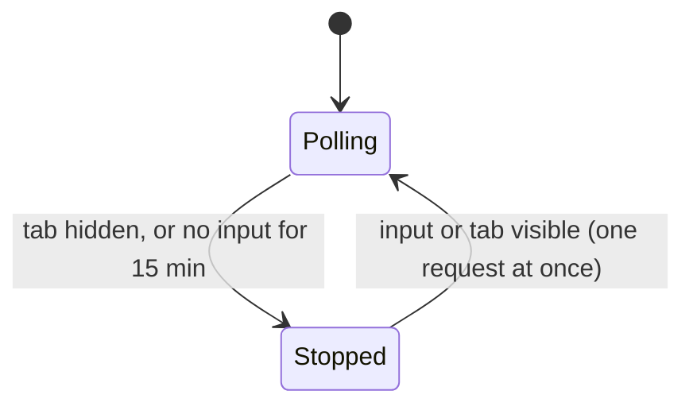

# rusthole web UI

This folder has the admin web UI of rusthole. It uses Svelte 5, Vite and TypeScript.
The REST API contract is in [docs/API.md](../docs/API.md).

The Rust binary embeds the build output (`web/dist`) with `rust-embed`. `cargo build`
does not run bun or Node. If `web/dist` is missing, the binary embeds a placeholder page.

## Requirements

- [bun](https://bun.sh) 1.4 or later. bun installs the packages and runs the scripts.

## Install

```bash
cd web
bun install --frozen-lockfile
```

## Run the dev server with mock data

```bash
bun run dev
```

Then open http://localhost:5173.

- The dev server uses the mock API (`VITE_MOCK=1` in `.env.development`). You do not
  need the Rust backend.
- The mock password is `rusthole`. When you turn on TOTP, any 6-digit code is valid.
- The mock keeps its data in memory. A page reload resets the data and logs you out.
- All mock names and addresses are synthetic: IPs from `192.0.2.0/24`, MACs like
  `02:00:00:00:00:01`, and domains under `example.com` or the `.example` TLD.

## Run the dev server with a real backend

```bash
bun run dev:api
```

The dev server sends `/api` requests to `https://127.0.0.1:8443`. To use a different
address, change `RUSTHOLE_API` in `.env.api`.

## Build

```bash
bun run build
```

The output goes to `web/dist`. The production build does not contain the mock.

To see the build with the strict CSP of the admin listener, run `bun run preview`.
The preview server sends the same `Content-Security-Policy` header.

## Checks

```bash
bun run check   # svelte-check and tsc
bun run test    # vitest unit and component tests (not `bun test`, which is a different test runner)
```

Component tests (`*.test.ts` with `// @vitest-environment happy-dom` on the first line)
mount pages in happy-dom. They use the real API client on top of the mock API
(`src/test/harness.ts`). Keep the mock in step with the real API: a difference hides
faults of the UI. `src/lib/mock/upstream.ts` is a port of the upstream URL parser of the
server; change it when `UpstreamUrl::parse` changes.

## Rules for UI code

- Do not use inline scripts, inline `style` attributes, `style:` directives, Svelte
  transitions or `eval`. The CSP blocks them. Use CSS classes and SVG attributes.
- Do not load resources from other hosts. Use the system font stack.
- Do not keep secrets in `localStorage`. The CSRF token stays in memory.
- All API calls go through `src/lib/api/client.ts`.
- On 403 `csrf_failed` for a write, the client reads the token again with
  `GET /auth/session` and tries the write one more time. This occurs when you log in
  again in another tab. A second 403 is the final result.
- A keyed `{#each}` block needs a unique key. Use a key that the API makes unique (an
  `id`, or for example `kind` and `address` together). To add a page of data to a list,
  use `mergeByKey` (`src/lib/grouping.ts`), because the server can send an item again.
- A checkbox that writes at once uses `actToggle` (`src/lib/state.svelte.ts`). When the
  write fails, it puts the checkbox back.
- rusthole v1 uses IPv4 transport only. Forms accept IPv4 for client ids, CIDRs and
  servers, and show a hint for IPv6.

## Domain report and Block (Domains page)

- "Report" opens `src/components/DomainReport.svelte`. It sends one request for each
  section in `REPORT_SECTIONS` (`src/lib/report.ts`) at the same time, and each card fills
  in when its answer comes. A busy (429 `busy`) section waits for `Retry-After` and asks
  again, at most 3 times. A failed section shows its error and "Try again"; the other
  sections do not wait. "Refresh" sends `refresh=true` (skip the server
  cache). To add a section, add it to `REPORT_SECTIONS`, `ReportSection` and the mock.
- The UI never calls an outside service. The server does the lookups (docs/API.md
  section 17). Show the report data as text only.
- "Block" (`src/components/BlockDomain.svelte`) adds an exact deny rule after a
  confirmation with group check boxes (`default` is ticked).

## Background polling and the session idle limit

Each API request moves the idle limit of the session (1 h, docs/API.md section 3). A
poll with no end would keep a session alive until the absolute limit (8 h). Thus all
background polls use `poll()` from `src/lib/activity.ts`, not `setInterval`:

- A poll sends no request while the tab is hidden.
- A poll sends no request when the last user input (pointer, key, wheel or touch) is
  15 minutes or more ago (`POLL_IDLE_LIMIT_MS`).
- When the user comes back (an input, or the tab becomes visible), each stopped poll
  sends one request at once. Then it continues at its interval.
- The idle time uses `performance.now()`, a monotonic clock.

When no request goes to the server for 1 h, the session ends on the server. The next
request then gets 401 and the UI shows the login page.


